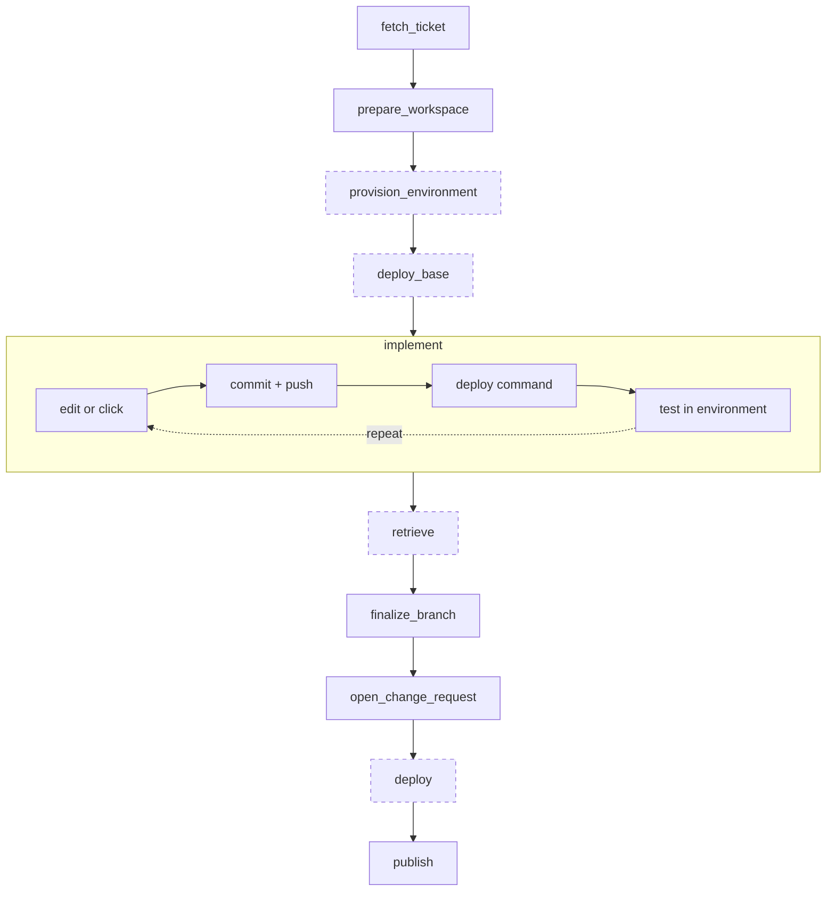
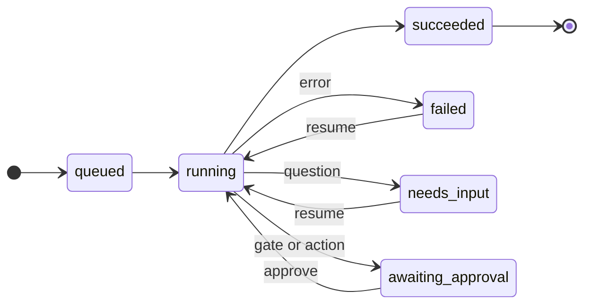

# Heinzel

*Specification — draft v0.3*

> *Heinzelmännchen: the little house gnomes said to have done all the work of
> the citizens of Cologne during the night, so the inhabitants could be lazy
> during the day.*

Heinzel is a **Go library for building software factories.** A factory takes a
ticket and, without human help:

1. creates a branch
2. provisions an environment
3. implements the ticket with a coding agent, testing it in that environment
4. opens merge/pull requests
5. deploys the result
6. reports back (MRs, ticket, people)

A factory is an ordinary Go program that wires components together:

```go
func main() {
	heinzel.Main(heinzel.Factory{
		Name:    "blanktracker",
		Tracker: trello.New(trello.Options{Board: "5f1a2b3c4d", Token: heinzel.Env("TRELLO_TOKEN")}),
		Repos: []heinzel.Repo{{
			Name: "app", TargetBranch: "develop",
			Forge: gitlab.New(gitlab.Options{Project: "blanktracker/app", Token: heinzel.Env("GITLAB_TOKEN")}),
		}},
		Agent:       claudecode.New(claudecode.Options{Model: "claude-opus-5-5"}),
		Environment: digitalocean.New(digitalocean.Options{Region: "fra1", Size: "s-2vcpu-4gb"}),
		Deployers: []heinzel.Deployer{
			{Name: "api", Repo: "app", Deployer: dockercompose.New(dockercompose.Options{Files: []string{"vibe.docker-compose.yaml"}})},
			{Name: "web", Repo: "app", Deployer: mycompany.SPADeployer{}}, // the team's own code
		},
		Notifiers: []heinzel.Notifier{{On: notify.Finished, Notifier: slack.New(heinzel.Env("SLACK_WEBHOOK"))}},
	})
}
```

`heinzel.Main` gives that binary the whole CLI (`run`, `serve`, `status`, …).
Every component is either a ready-made one from this repository or the team's
own code implementing the same interface. The compiler checks the wiring.

The coding agent (Claude Code, OpenHands, …) is a component like any other.
Heinzel's value is the pipeline, the run state, the interfaces, and a growing
**library of ready-made components**. Its killer feature is a
**build-a-factory skill** (§6): an agent that interviews a team, writes their
factory, and tests it end to end, so a team never has to learn Heinzel itself.

---

## 1. Goals and non-goals

**Goals (v1)**

- Fully autonomous by default: one trigger results in open MRs and a running
  environment with the change deployed.
- Pluggable at every edge: trigger, tracker, forge, agent, environment, DNS,
  deploy, notify. Teams can write their own component for any of them without
  forking Heinzel.
- **The factory adapts to the app, not the other way round.** Heinzel builds
  and deploys an app the way the team already does: their compose files,
  their build scripts, their hosting. Installing Heinzel on a project may need
  a few small changes to the app, never a restructuring. Anything specific to
  previews (an override file, a `.env` template) lives in the factory.
- Type-safe configuration: a factory is Go code, so wiring mistakes are
  compile errors, and `Main` reports the rest (missing repos, missing
  environment variables, …) all at once before doing anything.
- One ticket may span several repositories, each on its own forge. A run then
  opens one MR per repository it changed.
- A factory builds into a single static binary for Linux. No required
  external services (run state is stored on the local filesystem).
- Resumable and idempotent. A failed run can be resumed from the step that
  failed, and re-running a step does not duplicate branches, MRs or droplets.
- Optional approval gates for teams that don't want full autonomy.

**Working assumption: the agent has everything it needs.** Every agent works
inside a provisioned environment and has whatever access it needs: tools,
credentials, the running app or org. Heinzel does not sandbox the agent or
restrict its credentials. Limiting the agent's access makes every scenario much
harder, so it's out of scope until we choose to revisit it.

**Non-goals (v1)**

- A zero-code setup. A YAML front end over the ready-made components may come
  later, once the library is rich enough (§11).
- Reacting to review comments or iterating on an MR (planned for v7 or later).
- Automatic environment teardown policy (§11). Teardown is supported in the
  interfaces and through a manual CLI command.
- Multi-tenant/public SaaS deployment.

---

## 2. Reference scenarios

| | **A: BlankTracker (guinea pig)** | **B: Go service** | **C: Salesforce client** |
|---|---|---|---|
| Tracker | Trello | Jira | Jira |
| Forge | GitLab | Forgejo (self-hosted) | GitHub |
| Agent | Claude Code | Claude Code | Claude Code + Salesforce skills, DX MCP server, headless browser |
| Environment | New DigitalOcean droplet per ticket + Cloudflare DNS records in the production zone (`hz-*` names only) | Folder + nginx vhost on a shared server | New scratch org per ticket |
| Deploy | API: the team's own compose file on the droplet over SSH, plus an override and `.env` from the factory. SPA: the team's own build script, then `wrangler versions upload` to a preview alias of a previews-only Worker | build locally, rsync, restart, reload nginx | `sf project deploy start`, assign permission sets, import seed data |
| Human steps | add the environment's OAuth redirect URIs in Google Cloud Console | — | — |
| Trigger | CLI + Trello Power-Up button | CLI | CLI (Jira trigger later) |
| Notify | Trello comment + Slack | Jira comment + chat | Jira comment + chat |

Any design decision that makes one column awkward is wrong.

### Scenario A in more detail

BlankTracker is one GitLab repository (`blanktracker/app`) holding a Laravel
API with a Nova admin, and a Vue SPA, both at the repository root. Work merges
into `develop`; `master` is production. Every deployed environment
(production, staging, vibe) is three hostnames: the SPA on Cloudflare Workers
static assets, and `api` and `nova`, which both reach one Docker Compose stack
on a droplet. A preview environment looks like this:

| Part | Where | URL |
|---|---|---|
| API and Nova | new droplet, the repository's own `vibe.docker-compose.yaml` | `https://<env>-api.blanktracker.com`, `https://<env>-nova.blanktracker.com` (proxied A records to the droplet) |
| SPA | preview alias `<env>` of `blanktracker-frontend-preview`, a Worker used only for previews | `https://<env>-blanktracker-frontend-preview.<account>.workers.dev` |

- **All URLs are decided in `provision_environment`, before any deploy**
  (`env.Environment.Endpoints`). A Workers preview alias URL is predictable,
  so the SPA's URL is too. The two deployers don't depend on each other's
  output, and their order doesn't matter.
- **The SPA is built by Heinzel, with the team's own script.** The deployer
  runs `cloudflare-build.sh` with the variables Cloudflare's CI would set
  (`API_URL`, `NOVA_URL`, `WORKERS_CI_COMMIT_SHA`) and uploads with
  `--name blanktracker-frontend-preview`, so `wrangler.jsonc` is used as it is.
  Workers Builds can't do this: it bakes one API URL into every branch.
- **The SPA stays on `workers.dev`.** Preview aliases can't have a custom
  domain, and the SPA doesn't need one: it authenticates with a Sanctum token,
  not a cookie, and the API allows any origin.
- **The API and Nova need hostnames in the production zone.** An HTTPS SPA
  can't call a plain-HTTP API, and Google rejects redirect URIs on bare IPs.
  Names are one level deep (`<env>-api`, not `api.<env>`), which Cloudflare's
  free Universal SSL certificate covers. This is safe because production sets
  no `SESSION_DOMAIN`, so its cookies are host-only and never reach a preview.
  A Cloudflare token can't be limited to some records of a zone, so
  `dns/cloudflare` refuses any name outside `hz-*`: a bug must not be able to
  rewrite `api.blanktracker.com`.
- **TLS to the droplet.** The zone is in Full (strict) mode with proxied
  records, so the droplet needs a certificate Cloudflare trusts. One
  Cloudflare Origin CA certificate for `*.blanktracker.com` is kept on the
  Heinzel host, and `deploy/dockercompose` adds a TLS proxy in front of the
  stack's own nginx. Every droplet gets the same key, and each runs
  unreviewed code, so one leak exposes them all. That's acceptable for the
  first runs only: certificates per environment are planned for M2 (see
  [Per-environment certificates](#per-environment-certificates)).
- **Previews are cheap and quiet.** The compose stack reads `.env`, which the
  deployer writes from a template in the factory: no third-party API keys,
  `ONSOCIAL_DISABLED` and `SCRAPECREATORS_DISABLED` set, mail to the log. An
  override file drops the `cron` service, because the nightly schedule calls
  paid APIs. Postgres runs in the stack, seeded from the dump the repository
  already uses for vibe.
- **Google login needs a human.** Login is Google OAuth, through a dedicated
  "previews" OAuth client. Google has no API for adding redirect URIs, so each
  new environment produces a [human action](#human-actions) asking someone to
  add its two callback URLs. The agent doesn't need Google login: it creates a
  Sanctum token with `artisan tinker` over SSH.
- **The app's code needs no changes.** Installing Heinzel only adds the
  factory's directory to the repository. See §12.4.

### Scenario C in more detail

The client's work is about 70% code (Apex, Lightning Web Components) and 30%
clicks in Salesforce Setup (Flows, objects, fields, layouts, permissions).
Almost every click produces **metadata**. Metadata can be written as XML,
deployed, and pulled back out of a scratch org with `sf project retrieve start`,
because scratch orgs track every change made in them. So Heinzel puts the
clicks through git and PR review too, not only the code.

The agent has three ways to handle a change, in order of preference:

1. **Write the source or metadata directly**, then deploy it to the scratch org
   to compile and test it. Apex only compiles inside an org, which is one
   reason the environment always exists before the agent starts.
2. **Click in the scratch org through a headless browser** (Playwright MCP),
   for things that are impractical to write by hand, like complex Flows or
   Lightning pages. The changes are then pulled back into the working tree
   (`deploy.Retriever`) and committed. This is slower and more fragile than
   option 1, so it's the fallback.
3. **Changes the Metadata API can't deploy** become a manual checklist for a
   human (`agent.Outcome.ManualSteps`), shown in the PR and the notifications.
   Heinzel never clicks in production or in shared sandboxes.

---

## 3. Concepts

- **Factory.** A Go value (`heinzel.Factory`) that wires a tracker, one or more
  repos, an agent, an environment, DNS, deployers, triggers and notifiers
  together. A binary can hold several factories; one is the common case.
- **Component.** A value implementing one of Heinzel's interfaces, e.g.
  `gitlab.New(...)` is a `forge.Forge`. Components come from this repository,
  from third-party modules, or from the team's own code.
- **Repo.** One repository of a factory, on its own forge. All of a run's
  repos are checked out side by side on the same branch name. Repos the run
  doesn't change get no MR.
- **Endpoint.** A named public URL of an environment (`api`, `web`). All
  endpoints are decided when the environment is provisioned, before anything
  is deployed.
- **Run.** One execution of the pipeline for one ticket in one factory. It has
  an ID, a status, per-step results and a log, and is persisted after every step.
- **Step.** One idempotent unit of the pipeline (`implement`, `deploy`, …).
  Step names are typed constants (`heinzel.StepDeploy`).
- **Gate.** An optional pause before a step. The run waits in
  `awaiting_approval` until someone runs `approve`.
- **Action.** Something a human must do for an environment that Heinzel
  can't, such as registering its URLs with a third party. It may hold back a
  later step until someone confirms it's done ([Human actions](#human-actions)).

### Pipeline



Dashed steps are skipped when the factory has no environment (`retrieve` also
when no deployer implements `Retriever`).

| Step | Does | Persisted output |
|---|---|---|
| `fetch_ticket` | `Tracker.Fetch`; optionally move the ticket to "in progress" | `Ticket` |
| `prepare_workspace` | clone every repo side by side, create the run branch in each from its target branch and push it, so the agent can push to it | `Branch`, base commits |
| `provision_environment` | `Provisioner.Ensure`, then compute the factory's endpoint URLs and create their DNS records (`dns.Provider.Ensure`). Collect the environment's [human actions](#human-actions) and emit `run.action_required` for each new one | `Environment` (with `Endpoints` and `Actions`) |
| `deploy_base` | every deployer, in order, deploys its repo's unchanged branch, so the environment starts identical to the target branches | `Deployments` |
| `implement` | `Agent.Implement` in the workspace (all repos), with `Task.Environment` set. The agent loops: edit, commit, push, deploy, test (see [Agent loop](#agent-loop)) | `Outcome`, `Deployments` (latest) |
| `retrieve` | each deployer that implements `Retriever` pulls changes made directly in the environment (e.g. Salesforce clicks) into its repo's checkout. Skipped if none does | — |
| `finalize_branch` | per repo, a safety net: commit anything `retrieve` pulled in or the agent left uncommitted, and push. Repos without changes are dropped and their run branch deleted. No changes in any repo means `needs_input` | `Commits` |
| `open_change_request` | `Forge.OpenChangeRequest` for every changed repo (idempotent per branch). With several, each MR links to the others | `ChangeRequests` |
| `deploy` | every deployer deploys its repo's final commit, so what testers see is exactly what's in the MRs. A deployer is skipped if the agent already deployed that commit | `Deployments` |
| `publish` | add the endpoint URLs to every MR and the ticket, move the ticket to "in review" | — |

The environment comes first because the agent works in it. A consequence: if
provisioning fails, the run fails before any code is written and no MR is
opened.

### Agent loop

The agent tests its work in the environment many times during `implement`,
so these deploys are not pipeline steps. Heinzel gives the agent two commands
of the factory binary. The engine passes the binary's path in `HEINZEL_BIN`,
the run in `HEINZEL_RUN_ID` and the engine's socket in `HEINZEL_SOCKET`:

- **`$HEINZEL_BIN deploy`** runs every deployer on its repo's pushed HEAD and
  blocks until done, printing the results and the deploy logs. It refuses if
  any repo has uncommitted changes or an unpushed HEAD: **Heinzel only ever
  deploys pushed commits.** For each deployer that implements `Retriever`, it
  first retrieves from the environment and refuses if that produced
  uncommitted changes ("the environment has changes not in git; commit and
  push them first"). This stops a deploy from overwriting clicks that haven't
  been saved to git.
- **`$HEINZEL_BIN retrieve`** pulls changes made directly in the environment
  (e.g. Salesforce clicks) into the working tree, for the agent to review,
  commit and push.

Both commands send their request to the running engine over a Unix socket
(in the system temp directory, because socket paths are limited to about 108
bytes). They don't call the components themselves, so the engine
records every deployment in the run state and only one process ever writes
`run.json`.

Notifications are **events**, not a step. The engine emits `run.started`,
`run.succeeded`, `run.failed`, `run.needs_input`, `run.awaiting_approval` and
`run.action_required`. Each notifier is subscribed to a set of these.

### Human actions

Some environments can't be finished by software. BlankTracker's previews need
their OAuth redirect URIs added in Google Cloud Console, which has no API for
it. A Salesforce sandbox lease might need an admin's approval. Heinzel
supports this as **actions**: requests for a human, raised while the
environment is provisioned.

```go
// package env
type Action struct {
	ID     string `json:"id"`     // stable per environment; makes notifying and confirming idempotent
	Title  string `json:"title"`
	Body   string `json:"body"`   // CommonMark: exactly what to do
	Before string `json:"before"` // step that waits until it's done; "" = notify only
}
// Environment.Actions []Action is set by the Provisioner, for needs of the provider.

// package heinzel: needs of the app, added to the provisioner's.
EnvironmentActions func(e *env.Environment) []env.Action // Factory field
```

1. At the end of `provision_environment`, the engine collects the actions
   and emits `run.action_required` once for each one it hasn't announced
   before. The run carries on, so the human works while the agent does.
2. When the run reaches an action's `Before` step and nobody has confirmed the
   action, the run waits in `awaiting_approval`, exactly like a gate.
   `approve <run-id>` confirms every pending action. Later, a button in Trello
   or Slack can do the same through the trigger's `Dispatcher`.
3. Confirmations are kept per environment name. A new run that reuses the
   environment doesn't ask again.
4. The actions, and whether they're done, are listed in the MR description and
   in `publish`'s report. `env destroy` prints them as a reminder to undo
   them (remove the redirect URIs).

Pick `Before` by who needs the result. The agent never needs Google login on
a BlankTracker preview, so that action holds back only `publish`, which tells
testers the environment is ready. An environment the agent can't use without
the human holds back `implement`.

### Run status



`cancel` moves any run that hasn't finished (`queued`, `running`,
`awaiting_approval`, `failed`, `needs_input`) to `cancelled`; it's left out of
the diagram to keep it readable. `resume` and `approve` are the CLI commands of
the same name.

`needs_input` posts the agent's question as a comment on the ticket. Resuming
from `needs_input` fetches the ticket again before re-running the step that
stopped, so the agent sees the answer in the ticket's comments. Resuming from
`failed` just re-runs the failed step.

---

## 4. Go interfaces

The interfaces are code, not prose. The code is the source of truth and this
section only maps out the packages. Each interface package holds the interface
and the plain data types around it.

### Package map

| Package | Defines | Imports (Heinzel) |
|---|---|---|
| [`core`](./core) | `Message`, `Link`, `NeedsInputError`, `RetryableError`, `Checker` | — |
| [`tracker`](./tracker/tracker.go) | `Tracker` + optional `StageMover`, `Linker`, `AttachmentFetcher`; `Ticket`, `TicketRef`, `Stage` | core |
| [`forge`](./forge/forge.go) | `Forge` + optional `ChangeRequestUpdater`; `GitRemote`, `ChangeRequest`, `ChangeRequestInput` | core |
| [`agent`](./agent/agent.go) | `Agent`; `Task`, `Checkout`, `Outcome`, `Usage` | tracker, env |
| [`env`](./env/env.go) | `Provisioner` + optional `Lister`; `Spec`, `Environment` (with `Endpoints`, `Actions`), `Host`, `SSHAccess`, `Action` | — |
| [`dns`](./dns/dns.go) | `Provider`; `Record` | — |
| [`deploy`](./deploy/deploy.go) | `Deployer` + optional `Retriever`; `Source`, `Deployment` | env, tracker |
| [`run`](./run/run.go) | `ID`, `Request`, `Status`, `Snapshot`, `Run`, `StepRecord`, `Store`, `Filter` | tracker, forge, env, deploy, agent |
| [`notify`](./notify/notify.go) | `Notifier`; `Event`, `EventType`, the `Finished` / `Problems` event sets | core, run |
| [`trigger`](./trigger/trigger.go) | `Trigger`, `Dispatcher` | run, tracker |
| [`heinzel`](./factory.go) (root) | `Factory`, `Repo`, `Endpoint`, `DNSTarget` (+ `HostAddress`, `CNAME`), `Deployer`, `Notifier`, `Trigger`, `Step`, `Main`, `Run`, `Env` | all of the above |

Imports only point down the table. `run` is its own package so that `notify`
and `trigger` can use `run.Snapshot` without importing the root package, which
imports them.

### Where components go

A component lives under the interface it implements: `forge/gitlab`,
`env/digitalocean`, `dns/cloudflare`, `deploy/cfworkers`, `notify/ticket`. A
component that implements several interfaces lives under the one it's mainly
about: `deploy/sshnginx` and `deploy/scratchorg` are also `env.Provisioner`s.
Each component package has a `New(Options)` constructor, and a factory only
compiles in the components it imports.

**Components in this repository are generic.** None of them knows about a
particular team, app or project. Everything specific (names, URLs, compose
files, `.env` templates, instructions) comes in through options from the
factory, which lives with the app. BlankTracker appears in this document and
in tests only as the worked example; nothing here depends on it. If a
component seems to need one app's knowledge, that knowledge belongs in an
option, or in the factory's own code.

Components outside this repository (in a team's factory code or a
third-party module) follow the same interfaces and are used the same way.

### Test packages and internals

| Package | Purpose |
|---|---|
| [`tracker/trackertest`](./tracker/trackertest), [`forge/forgetest`](./forge/forgetest), [`env/envtest`](./env/envtest), [`dns/dnstest`](./dns/dnstest), [`deploy/deploytest`](./deploy/deploytest), [`notify/notifytest`](./notify/notifytest) | public: an in-memory `Fake` and a conformance suite `Run(t, …)` per interface (§9) |
| [`agent/agenttest`](./agent/agenttest) | public: a scriptable fake agent. No conformance suite; agents are tested end to end |
| [`internal/engine`](./internal/engine) | pipeline, steps, run state machine, gates, retries, the agent's Unix socket |
| [`internal/store`](./internal/store) | `run.Store` on the filesystem, plus the per-run lock |
| [`internal/workspace`](./internal/workspace) | git via the git CLI: clone, branch, commit, push, "is it pushed?", deploy worktrees |
| [`core/remote`](./core/remote) | SSH exec, file writes and directory upload through the system `ssh`; `remotetest.LocalSSH` runs them locally in tests. Public, because components outside this repository need it too |
| [`internal/apiclient`](./internal/apiclient) | the JSON-over-HTTP client the components here share; 429 and 5xx become `core.RetryableError` |

There is no `trigger/triggertest` yet; it comes with `serve` (M2).

### Design rules

These rules keep the interfaces from fighting each other:

1. **Small required interfaces, optional capabilities through type
   assertion** (the `io.WriterTo` pattern). A tracker that can't move tickets
   between columns simply doesn't implement `tracker.StageMover`. The engine
   checks and skips.
2. **The zero value is useful.** Every optional part of a `Factory` can be
   left out, and that part of the pipeline is then silently a no-op: no
   `Notifiers` means nobody is notified, no `Environment` means nothing is
   provisioned or deployed, no `DNS` means no records, no `Triggers` means
   runs only start from the CLI, empty `Gates` means fully autonomous, and an
   empty `On` means every event. Only `Name`, `Tracker`, `Agent` and at least
   one `Repo` with a `Forge` are required, because without them there is
   nothing to run. A setting that only makes sense with a missing component
   (an endpoint `DNSTarget` without a `DNS` provider, `Deployers` without an
   `Environment`) is still an error: it almost always means something was
   forgotten, and ignoring it would hide the mistake.
3. **Every mutating call is idempotent** with a natural key: branch name for
   MRs, environment name for provisioning, commit for deploys, host name for
   DNS records. This is what makes `resume` safe.
4. **Components never see each other.** The engine passes data between them
   as plain structs from the interface packages. The env→deploy hand-off is
   `env.Environment`. A component may *wrap* another one it's given (e.g.
   `notify/ticket` posts through the factory's `Tracker`), but never imports
   another component's package.
5. **Everything persisted is JSON-serialisable.** No funcs or interfaces inside
   the data types in `run`, `env`, `deploy`, `forge` and `tracker`. Functions
   are fine in the factory's own wiring (`Endpoint.URL`).
6. **Constructors don't fail.** `New(Options)` returns the component; bad
   options and credentials surface in `Check` (`core.Checker`) or on first use.
   `Check` also names every command the component runs on the Heinzel host
   that isn't installed (`core.NeedTools`), so one `check` on a fresh host
   lists everything it's missing.
   That keeps a factory a single readable expression.
7. **The engine owns the workflow; the agent owns the work.** The agent has
   full access (see the working assumption in §1). It commits and pushes, but
   **only to its own run branch**, and it deploys only through the `deploy`
   command. The engine creates the branch, makes the final commit and push
   (`finalize_branch`), opens the MRs and owns the final deploy. That keeps
   every run's outcome consistent and resumable. `forge.GitRemote` credentials
   are tagged `json:"-"` and never persisted.
8. **Only pushed commits are deployed.** `deploy.Source.Commit` is required and
   must exist in the forge, so an environment always runs something reviewable.
9. **The public API is versioned.** Factories outside this repository depend on
   these interfaces, so they only change in a new minor version while we're
   at v0.x, and are frozen at v1.
10. **Components take the app as it is.** A component's options point at what
    the team already has (a compose file, a build script, a `wrangler.jsonc`)
    and layer previews on top: files the component writes outside git,
    environment variables, name overrides. A component that only works if the app is
    restructured for it is the wrong component.

### Behaviour the types alone don't show

- **Forge.** Branch creation and pushing go through `internal/workspace` (git
  CLI), not the forge API. `git push` works the same on every host, so only MR
  operations need per-forge code. `OpenChangeRequest` returns the existing
  open CR for the branch if there is one.
- **Agent.** It commits and pushes to the run branch, and deploys with the
  `deploy` command ([Agent loop](#agent-loop)). The engine commits whatever is
  left over. Anything it couldn't do goes in `Outcome.ManualSteps`. Browser
  access, MCP servers and skills are options of the agent component, not
  interface.
- **The repo's own agent instructions.** Most `CLAUDE.md` / `AGENTS.md` files
  are written for a person working with an agent by hand: "push to `vibe` to
  deploy", "ask before every git operation". Heinzel can't expect teams to
  change them. The agent component therefore gives Heinzel's workflow the
  highest priority it can (for Claude Code: the system prompt, not the user
  prompt) and says that it replaces any branching, deploying or
  confirmation rules in the project's instructions. Everything else in them,
  such as coding conventions and how to run the tests, still applies.
- **Several repos.** Each repo has its own forge, so one factory can span
  GitLab and GitHub. The agent sees all checkouts (`Task.Repos`). Each
  deployer is bound to one repo and gets that repo's `Source`.
- **Several deployers, one environment.** Deployers run in order and all
  receive the same `Environment`. Because every endpoint URL is known before
  the first deploy, a deployer can use any other part's URL
  (`e.Endpoints["api"]`).
- **DNS.** For each endpoint with a `DNSTarget`, the engine calls
  `dns.Provider.Ensure` with the endpoint URL's host. Records are identified
  by name, so teardown needs no stored state. Provider options like Cloudflare
  proxying are component options. A provider working in a zone that also
  holds production records takes a guard option (`AllowedNames: "hz-*"`) and
  refuses every other name, because DNS tokens usually can't be scoped to
  single records.
- **Env + deploy in one component.** `deploy/sshnginx` and
  `deploy/scratchorg` implement both `env.Provisioner` and `deploy.Deployer`.
  The factory passes the same value to `Environment` and to a `Deployer`.
- **Environments without servers.** A scratch org has no hosts and no SSH. Its
  org username and instance URL go in `Environment.State` and `Hosts` stays
  empty.
- **Notify.** `notify/ticket` turns events into comments on the run's ticket,
  through the factory's tracker. This way "tell the tester on the Trello card"
  uses the same routing as "tell the dev channel on Slack".
- **Triggers belong to a factory.** Each trigger gets a `Dispatcher` scoped to
  its factory, and `serve` mounts its HTTP handlers under
  `/triggers/<factory>/<trigger>/`.
- **Actions.** A provisioner, or the factory, asks a human to do something the
  environment needs ([Human actions](#human-actions)). Unlike
  `Outcome.ManualSteps`, which arrive at the end of a run, actions are raised
  while the environment is set up, and can hold back a later step.
- **Errors.** `core.NeedsInputError` makes the engine post the question on the
  ticket, set the run to `needs_input` and emit `run.needs_input`.
  `core.RetryableError` makes the engine retry the step with backoff. Any
  other error fails the step and the run, which can then be resumed.

---

## 5. Writing a factory

A factory is a `main` package with its own `go.mod`, usually in a directory
of the app's repository (e.g. `heinzel/`), so it's versioned and reviewed with
the app it builds. A separate repository works too. Secrets come from the
environment through `heinzel.Env`. A missing variable doesn't fail on the
spot: `Main` lists every missing one at once and exits before doing anything.

### Scenario A: BlankTracker

Every component below exists except `trigger/trellopowerup` (M2).
[`example_test.go`](./example_test.go) compiles this factory, minus the
trigger, against the real packages.

```go
package main

import (
	_ "embed"
	"strings"

	"github.com/Tight-Line/heinzel"
	"github.com/Tight-Line/heinzel/agent/claudecode"
	"github.com/Tight-Line/heinzel/deploy"
	"github.com/Tight-Line/heinzel/deploy/cfworkers"
	"github.com/Tight-Line/heinzel/deploy/dockercompose"
	"github.com/Tight-Line/heinzel/dns/cloudflare"
	"github.com/Tight-Line/heinzel/env"
	"github.com/Tight-Line/heinzel/env/digitalocean"
	"github.com/Tight-Line/heinzel/forge/gitlab"
	"github.com/Tight-Line/heinzel/notify"
	"github.com/Tight-Line/heinzel/notify/slack"
	"github.com/Tight-Line/heinzel/notify/ticket"
	"github.com/Tight-Line/heinzel/tracker"
	"github.com/Tight-Line/heinzel/tracker/trello"
	"github.com/Tight-Line/heinzel/trigger/trellopowerup"
)

const (
	zone          = "blanktracker.com"
	previewWorker = "blanktracker-frontend-preview" // a Worker used only for previews
	workers       = "blanktracker"                  // the account's workers.dev subdomain
)

// Settings for every preview: no third-party API keys, paid integrations
// switched off, mail to the log. The deployer adds the per-environment values.
//
//go:embed preview.env
var previewEnv string

// Applied on top of the repository's vibe.docker-compose.yaml. Drops the cron
// service, because the nightly schedule calls paid APIs.
//
//go:embed preview.override.yaml
var previewOverride string

func main() {
	board := trello.New(trello.Options{
		Board:  "5f1a2b3c4d",
		APIKey: heinzel.Env("TRELLO_API_KEY"),
		Token:  heinzel.Env("TRELLO_TOKEN"),
		Stages: map[tracker.Stage]string{
			tracker.StageInProgress: "Doing",
			tracker.StageInReview:   "Review",
			tracker.StageBlocked:    "Blocked",
		},
	})

	heinzel.Main(heinzel.Factory{
		Name:    "blanktracker",
		Tracker: board,
		Repos: []heinzel.Repo{{
			Name:         "app",
			TargetBranch: "develop",
			Forge: gitlab.New(gitlab.Options{
				Project: "blanktracker/app",
				Token:   heinzel.Env("GITLAB_TOKEN"),
			}),
		}},
		Agent: claudecode.New(claudecode.Options{Model: "claude-opus-5-5", MaxTurns: 200}),
		Instructions: "Run `./toolkit check` before you finish. Google login doesn't work for you on the " +
			"environment: log in with a Sanctum token created with `artisan tinker` over SSH.",
		EnvName: func(t *tracker.Ticket) string { return "hz-" + strings.ToLower(t.Key) }, // Trello shortLink

		Environment: digitalocean.New(digitalocean.Options{
			Token:      heinzel.Env("DO_TOKEN"),
			Region:     "fra1",
			Size:       "s-2vcpu-4gb", // the first build compiles every PHP extension
			Image:      "docker-24-04",
			SSHKeys:    []string{"ab:cd:…"},          // fingerprints of keys in the DO account
			SSHKeyPath: heinzel.Env("HEINZEL_SSH_KEY"), // the matching private key on the Heinzel host
		}),
		DNS: cloudflare.New(cloudflare.Options{
			Token:        heinzel.Env("CLOUDFLARE_DNS_TOKEN"),
			Zone:         zone,
			Proxied:      true,
			AllowedNames: "hz-*", // the production zone: never touch any other record
		}),
		Endpoints: []heinzel.Endpoint{
			{Name: "api", URL: previewURL("-api"), DNS: heinzel.HostAddress(0)},
			{Name: "nova", URL: previewURL("-nova"), DNS: heinzel.HostAddress(0)},
			{Name: "web", URL: func(e *env.Environment) string {
				return cfworkers.PreviewURL(e.Name, previewWorker, workers)
			}},
		},
		EnvironmentActions: func(e *env.Environment) []env.Action {
			return []env.Action{{
				ID:    "google-oauth",
				Title: "Allow Google login on " + e.Name,
				Body: "In Google Cloud Console, open the **BlankTracker previews** OAuth client and add " +
					"these authorized redirect URIs:\n\n" +
					"- " + e.Endpoints["api"] + "/auth/google/callback\n" +
					"- " + e.Endpoints["api"] + "/api/auth/google/callback\n",
				Before: string(heinzel.StepPublish), // only testers need it, the agent doesn't
			}}
		},
		Deployers: []heinzel.Deployer{
			{Name: "api", Repo: "app", Deployer: dockercompose.New(dockercompose.Options{
				Files:    []string{"vibe.docker-compose.yaml"}, // the team's own, unchanged
				Override: previewOverride,
				EnvFile:  previewEnv,
				Env: func(e *env.Environment) map[string]string {
					return map[string]string{
						"APP_URL":              e.Endpoints["api"],
						"FRONTEND_URL":         e.Endpoints["web"],
						"GOOGLE_REDIRECT_HOST": e.Endpoints["api"],
						"GOOGLE_CLIENT_ID":     heinzel.Env("PREVIEW_GOOGLE_CLIENT_ID"),
						"GOOGLE_CLIENT_SECRET": heinzel.Env("PREVIEW_GOOGLE_CLIENT_SECRET"),
					}
				},
				TLS: &dockercompose.TLS{ // Cloudflare Origin CA certificate for *.blanktracker.com
					CertFile: heinzel.Env("ORIGIN_CERT_FILE"),
					KeyFile:  heinzel.Env("ORIGIN_KEY_FILE"),
					Upstream: "nginx:80",
					Network:  "blanktracker", // the network vibe.docker-compose.yaml puts nginx on
				},
				PostDeploy: []dockercompose.Exec{
					{Service: "app", Command: "php artisan migrate --force"},
					{Service: "app", Command: "php artisan optimize"},
				},
			})},
			{Name: "web", Repo: "app", Deployer: cfworkers.New(cfworkers.Options{
				AccountID:    heinzel.Env("CLOUDFLARE_ACCOUNT_ID"),
				Token:        heinzel.Env("CLOUDFLARE_WORKERS_TOKEN"),
				Worker:       previewWorker, // overrides the name in wrangler.jsonc; created on first use
				PreviewAlias: func(e *env.Environment) string { return e.Name },
				Build:        "npm ci && ./cloudflare-build.sh", // the team's own build script
				BuildEnv: func(e *env.Environment, src *deploy.Source) map[string]string {
					return map[string]string{ // what Cloudflare's CI would set
						"API_URL":                e.Endpoints["api"] + "/api",
						"NOVA_URL":               e.Endpoints["nova"] + "/nova",
						"WORKERS_CI_COMMIT_SHA":  src.Commit,
						"VITE_EMAIL_TRACKER_URL": "https://email-tracker.invalid", // empty would fall back to production
					}
				},
			})},
		},

		Triggers: []heinzel.Trigger{{Name: "trello", Trigger: trellopowerup.New(trellopowerup.Options{ // M2
			APIKey: heinzel.Env("TRELLO_POWERUP_API_KEY"),
			Boards: []string{"5f1a2b3c4d"}, // only cards on these boards can start a run
		})}},
		Notifiers: []heinzel.Notifier{
			{On: notify.Problems, Notifier: ticket.New(board)}, // failures, questions and actions, on the card
			{On: []notify.EventType{notify.EventRunActionRequired}, Notifier: slack.New(heinzel.Env("SLACK_OPS_WEBHOOK"))},
			{On: notify.Finished, Notifier: slack.New(heinzel.Env("SLACK_DEV_WEBHOOK"))},
		},
	})
}

func previewURL(suffix string) func(*env.Environment) string {
	return func(e *env.Environment) string { return "https://" + e.Name + suffix + "." + zone }
}
```

`notify.Problems` includes `run.action_required`, so the card gets the Google
action too. The Slack ops channel is where someone with Google Cloud Console
access sees it.

The two embedded files live next to `main.go` in the factory's repository:

```yaml
# preview.override.yaml
services:
  cron:
    profiles: [disabled] # the nightly schedule calls paid APIs
```

```sh
# preview.env (excerpt)
ONSOCIAL_DISABLED=true
SCRAPECREATORS_DISABLED=true
MAIL_MAILER=log
YOUTUBE_API_KEY=
```

### Scenario B: one component for environment and deploy

```go
host := sshnginx.New(sshnginx.Options{
	Host:      "shared.acme.internal",
	User:      "deploy",
	KeyPath:   "~/.ssh/heinzel_deploy",
	Root:      func(e *env.Environment) string { return "/srv/previews/" + e.Name },
	Domain:    func(e *env.Environment) string { return e.Name + ".preview.acme.internal" },
	PortRange: [2]int{20000, 20999},
	Build:     "CGO_ENABLED=0 go build -o dist/app ./cmd/server",
	Run:       func(e *env.Environment) string { return "./app --addr 127.0.0.1:" + e.State["port"] },
})

heinzel.Main(heinzel.Factory{
	Name:        "go-service",
	Tracker:     jira.New(jira.Options{BaseURL: "https://acme.atlassian.net", Token: heinzel.Env("JIRA_TOKEN")}),
	Repos:       []heinzel.Repo{{Name: "go-service", TargetBranch: "main", Forge: forgejo.New(forgejo.Options{…})}},
	Agent:       claudecode.New(claudecode.Options{Model: "claude-opus-5-5"}),
	Environment: host,
	Deployers:   []heinzel.Deployer{{Name: "app", Repo: "go-service", Deployer: host}},
})
```

### Scenario C: an agent with Salesforce tools

```go
org := scratchorg.New(scratchorg.Options{
	DevHub:       "client-devhub", // sf alias, authorised on the Heinzel host via JWT
	Definition:   "config/project-scratch-def.json",
	DurationDays: 7,
	PostDeploy:   []string{"sf org assign permset --name Client_Admin", "sf data import tree --plan data/plan.json"},
})

heinzel.Main(heinzel.Factory{
	Name:    "salesforce-client",
	Tracker: jira.New(jira.Options{…}),
	Repos:   []heinzel.Repo{{Name: "salesforce", TargetBranch: "main", Forge: github.New(github.Options{Repo: "client/salesforce", …})}},
	Agent: claudecode.New(claudecode.Options{
		Model:      "claude-opus-5-5",
		Skills:     []string{"forcedotcom/sf-skills"},
		MCPServers: []string{"salesforce-dx", "playwright"}, // playwright = headless browser for clicks
	}),
	Instructions: "Prefer writing metadata over clicking. Click in the scratch org only when " +
		"writing the metadata by hand is impractical. Never touch any other org.",
	Environment: org,
	Deployers:   []heinzel.Deployer{{Name: "org", Repo: "salesforce", Deployer: org}}, // also a Retriever
})
```

Repository-side files are optional and read from each checkout:
`.heinzel/prompt.md` (extra agent instructions for that repo). The agent also
picks up the repo's own `AGENTS.md` / `CLAUDE.md` as usual.

---

## 6. Building a factory with an agent

Teams shouldn't have to read this document. Upstream Heinzel ships a
**build-a-factory guide and a Claude skill**: point an agent at a team's
repositories and tools, and it builds, tests and hands over their factory.

Because Heinzel is autonomous by design, the agent can test its own work
end to end:

1. **Discover the process.** Read the team's repos (compose files, CI config,
   `package.json`, deploy scripts) and ask about the rest: where tickets live,
   how and where things are deployed, which domains, who should hear about
   what.
2. **Choose components.** Use ready-made ones where they fit.
3. **Write the missing ones** in the factory's own code, against the
   interfaces, and run the matching conformance suite
   (`trackertest.Run(t, myTracker)`, …) until it passes.
4. **Check credentials** with `check` until every component passes.
5. **Bring up an environment** for the target branches alone with
   `env up`, and iterate until it provisions, deploys and answers on its
   endpoint URLs.
6. **Prove the whole flow.** Ask the user for a small test feature, run it as a
   real ticket, and verify the result with them: branch, MRs, a working
   environment with the change, notifications. Fix and repeat until it works.
7. **Hand over** the factory repository, with a short README of what was built
   and any components worth contributing upstream.

What makes this work is that a factory is small, typed Go code with
conformance suites to check it against. Every case study (§12) is the kind of
material the skill learns from.

---

## 7. CLI

`heinzel.Main` provides these commands. The binary is the team's factory, e.g.
`blanktracker-factory`.

```sh
<factory> run [--factory F] <ticket-id> [--gate STEP]...
<factory> status [run-id]              # list runs or show one
<factory> logs [-f] <run-id>
<factory> resume <run-id>              # continue a failed, needs_input or interrupted run
<factory> approve <run-id>             # pass the current gate, confirm pending actions, continue
<factory> cancel <run-id>              # cancel a run that isn't executing
<factory> check                        # test credentials and the tools this host needs (git, ssh, node, claude, …)
<factory> serve                        # HTTP triggers + worker pool (M2)
<factory> env up [--factory F]         # provision + deploy the target branches, without a ticket (M2)
<factory> env list                     # (M5)
<factory> env destroy <run-id | env-name>   # (M5)

# used by the agent inside a run (engine found via $HEINZEL_SOCKET)
$HEINZEL_BIN deploy                    # deploy every repo's pushed HEAD to the run's environment
$HEINZEL_BIN retrieve                  # pull environment changes into the working tree
```

`--factory` is only needed when the binary holds more than one factory.
`run`, `resume` and `approve` execute the run in the foreground, streaming its
progress, until it finishes or pauses. A run executing in one process is
locked; `resume` and `cancel` refuse it until that process stops (Ctrl-C
leaves the run `failed`, ready to resume). A run whose process died is not
locked and resumes normally. Running in the background arrives with `serve`.

[`examples/demo`](./examples/demo) is a factory built entirely from fakes, to
try the CLI without any accounts.

---

## 8. Operational behaviour

- **State:** `$HEINZEL_STATE_DIR`, else `$XDG_STATE_HOME/heinzel`, else
  `~/.local/state/heinzel`. Each run has
  `runs/<run-id>/{run.json,log.txt,lock,repos/<name>/,deploy/<deployer>/}`.
  `run.json` is written atomically after every step. Every repo is a fresh
  clone per run, which costs time but avoids state bleeding between runs.
  Deployers build in their own worktree (`deploy/<deployer>/`) at the
  commit being deployed, so build output never shows up as uncommitted
  changes in the agent's checkout.
- **Concurrency:** at most one unfinished run per (factory, ticket). A global
  worker limit applies in `serve`.
- **Re-triggering a ticket that already has a run:** refused while that run is
  unfinished (queued, running, awaiting approval, needs input or failed):
  resume or cancel it first. After a run succeeded or was cancelled, a new
  run continues the existing branch if it is still on the forge, and reuses
  the environment and MRs (thanks to the idempotent keys). *(See Open
  Questions.)*
- **Agent access:** set through the agent component's options and carries
  whatever the agent needs, including push access to the forges. Heinzel does
  not restrict it (§1).
- **Logging:** one timestamped line per event (`2026-10-09T09:12:31Z
  [deploy_base] done`), written to the run log and to the CLI's output. The
  agent's transcript and the output of its `deploy`/`retrieve` commands go to
  the run log only.
- **Timeouts:** per step. Defaults: implement 60m, provision 15m, deploy and
  deploy_base 20m, prepare_workspace 15m, the rest 2–10m. Not yet
  configurable.
- **Retries:** a step that returns `core.RetryableError` is retried up to 3
  times, with backoff starting at 5s and doubling.

---

## 9. Testing strategy

- `internal/engine` is tested end to end with fakes: two repos (one
  unchanged), the agent deploying over the socket, resume after a failure,
  retries, gates, needs-input with a re-fetched ticket, the deploy guards
  (uncommitted, unpushed, unretrieved environment changes) and a factory
  without an environment.
- **Conformance suites are public**, one per interface: `forge/forgetest`,
  `env/envtest`, `deploy/deploytest`, … They check the contract (idempotency,
  `Destroy` on a missing env, a missing DNS record is not an error, …). Every
  component in this repository runs its suite against a real sandbox, guarded
  by an env var such as `HEINZEL_IT_GITLAB=1`. Without it, a component's
  tests run its suite against an `httptest` fake of its API, and remote
  commands run locally through `remotetest.LocalSSH`. The switches:
  `HEINZEL_IT_TRELLO`, `HEINZEL_IT_GITLAB`, `HEINZEL_IT_CLOUDFLARE`,
  `HEINZEL_IT_DIGITALOCEAN`, `HEINZEL_IT_SLACK` and `HEINZEL_IT_CLAUDECODE`;
  each test's skip message names the credentials it needs. Components written by teams or
  agents run the same suites, which is what makes writing your own component
  safe (§6).
- BlankTracker, the guinea-pig project, is the end-to-end acceptance test.

---

## 10. Milestones

| # | Deliverable |
|---|---|
| M0 ✅ | interface packages and the root `heinzel` package; conformance suites and fakes; engine (multi-repo), file store, git workspace; `run` / `status` / `logs` / `resume` / `approve` / `cancel` / `check`; the agent's `deploy` / `retrieve`; `examples/demo` |
| M1 🔨 | Components and human actions ✅, each passing its conformance suite against a fake of its API. Still open: a real end-to-end run, from BlankTracker's repository, once credentials are in place. Scenario A end to end from the CLI: `tracker/trello`, `forge/gitlab`, `agent/claudecode`, `env/digitalocean`, `dns/cloudflare`, `deploy/dockercompose`, `deploy/cfworkers`, `notify/ticket`, `notify/slack`, [human actions](#human-actions). The BlankTracker factory itself lives in BlankTracker's repository (`heinzel/`), not here |
| M2 | `serve` + `trigger/trellopowerup` (button, badges, confirming actions); `env up`; [per-environment certificates](#per-environment-certificates) and the `deploy.Destroyer` teardown hook they need |
| M3 | Build-a-factory guide + Claude skill, and the conformance suites it relies on. Accepted when an agent rebuilds BlankTracker's factory from scratch with it |
| M4 | Scenario B: `tracker/jira`, `forge/forgejo`, `deploy/sshnginx` |
| M5 | Gates/approve, `env list/destroy`, hardening |
| M6 | Scenario C: `forge/github`, `deploy/scratchorg`, `retrieve` step, browser tooling for `agent/claudecode` |

---

## 11. Open questions

1. **Environment teardown policy.** Options: on MR merged/closed (needs a forge
   webhook or poller), a TTL, ticket moved to "Done", or manual only. The
   interfaces support all of them (`Provisioner.Destroy`, `env.Lister`,
   `dns.Provider.Delete`). v1 ships only `env destroy`.
2. **Merge order across repos.** When one ticket changes several repos, some
   MRs may need to merge before others (API before SPA). For now Heinzel only
   links the MRs to each other and states the dependency in their
   descriptions. Should it enforce an order?
3. **Scenario B process model.** How does the Go binary keep running on the
   shared host: a systemd unit per preview, a supervisor, or something else?
   Who allocates ports (proposed: the provisioner, stored in `Environment.State`)?
4. **Re-trigger semantics.** Should re-running a ticket continue from the
   existing branch (the agent sees its previous work) or start fresh from the
   target branch?
5. **Where the agent process runs.** Directly on the Heinzel host (v1,
   simplest), or in a container per run for isolation between concurrent
   runs? This is an option of the agent component and does not change the
   interface.
6. **Giving testers access without leaking logins.** A Salesforce "open org"
   URL (`sf org open --url-only`) contains a live session, so it must not be
   posted to chat. Options: create a tester user with a generated password and
   deliver it privately, or post only the login URL and let testers request
   access. This may add an `Access` field to `deploy.Deployment` that is kept
   apart from the public `URL`.
7. **How far to trust browser clicking.** Should a run that relied on browser
   clicks always open a draft PR, or add an automatic gate? Clicked changes
   are still reviewed as diffs, but they're harder to read than code.
8. **Shared sandboxes for scenario C.** Some work (integrations, realistic
   data) needs a full or partial-copy sandbox instead of a scratch org. That
   would be a pool of existing environments that runs lease, not create, which
   is closer to scenario B.
9. **A YAML front end.** Once there are enough ready-made components, a
    `heinzel` binary could build a factory from YAML for teams that only use
    those. It would be a thin layer over the library, not a second
    configuration model.
10. **Workers preview aliases at scale.** Scenario A gives every environment a
    preview alias on one Worker and never deletes them. We haven't checked
    whether Cloudflare limits how many aliases a Worker keeps, or whether a
    later upload can push an old alias out. If it can, `deploy/cfworkers`
    needs a Worker per environment instead, deleted on teardown.

### Per-environment certificates

*Planned for M2.* Today Scenario A copies one wildcard Origin CA key to every
droplet. Instead, `deploy/dockercompose`'s TLS option will be able to get a
certificate for each environment from Cloudflare's Origin CA API:

- **Issue.** On the first deploy to an environment, generate a key on the
  Heinzel host, send a CSR for exactly that environment's hostnames (taken
  from `e.Endpoints`) and install the issued certificate. A leaked key then
  exposes one preview, for as long as it exists.
- **Reuse.** Keep the key and certificate in the Heinzel state directory, per
  environment, so later deploys reuse them. If they're lost, issue a new
  certificate and revoke the old one, found by its hostnames, so no state is
  needed to clean up.
- **Revoke.** Teardown revokes the certificate. Deployers have no teardown
  hook yet, so this adds an optional `deploy.Destroyer` interface
  (`Destroy(ctx, e)`), called by `env destroy` before the provisioner's
  `Destroy`. `deploy/cfworkers` can use the same hook for its aliases (open
  question 10).
- **Credentials.** A Cloudflare token with SSL and Certificates:Edit on the
  zone, in place of the certificate files. The shared certificate stays
  available as an option for teams without one.

---

## 12. Case studies

Real and hypothetical setups used to test the design against real-world
messiness. A case study passes if it fits the existing interfaces without
changing them.

### 12.1 Guinea pig: a "build this" button on Trello cards

**The setup.** BlankTracker, the guinea-pig project (scenario A: Laravel API +
SPA, GitLab, Trello, DigitalOcean, Cloudflare). People on the Trello board
start Heinzel from the card itself and see its progress there, without
touching the CLI.

**What Heinzel delivers.** A **"🧙 Heinzel: build this"** button on every
card, and badges on the card showing run status, the MR links and the
environment links.

**How it maps.**

| Piece | Implementation |
|---|---|
| Trigger | `trigger/trellopowerup`, listed in the factory's `Triggers`. `serve` mounts it under `/triggers/blanktracker/trello/` |
| Power-Up assets | a static connector (`index.html` + JS) served from `embed.FS`. In the Trello Power-Up admin, the iframe connector URL is set to `https://<public_url>/triggers/blanktracker/trello/`. Because the connector and the API share an origin, the button's request needs no CORS. BlankTracker's repository already has a generic version (`local-dev/trello-power-up/`); the trigger ships its own copy, so nothing is added to the app |
| Button | the `card-buttons` capability calls `POST …/runs {cardId}`, which calls `Dispatcher.Submit` |
| Badges | the `card-badges` / `card-detail-badges` capabilities poll `GET …/cards/{cardId}`, which calls `Dispatcher.Latest` |
| Which factory | the trigger belongs to one factory, and its `Dispatcher` is scoped to it, so no board-to-factory mapping is needed |
| Auth | the Power-Up's code is public, so it holds no secret. `t.getRestApi().authorize({scope: 'read'})` gets the member's own Trello token, which is sent with the card ID. The server asks Trello for the card (401/404 are passed on, and the card's URL comes from Trello, never from the request), checks that the member belongs to the card's board, and that the board is in the trigger's `Boards` allowlist. The token is used for that check only, never logged or stored; the run records the member ID in `RequestedBy` |

**Design points this case confirms.**

- **Triggers are not limited to the CLI.** A trigger can ship its own UI,
  serve it over HTTP and use only the `Dispatcher` to talk to the engine.
- **`Dispatcher.Latest` exists for this case.** A trigger needs to show the
  state of the most recent run for a ticket, not only start new ones.
- **A trigger belongs to one factory.** The engine doesn't need to know about
  Trello boards.

**Caveat.** Trello requires HTTPS for the connector. For local testing, put
`serve` behind a tunnel (cloudflared/ngrok).

### 12.3 A preview that needs a human: Google login

**The setup.** BlankTracker logs users in with Google OAuth only. Google
checks every redirect URI against a list on the OAuth client, accepts no
wildcards, and offers no API to edit that list. Each preview has new
hostnames, so until someone adds them, nobody can log in to it.

**What Heinzel delivers.** As soon as the environment exists, a message on the
Trello card and in a Slack channel says exactly which two URIs to add to the
"BlankTracker previews" OAuth client. The run carries on. It waits only before
`publish`, the step that tells testers the environment is ready, until
someone runs `approve`.

**How it maps.**

| Piece | Implementation |
|---|---|
| The request | `Factory.EnvironmentActions` returns one `env.Action` built from `e.Endpoints["api"]`, with `Before: publish` |
| Telling people | `run.action_required`, routed like any other event: `notify/ticket` for the card, `notify/slack` for whoever has Console access |
| Waiting | the engine's gate machinery: `awaiting_approval` before `publish`, `approve` confirms |
| The agent | not affected: it logs in with a Sanctum token from `artisan tinker` |
| Teardown | `env destroy` prints the action as a reminder to remove the URIs |

**Design points this case confirms.**

- **This case needed an addition.** It's the first that didn't fit the
  existing interfaces: `core.NeedsInputError` stops the run at once and can't
  tell on resume whether the human acted, and `Outcome.ManualSteps` comes from
  the agent, at the end. A request for a human that starts early and blocks
  late is a concept of its own ([Human actions](#human-actions)).
- **The app or the provider can ask.** Google login is BlankTracker's need,
  not DigitalOcean's, so this action comes from the factory. A provider with
  its own manual step (a sandbox lease an admin approves) sets
  `Environment.Actions` instead.
- **Waiting is per step.** Blocking at provisioning would leave the agent
  idle for something it doesn't need.

### 12.4 Installing Heinzel on an app that wasn't built for it

**The setup.** BlankTracker as it really is, not as Scenario A first imagined
it: API and SPA in one repository root, the SPA on Cloudflare Workers (not
Pages), three hostnames per environment, no preview domain, a `CLAUDE.md`
written for non-developers who drive Claude by hand, and a nightly schedule
that spends money on third-party APIs.

**What Heinzel delivers.** Previews with no changes to the app's code. The
only addition to the repository is the factory, in `heinzel/`.

**How it maps.**

| What the app has | How the factory uses it |
|---|---|
| `vibe.docker-compose.yaml`, a self-contained stack with its own Postgres | used unchanged; an override from the factory drops `cron` |
| `.env` read through `env_file` | written by `deploy/dockercompose` from a template in the factory, with no third-party keys |
| `cloudflare-build.sh`, which reads `API_URL` and `NOVA_URL` | run by `deploy/cfworkers` with the variables Cloudflare's CI would set |
| `wrangler.jsonc` naming production Workers | used as it is; `--name` points the upload at a previews-only Worker |
| Production zone `blanktracker.com`, no `SESSION_DOMAIN` | preview hostnames `hz-*` in that zone, guarded by `AllowedNames` |
| `CLAUDE.md`: "push to `vibe`", "ask before every git operation" | overridden by Heinzel's workflow in the agent's system prompt |

**Design points this case confirms.**

- **The factory adapts to the app** (§1, design rule 10). Every gap was
  closed with a component option or a file in the factory, not a change to
  the app.
- **An app's own agent instructions will contradict Heinzel.** They were
  written for a person at a keyboard. Handling that belongs in the agent
  component, for every team, not in each repository.
- **Preview hosting may sit next to production.** Guards against touching
  production records belong in the components that hold the tokens.

### 12.2 The Salesforce team that only clicks

**The team.** A Salesforce team with no source-driven development at all.
They implement a ticket by clicking in a shared dev org, then repeat the same
clicks by hand, from memory, in production. Git is not part of their process.

**What Heinzel delivers.** For each ticket: the change made in an isolated
org, an exact record of what changed, and a step-by-step `instructions.md` a
human follows to repeat the change in production. Heinzel never clicks in
production.

**How it maps.**

| Piece | Implementation |
|---|---|
| Tracker, forge | whatever they use (a repo is created for Heinzel's output if they have none) |
| Environment | a fresh scratch org, or a dedicated dev sandbox, **per ticket**. Not the team's shared dev org |
| Agent | Claude Code clicking in that org through a headless browser |
| `Retriever` | a component in the team's own factory code that (1) runs `sf project retrieve start` to get the exact metadata the clicks produced, then (2) has an LLM turn that diff into click-by-click instructions, written to `instructions.md` |
| `Deployer` | a no-op. Nothing is deployed from git; the clicks already live in the org. The `deploy` command's guard still works: after a click, retrieve produces uncommitted files, so the agent commits and pushes them before deploying |
| Change request | contains `instructions.md` plus the retrieved metadata; a human reviews it and carries out the steps in production |

**Design points this case confirms.**

- **Team-specific components are ordinary code.** The instructions-writing
  `Retriever` is exactly the kind of component a team (or the build-a-factory
  agent) writes in its own factory, without changing Heinzel.
- **`Retriever` is not limited to source code.** Its contract is "bring
  changes made in the environment into the working tree as files, so they're
  committed and reviewed". Instructions for a human meet that contract.
- **Components may use an LLM internally.** The interfaces don't care how a
  component produces its result.
- **The instructions must come from the org's actual changes, not the agent's
  memory.** An agent describing what it remembers clicking will leave steps
  out. A metadata diff is ground truth, and reviewers can check the
  instructions against it.
- **Isolation per ticket is required.** In a shared dev org, retrieve also
  picks up colleagues' unfinished clicks, and the instructions would contain
  changes nobody asked for.
- **`agent.Outcome.ManualSteps` stays separate.** It is the agent's short
  "also do this by hand" list. Here `instructions.md` is the deliverable
  itself, generated from the org.

**Side benefit: a migration path.** The retrieved metadata is committed
alongside the instructions, even though nobody deploys it at first. The team
gets an exact history of every change and can later switch to deploying the
metadata instead of re-clicking, moving towards source-driven development
one ticket at a time.

**Caveat.** The instructions will be good, not perfect. Salesforce's Setup UI
changes between releases and some settings are deeply nested, so whoever
follows them in production still needs basic Salesforce knowledge.
