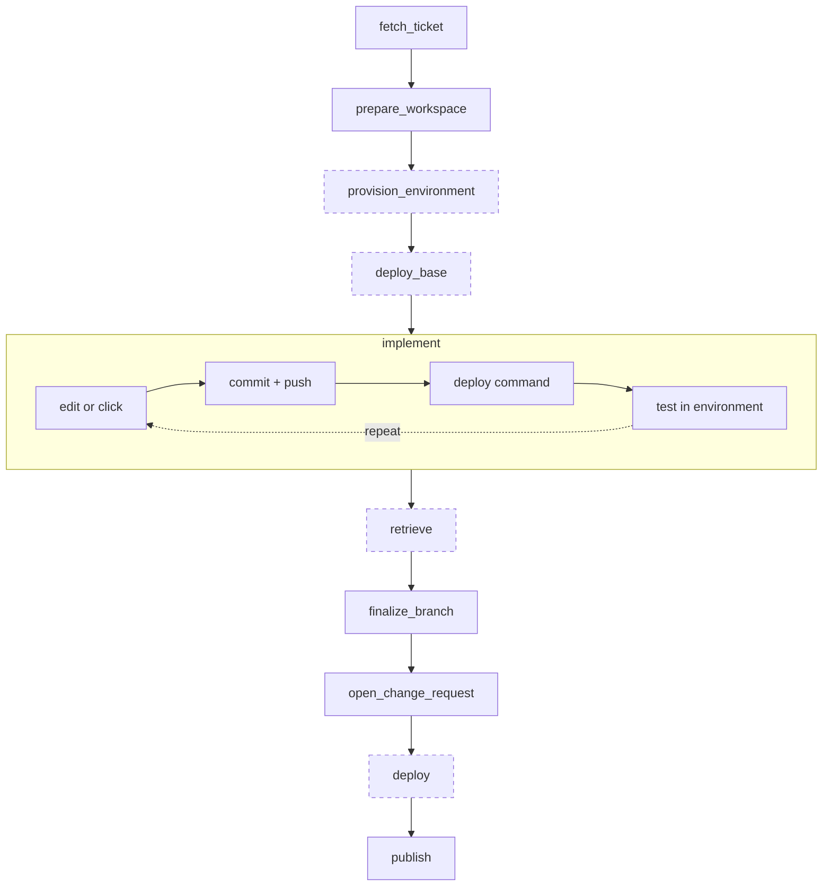
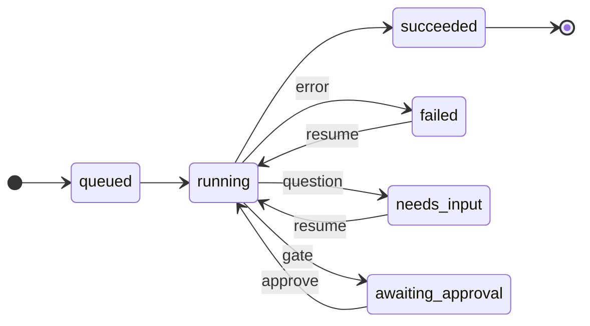

# Heinzel

*Specification — draft v0.2*

> *Heinzelmännchen: the little house gnomes said to have done all the work of
> the citizens of Cologne during the night, so the inhabitants could be lazy
> during the day.*

Heinzel is a **Go library for building software factories.** A factory takes a
ticket and, without human help:

1. creates a branch
2. provisions an environment
3. implements the ticket with a coding agent, testing it in that environment
4. opens merge/pull requests
5. deploys the result
6. reports back (MRs, ticket, people)

A factory is an ordinary Go program that wires components together:

```go
func main() {
	heinzel.Main(heinzel.Factory{
		Name:    "blanktracker",
		Tracker: trello.New(trello.Options{Board: "5f1a2b3c4d", Token: heinzel.Env("TRELLO_TOKEN")}),
		Repos: []heinzel.Repo{{
			Name: "blanktracker", TargetBranch: "staging",
			Forge: gitlab.New(gitlab.Options{Project: "acme/blanktracker", Token: heinzel.Env("GITLAB_TOKEN")}),
		}},
		Agent:       claudecode.New(claudecode.Options{Model: "claude-opus-5-5"}),
		Environment: digitalocean.New(digitalocean.Options{Region: "fra1", Size: "s-2vcpu-4gb"}),
		Deployers: []heinzel.Deployer{
			{Name: "api", Repo: "blanktracker", Deployer: dockercompose.New(dockercompose.Options{Dir: "api"})},
			{Name: "web", Repo: "blanktracker", Deployer: mycompany.SPADeployer{}}, // the team's own code
		},
		Notifiers: []heinzel.Notifier{{On: notify.Finished, Notifier: slack.New(heinzel.Env("SLACK_WEBHOOK"))}},
	})
}
```

`heinzel.Main` gives that binary the whole CLI (`run`, `serve`, `status`, …).
Every component is either a ready-made one from this repository or the team's
own code implementing the same interface. The compiler checks the wiring.

The coding agent (Claude Code, OpenHands, …) is a component like any other.
Heinzel's value is the pipeline, the run state, the interfaces, and a growing
**library of ready-made components**. Its killer feature is a
**build-a-factory skill** (§6): an agent that interviews a team, writes their
factory, and tests it end to end, so a team never has to learn Heinzel itself.

---

## 1. Goals and non-goals

**Goals (v1)**

- Fully autonomous by default: one trigger results in open MRs and a running
  environment with the change deployed.
- Pluggable at every edge: trigger, tracker, forge, agent, environment, DNS,
  deploy, notify. Teams can write their own component for any of them without
  forking Heinzel.
- Type-safe configuration: a factory is Go code, so wiring mistakes are
  compile errors, and `Main` reports the rest (missing repos, missing
  environment variables, …) all at once before doing anything.
- One ticket may span several repositories, each on its own forge. A run then
  opens one MR per repository it changed.
- A factory builds into a single static binary for Linux. No required
  external services (run state is stored on the local filesystem).
- Resumable and idempotent. A failed run can be resumed from the step that
  failed, and re-running a step does not duplicate branches, MRs or droplets.
- Optional approval gates for teams that don't want full autonomy.

**Working assumption: the agent has everything it needs.** Every agent works
inside a provisioned environment and has whatever access it needs: tools,
credentials, the running app or org. Heinzel does not sandbox the agent or
restrict its credentials. Limiting the agent's access makes every scenario much
harder, so it's out of scope until we choose to revisit it.

**Non-goals (v1)**

- A zero-code setup. A YAML front end over the ready-made components may come
  later, once the library is rich enough (§11).
- Reacting to review comments or iterating on an MR (planned for v7 or later).
- Automatic environment teardown policy (§11). Teardown is supported in the
  interfaces and through a manual CLI command.
- Multi-tenant/public SaaS deployment.

---

## 2. Reference scenarios

| | **A: BlankTracker (guinea pig)** | **B: Go service** | **C: Salesforce client** |
|---|---|---|---|
| Tracker | Trello | Jira | Jira |
| Forge | GitLab | Forgejo (self-hosted) | GitHub |
| Agent | Claude Code | Claude Code | Claude Code + Salesforce skills, DX MCP server, headless browser |
| Environment | New DigitalOcean droplet per ticket + Cloudflare DNS on a separate preview domain | Folder + nginx vhost on a shared server | New scratch org per ticket |
| Deploy | API: `docker compose up` on the droplet over SSH. SPA: build with the preview API URL, `wrangler pages deploy` as a Pages preview | build locally, rsync, restart, reload nginx | `sf project deploy start`, assign permission sets, import seed data |
| Trigger | CLI + Trello Power-Up button | CLI | CLI (Jira trigger later) |
| Notify | Trello comment + chat | Jira comment + chat | Jira comment + chat |

Any design decision that makes one column awkward is wrong.

### Scenario A in more detail

BlankTracker is one repository with two deployable parts: a Laravel API, and
an SPA hosted on Cloudflare Pages. Production is `app.blanktracker.com`,
staging is `dev.blanktracker.com`. A preview environment needs both parts, and
each must know the other's URL: the SPA is built with the API URL, and the API
needs the SPA URL for CORS and Sanctum.

| Part | Where | URL |
|---|---|---|
| API | new droplet, `docker compose` | `https://<env>-api.blanktracker-preview.com` (A record to the droplet) |
| SPA | Pages preview deploy, in a Pages project used only for previews | `https://<env>.blanktracker-preview.com` (CNAME to the preview's `pages.dev` URL, registered as a custom domain on the Pages project) |

- **All URLs are decided in `provision_environment`, before any deploy**
  (`env.Environment.Endpoints`). So the two deployers don't depend on each
  other's output, and their order doesn't matter.
- **The SPA is built by Heinzel, not by Pages.** Pages settings apply to all
  previews at once, so a Pages-side build can't get a different API URL per
  branch.
- **Previews use a separate domain, `blanktracker-preview.com`.** Sanctum cookie
  auth needs the SPA and API on a shared parent domain. If previews lived
  under `blanktracker.com`, browsers of anyone logged into production would
  send production session cookies to preview code nobody has reviewed yet,
  and previews could overwrite production's cookies. On a separate domain,
  previews set `SESSION_DOMAIN=.blanktracker-preview.com` and only share
  cookies with each other. Both names are one level below the domain, so
  Cloudflare's free Universal SSL certificate covers them.
- **Cloudflare proxies both records**, so it serves HTTPS and the droplet only
  needs plain HTTP, or a free Cloudflare origin certificate.

### Scenario C in more detail

The client's work is about 70% code (Apex, Lightning Web Components) and 30%
clicks in Salesforce Setup (Flows, objects, fields, layouts, permissions).
Almost every click produces **metadata**. Metadata can be written as XML,
deployed, and pulled back out of a scratch org with `sf project retrieve start`,
because scratch orgs track every change made in them. So Heinzel puts the
clicks through git and PR review too, not only the code.

The agent has three ways to handle a change, in order of preference:

1. **Write the source or metadata directly**, then deploy it to the scratch org
   to compile and test it. Apex only compiles inside an org, which is one
   reason the environment always exists before the agent starts.
2. **Click in the scratch org through a headless browser** (Playwright MCP),
   for things that are impractical to write by hand, like complex Flows or
   Lightning pages. The changes are then pulled back into the working tree
   (`deploy.Retriever`) and committed. This is slower and more fragile than
   option 1, so it's the fallback.
3. **Changes the Metadata API can't deploy** become a manual checklist for a
   human (`agent.Outcome.ManualSteps`), shown in the PR and the notifications.
   Heinzel never clicks in production or in shared sandboxes.

---

## 3. Concepts

- **Factory.** A Go value (`heinzel.Factory`) that wires a tracker, one or more
  repos, an agent, an environment, DNS, deployers, triggers and notifiers
  together. A binary can hold several factories; one is the common case.
- **Component.** A value implementing one of Heinzel's interfaces, e.g.
  `gitlab.New(...)` is a `forge.Forge`. Components come from this repository,
  from third-party modules, or from the team's own code.
- **Repo.** One repository of a factory, on its own forge. All of a run's
  repos are checked out side by side on the same branch name. Repos the run
  doesn't change get no MR.
- **Endpoint.** A named public URL of an environment (`api`, `web`). All
  endpoints are decided when the environment is provisioned, before anything
  is deployed.
- **Run.** One execution of the pipeline for one ticket in one factory. It has
  an ID, a status, per-step results and a log, and is persisted after every step.
- **Step.** One idempotent unit of the pipeline (`implement`, `deploy`, …).
  Step names are typed constants (`heinzel.StepDeploy`).
- **Gate.** An optional pause before a step. The run waits in
  `awaiting_approval` until someone runs `approve`.

### Pipeline



Dashed steps are skipped when the factory has no environment (`retrieve` also
when no deployer implements `Retriever`).

| Step | Does | Persisted output |
|---|---|---|
| `fetch_ticket` | `Tracker.Fetch`; optionally move the ticket to "in progress" | `Ticket` |
| `prepare_workspace` | clone every repo side by side, create the run branch in each from its target branch and push it, so the agent can push to it | `Branch`, base commits |
| `provision_environment` | `Provisioner.Ensure`, then compute the factory's endpoint URLs and create their DNS records (`dns.Provider.Ensure`) | `Environment` (with `Endpoints`) |
| `deploy_base` | every deployer, in order, deploys its repo's unchanged branch, so the environment starts identical to the target branches | `Deployments` |
| `implement` | `Agent.Implement` in the workspace (all repos), with `Task.Environment` set. The agent loops: edit, commit, push, deploy, test (see [Agent loop](#agent-loop)) | `Outcome`, `Deployments` (latest) |
| `retrieve` | each deployer that implements `Retriever` pulls changes made directly in the environment (e.g. Salesforce clicks) into its repo's checkout. Skipped if none does | — |
| `finalize_branch` | per repo, a safety net: commit anything `retrieve` pulled in or the agent left uncommitted, and push. Repos without changes are dropped and their run branch deleted. No changes in any repo means `needs_input` | `Commits` |
| `open_change_request` | `Forge.OpenChangeRequest` for every changed repo (idempotent per branch). With several, each MR links to the others | `ChangeRequests` |
| `deploy` | every deployer deploys its repo's final commit, so what testers see is exactly what's in the MRs. A deployer is skipped if the agent already deployed that commit | `Deployments` |
| `publish` | add the endpoint URLs to every MR and the ticket, move the ticket to "in review" | — |

The environment comes first because the agent works in it. A consequence: if
provisioning fails, the run fails before any code is written and no MR is
opened.

### Agent loop

The agent tests its work in the environment many times during `implement`,
so these deploys are not pipeline steps. Heinzel gives the agent two commands
of the factory binary. The engine passes the binary's path in `HEINZEL_BIN`
and the run in `HEINZEL_RUN_ID`:

- **`$HEINZEL_BIN deploy`** runs every deployer on its repo's pushed HEAD and
  blocks until done, printing the results and the deploy logs. It refuses if
  any repo has uncommitted changes or an unpushed HEAD: **Heinzel only ever
  deploys pushed commits.** For each deployer that implements `Retriever`, it
  first retrieves from the environment and refuses if that produced
  uncommitted changes ("the environment has changes not in git; commit and
  push them first"). This stops a deploy from overwriting clicks that haven't
  been saved to git.
- **`$HEINZEL_BIN retrieve`** pulls changes made directly in the environment
  (e.g. Salesforce clicks) into the working tree, for the agent to review,
  commit and push.

Both commands send their request to the running engine over a Unix socket in
the run directory. They don't call the components themselves, so the engine
records every deployment in the run state and only one process ever writes
`run.json`.

Notifications are **events**, not a step. The engine emits `run.started`,
`run.succeeded`, `run.failed`, `run.needs_input` and `run.awaiting_approval`.
Each notifier is subscribed to a set of these.

### Run status



`cancel` moves any run that hasn't finished (`queued`, `running`,
`awaiting_approval`, `failed`, `needs_input`) to `cancelled`; it's left out of
the diagram to keep it readable. `resume` and `approve` are the CLI commands of
the same name.

`needs_input` posts the agent's question as a comment on the ticket. Resuming
from `needs_input` fetches the ticket again before re-running the step that
stopped, so the agent sees the answer in the ticket's comments. Resuming from
`failed` just re-runs the failed step.

---

## 4. Go interfaces

The interfaces are code, not prose. The code is the source of truth and this
section only maps out the packages. Each interface package holds the interface
and the plain data types around it.

### Package map

| Package | Defines | Imports (Heinzel) |
|---|---|---|
| [`core`](./core) | `Message`, `Link`, `NeedsInputError`, `RetryableError`, `Checker` | — |
| [`tracker`](./tracker/tracker.go) | `Tracker` + optional `StageMover`, `Linker`, `AttachmentFetcher`; `Ticket`, `TicketRef`, `Stage` | core |
| [`forge`](./forge/forge.go) | `Forge` + optional `ChangeRequestUpdater`; `GitRemote`, `ChangeRequest`, `ChangeRequestInput` | core |
| [`agent`](./agent/agent.go) | `Agent`; `Task`, `Checkout`, `Outcome`, `Usage` | tracker, env |
| [`env`](./env/env.go) | `Provisioner` + optional `Lister`; `Spec`, `Environment` (with `Endpoints`), `Host`, `SSHAccess` | — |
| [`dns`](./dns/dns.go) | `Provider`; `Record` | — |
| [`deploy`](./deploy/deploy.go) | `Deployer` + optional `Retriever`; `Source`, `Deployment` | env, tracker |
| [`run`](./run/run.go) | `ID`, `Request`, `Status`, `Snapshot`, `Run`, `StepRecord`, `Store`, `Filter` | tracker, forge, env, deploy, agent |
| [`notify`](./notify/notify.go) | `Notifier`; `Event`, `EventType`, the `Finished` / `Problems` event sets | core, run |
| [`trigger`](./trigger/trigger.go) | `Trigger`, `Dispatcher` | run, tracker |
| [`heinzel`](./factory.go) (root) | `Factory`, `Repo`, `Endpoint`, `DNSTarget` (+ `HostAddress`, `CNAME`), `Deployer`, `Notifier`, `Trigger`, `Step`, `Main`, `Run`, `Env` | all of the above |

Imports only point down the table. `run` is its own package so that `notify`
and `trigger` can use `run.Snapshot` without importing the root package, which
imports them.

### Where components go

A component lives under the interface it implements: `forge/gitlab`,
`env/digitalocean`, `dns/cloudflare`, `deploy/cfpages`, `notify/ticket`. A
component that implements several interfaces lives under the one it's mainly
about: `deploy/sshnginx` and `deploy/scratchorg` are also `env.Provisioner`s.
Each component package has a `New(Options)` constructor, and a factory only
compiles in the components it imports.

Components outside this repository (in a team's factory code or a
third-party module) follow the same interfaces and are used the same way.

### Planned internal packages

Not written yet.

| Package | Purpose |
|---|---|
| `internal/engine` | pipeline, steps, run state machine, gates, the agent's Unix socket |
| `internal/store` | `run.Store` on the filesystem |
| `internal/workspace` | git via the git CLI: clone, branch, commit, push |
| `core/remote` | SSH exec and file sync. Public, because components outside this repository need it too |
| `<interface>/<interface>test` | conformance test suites, e.g. `forge/forgetest`. Public (§9) |

### Design rules

These rules keep the interfaces from fighting each other:

1. **Small required interfaces, optional capabilities through type
   assertion** (the `io.WriterTo` pattern). A tracker that can't move tickets
   between columns simply doesn't implement `tracker.StageMover`. The engine
   checks and skips.
2. **The zero value is useful.** Every optional part of a `Factory` can be
   left out, and that part of the pipeline is then silently a no-op: no
   `Notifiers` means nobody is notified, no `Environment` means nothing is
   provisioned or deployed, no `DNS` means no records, no `Triggers` means
   runs only start from the CLI, empty `Gates` means fully autonomous, and an
   empty `On` means every event. Only `Name`, `Tracker`, `Agent` and at least
   one `Repo` with a `Forge` are required, because without them there is
   nothing to run. A setting that only makes sense with a missing component
   (an endpoint `DNSTarget` without a `DNS` provider, `Deployers` without an
   `Environment`) is still an error: it almost always means something was
   forgotten, and ignoring it would hide the mistake.
3. **Every mutating call is idempotent** with a natural key: branch name for
   MRs, environment name for provisioning, commit for deploys, host name for
   DNS records. This is what makes `resume` safe.
4. **Components never see each other.** The engine passes data between them
   as plain structs from the interface packages. The env→deploy hand-off is
   `env.Environment`. A component may *wrap* another one it's given (e.g.
   `notify/ticket` posts through the factory's `Tracker`), but never imports
   another component's package.
5. **Everything persisted is JSON-serialisable.** No funcs or interfaces inside
   the data types in `run`, `env`, `deploy`, `forge` and `tracker`. Functions
   are fine in the factory's own wiring (`Endpoint.URL`).
6. **Constructors don't fail.** `New(Options)` returns the component; bad
   options and credentials surface in `Check` (`core.Checker`) or on first use.
   That keeps a factory a single readable expression.
7. **The engine owns the workflow; the agent owns the work.** The agent has
   full access (see the working assumption in §1). It commits and pushes, but
   **only to its own run branch**, and it deploys only through the `deploy`
   command. The engine creates the branch, makes the final commit and push
   (`finalize_branch`), opens the MRs and owns the final deploy. That keeps
   every run's outcome consistent and resumable. `forge.GitRemote` credentials
   are tagged `json:"-"` and never persisted.
8. **Only pushed commits are deployed.** `deploy.Source.Commit` is required and
   must exist in the forge, so an environment always runs something reviewable.
9. **The public API is versioned.** Factories outside this repository depend on
   these interfaces, so they only change in a new minor version while we're
   at v0.x, and are frozen at v1.

### Behaviour the types alone don't show

- **Forge.** Branch creation and pushing go through `internal/workspace` (git
  CLI), not the forge API. `git push` works the same on every host, so only MR
  operations need per-forge code. `OpenChangeRequest` returns the existing
  open CR for the branch if there is one.
- **Agent.** It commits and pushes to the run branch, and deploys with the
  `deploy` command ([Agent loop](#agent-loop)). The engine commits whatever is
  left over. Anything it couldn't do goes in `Outcome.ManualSteps`. Browser
  access, MCP servers and skills are options of the agent component, not
  interface.
- **Several repos.** Each repo has its own forge, so one factory can span
  GitLab and GitHub. The agent sees all checkouts (`Task.Repos`). Each
  deployer is bound to one repo and gets that repo's `Source`.
- **Several deployers, one environment.** Deployers run in order and all
  receive the same `Environment`. Because every endpoint URL is known before
  the first deploy, a deployer can use any other part's URL
  (`e.Endpoints["api"]`).
- **DNS.** For each endpoint with a `DNSTarget`, the engine calls
  `dns.Provider.Ensure` with the endpoint URL's host. Records are identified
  by name, so teardown needs no stored state. Provider options like Cloudflare
  proxying are component options.
- **Env + deploy in one component.** `deploy/sshnginx` and
  `deploy/scratchorg` implement both `env.Provisioner` and `deploy.Deployer`.
  The factory passes the same value to `Environment` and to a `Deployer`.
- **Environments without servers.** A scratch org has no hosts and no SSH. Its
  org username and instance URL go in `Environment.State` and `Hosts` stays
  empty.
- **Notify.** `notify/ticket` turns events into comments on the run's ticket,
  through the factory's tracker. This way "tell the tester on the Trello card"
  uses the same routing as "tell the dev channel on Slack".
- **Triggers belong to a factory.** Each trigger gets a `Dispatcher` scoped to
  its factory, and `serve` mounts its HTTP handlers under
  `/triggers/<factory>/<trigger>/`.
- **Errors.** `core.NeedsInputError` makes the engine post the question on the
  ticket, set the run to `needs_input` and emit `run.needs_input`.
  `core.RetryableError` makes the engine retry the step with backoff. Any
  other error fails the step and the run, which can then be resumed.

---

## 5. Writing a factory

A factory is a `main` package, usually in its own small repository (or a
`factory/` directory) owned by the team. Secrets come from the environment
through `heinzel.Env`. A missing variable doesn't fail on the spot: `Main`
lists every missing one at once and exits before doing anything.

### Scenario A: BlankTracker

The component packages below are planned (§10); their options are a sketch.

```go
package main

import (
	"github.com/Tight-Line/heinzel"
	"github.com/Tight-Line/heinzel/agent/claudecode"
	"github.com/Tight-Line/heinzel/deploy/cfpages"
	"github.com/Tight-Line/heinzel/deploy/dockercompose"
	"github.com/Tight-Line/heinzel/dns/cloudflare"
	"github.com/Tight-Line/heinzel/env"
	"github.com/Tight-Line/heinzel/env/digitalocean"
	"github.com/Tight-Line/heinzel/forge/gitlab"
	"github.com/Tight-Line/heinzel/notify"
	"github.com/Tight-Line/heinzel/notify/slack"
	"github.com/Tight-Line/heinzel/notify/ticket"
	"github.com/Tight-Line/heinzel/tracker"
	"github.com/Tight-Line/heinzel/tracker/trello"
	"github.com/Tight-Line/heinzel/trigger/trellopowerup"
)

const previewDomain = "blanktracker-preview.com"

func main() {
	board := trello.New(trello.Options{
		Board:  "5f1a2b3c4d",
		APIKey: heinzel.Env("TRELLO_API_KEY"),
		Token:  heinzel.Env("TRELLO_TOKEN"),
		Stages: map[tracker.Stage]string{
			tracker.StageInProgress: "Doing",
			tracker.StageInReview:   "Review",
			tracker.StageBlocked:    "Blocked",
		},
	})

	heinzel.Main(heinzel.Factory{
		Name:    "blanktracker",
		Tracker: board,
		Repos: []heinzel.Repo{{
			Name:         "blanktracker",
			TargetBranch: "staging",
			Forge: gitlab.New(gitlab.Options{
				Project: "acme/blanktracker",
				Token:   heinzel.Env("GITLAB_TOKEN"),
			}),
		}},
		Agent:        claudecode.New(claudecode.Options{Model: "claude-opus-5-5", MaxTurns: 200}),
		Instructions: "Laravel API in api/, SPA in web/. Run the tests of every part you change.",

		Environment: digitalocean.New(digitalocean.Options{
			Token:              heinzel.Env("DO_TOKEN"),
			Region:             "fra1",
			Size:               "s-2vcpu-4gb",
			Image:              "docker-24-04",
			SSHKeyFingerprints: []string{"ab:cd:…"},
		}),
		DNS: cloudflare.New(cloudflare.Options{
			Token:   heinzel.Env("CLOUDFLARE_DNS_TOKEN"), // DNS edit on the preview zone only
			Zone:    previewDomain,
			Proxied: true,
		}),
		Endpoints: []heinzel.Endpoint{
			{Name: "api", URL: previewURL("-api"), DNS: heinzel.HostAddress(0)},
			{Name: "web", URL: previewURL(""), DNS: heinzel.CNAME(func(e *env.Environment) string {
				return e.Name + ".blanktracker-previews.pages.dev"
			})},
		},
		Deployers: []heinzel.Deployer{
			{Name: "api", Repo: "blanktracker", Deployer: dockercompose.New(dockercompose.Options{
				Dir:   "api",
				Files: []string{"docker-compose.yml", "docker-compose.preview.yml"},
				Env: func(e *env.Environment) map[string]string {
					return map[string]string{
						"APP_URL":        e.Endpoints["api"],
						"FRONTEND_URL":   e.Endpoints["web"],
						"SESSION_DOMAIN": "." + previewDomain,
					}
				},
				PostDeploy: []dockercompose.Exec{{Service: "app", Command: "php artisan migrate --force --seed"}},
			})},
			{Name: "web", Repo: "blanktracker", Deployer: cfpages.New(cfpages.Options{
				Dir:       "web",
				AccountID: heinzel.Env("CLOUDFLARE_ACCOUNT_ID"),
				Token:     heinzel.Env("CLOUDFLARE_PAGES_TOKEN"),
				Project:   "blanktracker-previews", // previews only, not the production Pages project
				Branch:    func(e *env.Environment) string { return e.Name }, // <env>.blanktracker-previews.pages.dev
				Build:     "npm ci && npm run build",
				Output:    "dist",
				BuildEnv: func(e *env.Environment) map[string]string {
					return map[string]string{"VITE_API_URL": e.Endpoints["api"]}
				},
				CustomDomain: func(e *env.Environment) string { return e.Name + "." + previewDomain },
			})},
		},

		Triggers: []heinzel.Trigger{{Name: "trello", Trigger: trellopowerup.New(trellopowerup.Options{
			Secret: heinzel.Env("HEINZEL_TRELLO_SECRET"),
		})}},
		Notifiers: []heinzel.Notifier{
			{On: notify.Problems, Notifier: ticket.New(board)},
			{On: notify.Finished, Notifier: slack.New(heinzel.Env("SLACK_DEV_WEBHOOK"))},
		},
	})
}

func previewURL(suffix string) func(*env.Environment) string {
	return func(e *env.Environment) string { return "https://" + e.Name + suffix + "." + previewDomain }
}
```

### Scenario B: one component for environment and deploy

```go
host := sshnginx.New(sshnginx.Options{
	Host:      "shared.acme.internal",
	User:      "deploy",
	KeyPath:   "~/.ssh/heinzel_deploy",
	Root:      func(e *env.Environment) string { return "/srv/previews/" + e.Name },
	Domain:    func(e *env.Environment) string { return e.Name + ".preview.acme.internal" },
	PortRange: [2]int{20000, 20999},
	Build:     "CGO_ENABLED=0 go build -o dist/app ./cmd/server",
	Run:       func(e *env.Environment) string { return "./app --addr 127.0.0.1:" + e.State["port"] },
})

heinzel.Main(heinzel.Factory{
	Name:        "go-service",
	Tracker:     jira.New(jira.Options{BaseURL: "https://acme.atlassian.net", Token: heinzel.Env("JIRA_TOKEN")}),
	Repos:       []heinzel.Repo{{Name: "go-service", TargetBranch: "main", Forge: forgejo.New(forgejo.Options{…})}},
	Agent:       claudecode.New(claudecode.Options{Model: "claude-opus-5-5"}),
	Environment: host,
	Deployers:   []heinzel.Deployer{{Name: "app", Repo: "go-service", Deployer: host}},
})
```

### Scenario C: an agent with Salesforce tools

```go
org := scratchorg.New(scratchorg.Options{
	DevHub:       "client-devhub", // sf alias, authorised on the Heinzel host via JWT
	Definition:   "config/project-scratch-def.json",
	DurationDays: 7,
	PostDeploy:   []string{"sf org assign permset --name Client_Admin", "sf data import tree --plan data/plan.json"},
})

heinzel.Main(heinzel.Factory{
	Name:    "salesforce-client",
	Tracker: jira.New(jira.Options{…}),
	Repos:   []heinzel.Repo{{Name: "salesforce", TargetBranch: "main", Forge: github.New(github.Options{Repo: "client/salesforce", …})}},
	Agent: claudecode.New(claudecode.Options{
		Model:      "claude-opus-5-5",
		Skills:     []string{"forcedotcom/sf-skills"},
		MCPServers: []string{"salesforce-dx", "playwright"}, // playwright = headless browser for clicks
	}),
	Instructions: "Prefer writing metadata over clicking. Click in the scratch org only when " +
		"writing the metadata by hand is impractical. Never touch any other org.",
	Environment: org,
	Deployers:   []heinzel.Deployer{{Name: "org", Repo: "salesforce", Deployer: org}}, // also a Retriever
})
```

Repository-side files are optional and read from each checkout:
`.heinzel/prompt.md` (extra agent instructions for that repo). The agent also
picks up the repo's own `AGENTS.md` / `CLAUDE.md` as usual.

---

## 6. Building a factory with an agent

Teams shouldn't have to read this document. Upstream Heinzel ships a
**build-a-factory guide and a Claude skill**: point an agent at a team's
repositories and tools, and it builds, tests and hands over their factory.

Because Heinzel is autonomous by design, the agent can test its own work
end to end:

1. **Discover the process.** Read the team's repos (compose files, CI config,
   `package.json`, deploy scripts) and ask about the rest: where tickets live,
   how and where things are deployed, which domains, who should hear about
   what.
2. **Choose components.** Use ready-made ones where they fit.
3. **Write the missing ones** in the factory's own code, against the
   interfaces, and run the matching conformance suite
   (`trackertest.Run(t, myTracker)`, …) until it passes.
4. **Check credentials** with `check` until every component passes.
5. **Bring up an environment** for the target branches alone with
   `env up`, and iterate until it provisions, deploys and answers on its
   endpoint URLs.
6. **Prove the whole flow.** Ask the user for a small test feature, run it as a
   real ticket, and verify the result with them: branch, MRs, a working
   environment with the change, notifications. Fix and repeat until it works.
7. **Hand over** the factory repository, with a short README of what was built
   and any components worth contributing upstream.

What makes this work is that a factory is small, typed Go code with
conformance suites to check it against. Every case study (§12) is the kind of
material the skill learns from.

---

## 7. CLI

`heinzel.Main` provides these commands. The binary is the team's factory, e.g.
`blanktracker-factory`.

```sh
<factory> run [--factory F] <ticket-id> [--gate STEP]... [--detach]
<factory> serve                        # HTTP triggers + worker pool
<factory> status [run-id]              # list runs or show one
<factory> logs <run-id> [-f]
<factory> resume <run-id>              # continue a failed or needs_input run
<factory> approve <run-id>             # pass the current gate
<factory> cancel <run-id>
<factory> env up [--factory F]         # provision + deploy the target branches, without a ticket
<factory> env list
<factory> env destroy <run-id | env-name>
<factory> check                        # validate factories and test component credentials

# used by the agent inside a run (run found via $HEINZEL_RUN_ID)
$HEINZEL_BIN deploy                    # deploy every repo's pushed HEAD to the run's environment
$HEINZEL_BIN retrieve                  # pull environment changes into the working tree
```

`--factory` is only needed when the binary holds more than one factory. `run`
without `--detach` executes in-process and streams the log. It uses the same
engine and store as `serve`.

---

## 8. Operational behaviour

- **Workspace:** `$XDG_STATE_HOME/heinzel/runs/<run-id>/{run.json,log.txt,engine.sock,repos/<name>/}`.
  Every repo is a fresh clone per run, which costs time but avoids state
  bleeding between runs.
- **Concurrency:** at most one active run per (factory, ticket). A global
  worker limit applies in `serve`.
- **Re-triggering a ticket that already has a run:** refused while a run is
  active. Otherwise a new run starts, reusing the same branch, environment
  and MRs (thanks to the idempotent keys). It force-pushes with lease. *(See
  Open Questions.)*
- **Agent access:** set through the agent component's options and carries
  whatever the agent needs, including push access to the forges. Heinzel does
  not restrict it (§1).
- **Logging:** `log/slog`, written to stderr and to the run log. The agent
  transcript goes to the run log only.
- **Timeouts:** per step, configurable. Defaults: implement 60m, provision
  15m, deploy 20m.

---

## 9. Testing strategy

- `internal/engine` is tested end to end with fakes: resume, gates,
  idempotency, error kinds, several repos.
- **Conformance suites are public**, one per interface: `forge/forgetest`,
  `env/envtest`, `deploy/deploytest`, … They check the contract (idempotency,
  `Destroy` on a missing env, a missing DNS record is not an error, …). Every
  component in this repository runs its suite against a real sandbox, guarded
  by an env var such as `HEINZEL_IT_GITLAB=1`. Components written by teams or
  agents run the same suites, which is what makes writing your own component
  safe (§6).
- BlankTracker, the guinea-pig project, is the end-to-end acceptance test.

---

## 10. Milestones

| # | Deliverable |
|---|---|
| M0 | interface packages and the root `heinzel` package (`Factory`, validation, `Main`, `check`) ✅ partly; engine with fakes (multi-repo from the start), file store, `run` / `status` / `resume` |
| M1 | Scenario A end to end from the CLI: `tracker/trello`, `forge/gitlab`, `agent/claudecode`, `env/digitalocean`, `dns/cloudflare`, `deploy/dockercompose`, `deploy/cfpages`, `notify/ticket`, and `examples/blanktracker` |
| M2 | `serve` + `trigger/trellopowerup` + one chat notifier; `env up` |
| M3 | Build-a-factory guide + Claude skill, and the conformance suites it relies on. Accepted when an agent rebuilds BlankTracker's factory from scratch with it |
| M4 | Scenario B: `tracker/jira`, `forge/forgejo`, `deploy/sshnginx` |
| M5 | Gates/approve, `env list/destroy`, hardening |
| M6 | Scenario C: `forge/github`, `deploy/scratchorg`, `retrieve` step, browser tooling for `agent/claudecode` |

---

## 11. Open questions

1. **Environment teardown policy.** Options: on MR merged/closed (needs a forge
   webhook or poller), a TTL, ticket moved to "Done", or manual only. The
   interfaces support all of them (`Provisioner.Destroy`, `env.Lister`,
   `dns.Provider.Delete`). v1 ships only `env destroy`.
2. **Merge order across repos.** When one ticket changes several repos, some
   MRs may need to merge before others (API before SPA). For now Heinzel only
   links the MRs to each other and states the dependency in their
   descriptions. Should it enforce an order?
3. **Scenario B process model.** How does the Go binary keep running on the
   shared host: a systemd unit per preview, a supervisor, or something else?
   Who allocates ports (proposed: the provisioner, stored in `Environment.State`)?
4. **Re-trigger semantics.** Should re-running a ticket continue from the
   existing branch (the agent sees its previous work) or start fresh from the
   target branch?
5. **Where the agent process runs.** Directly on the Heinzel host (v1,
   simplest), or in a container per run for isolation between concurrent
   runs? This is an option of the agent component and does not change the
   interface.
6. **Giving testers access without leaking logins.** A Salesforce "open org"
   URL (`sf org open --url-only`) contains a live session, so it must not be
   posted to chat. Options: create a tester user with a generated password and
   deliver it privately, or post only the login URL and let testers request
   access. This may add an `Access` field to `deploy.Deployment` that is kept
   apart from the public `URL`.
7. **How far to trust browser clicking.** Should a run that relied on browser
   clicks always open a draft PR, or add an automatic gate? Clicked changes
   are still reviewed as diffs, but they're harder to read than code.
8. **Shared sandboxes for scenario C.** Some work (integrations, realistic
   data) needs a full or partial-copy sandbox instead of a scratch org. That
   would be a pool of existing environments that runs lease, not create, which
   is closer to scenario B.
9. **A YAML front end.** Once there are enough ready-made components, a
    `heinzel` binary could build a factory from YAML for teams that only use
    those. It would be a thin layer over the library, not a second
    configuration model.

---

## 12. Case studies

Real and hypothetical setups used to test the design against real-world
messiness. A case study passes if it fits the existing interfaces without
changing them.

### 12.1 Guinea pig: a "build this" button on Trello cards

**The setup.** BlankTracker, the guinea-pig project (scenario A: Laravel API +
SPA, GitLab, Trello, DigitalOcean, Cloudflare). People on the Trello board
start Heinzel from the card itself and see its progress there, without
touching the CLI.

**What Heinzel delivers.** A **"🧙 Heinzel: build this"** button on every
card, and badges on the card showing run status, the MR links and the
environment links.

**How it maps.**

| Piece | Implementation |
|---|---|
| Trigger | `trigger/trellopowerup`, listed in the factory's `Triggers`. `serve` mounts it under `/triggers/blanktracker/trello/` |
| Power-Up assets | a static connector (`index.html` + JS) served from `embed.FS`. In the Trello Power-Up admin, the iframe connector URL is set to `https://<public_url>/triggers/blanktracker/trello/` |
| Button | the `card-buttons` capability calls `POST …/runs {cardId}`, which calls `Dispatcher.Submit` |
| Badges | the `card-badges` / `card-detail-badges` capabilities poll `GET …/cards/{cardId}`, which calls `Dispatcher.Latest` |
| Which factory | the trigger belongs to one factory, and its `Dispatcher` is scoped to it, so no board-to-factory mapping is needed |
| Auth (v1) | a shared secret, entered once per board in the Power-Up settings and stored with `t.set('board','private',…)` |
| Auth (later) | `t.getRestApi()` gets the member's Trello token; the server verifies that the member can see the card |

**Design points this case confirms.**

- **Triggers are not limited to the CLI.** A trigger can ship its own UI,
  serve it over HTTP and use only the `Dispatcher` to talk to the engine.
- **`Dispatcher.Latest` exists for this case.** A trigger needs to show the
  state of the most recent run for a ticket, not only start new ones.
- **A trigger belongs to one factory.** The engine doesn't need to know about
  Trello boards.

**Caveat.** Trello requires HTTPS for the connector. For local testing, put
`serve` behind a tunnel (cloudflared/ngrok).

### 12.2 The Salesforce team that only clicks

**The team.** A Salesforce team with no source-driven development at all.
They implement a ticket by clicking in a shared dev org, then repeat the same
clicks by hand, from memory, in production. Git is not part of their process.

**What Heinzel delivers.** For each ticket: the change made in an isolated
org, an exact record of what changed, and a step-by-step `instructions.md` a
human follows to repeat the change in production. Heinzel never clicks in
production.

**How it maps.**

| Piece | Implementation |
|---|---|
| Tracker, forge | whatever they use (a repo is created for Heinzel's output if they have none) |
| Environment | a fresh scratch org, or a dedicated dev sandbox, **per ticket**. Not the team's shared dev org |
| Agent | Claude Code clicking in that org through a headless browser |
| `Retriever` | a component in the team's own factory code that (1) runs `sf project retrieve start` to get the exact metadata the clicks produced, then (2) has an LLM turn that diff into click-by-click instructions, written to `instructions.md` |
| `Deployer` | a no-op. Nothing is deployed from git; the clicks already live in the org. The `deploy` command's guard still works: after a click, retrieve produces uncommitted files, so the agent commits and pushes them before deploying |
| Change request | contains `instructions.md` plus the retrieved metadata; a human reviews it and carries out the steps in production |

**Design points this case confirms.**

- **Team-specific components are ordinary code.** The instructions-writing
  `Retriever` is exactly the kind of component a team (or the build-a-factory
  agent) writes in its own factory, without changing Heinzel.
- **`Retriever` is not limited to source code.** Its contract is "bring
  changes made in the environment into the working tree as files, so they're
  committed and reviewed". Instructions for a human meet that contract.
- **Components may use an LLM internally.** The interfaces don't care how a
  component produces its result.
- **The instructions must come from the org's actual changes, not the agent's
  memory.** An agent describing what it remembers clicking will leave steps
  out. A metadata diff is ground truth, and reviewers can check the
  instructions against it.
- **Isolation per ticket is required.** In a shared dev org, retrieve also
  picks up colleagues' unfinished clicks, and the instructions would contain
  changes nobody asked for.
- **`agent.Outcome.ManualSteps` stays separate.** It is the agent's short
  "also do this by hand" list. Here `instructions.md` is the deliverable
  itself, generated from the org.

**Side benefit: a migration path.** The retrieved metadata is committed
alongside the instructions, even though nobody deploys it at first. The team
gets an exact history of every change and can later switch to deploying the
metadata instead of re-clicking, moving towards source-driven development
one ticket at a time.

**Caveat.** The instructions will be good, not perfect. Salesforce's Setup UI
changes between releases and some settings are deeply nested, so whoever
follows them in production still needs basic Salesforce knowledge.
