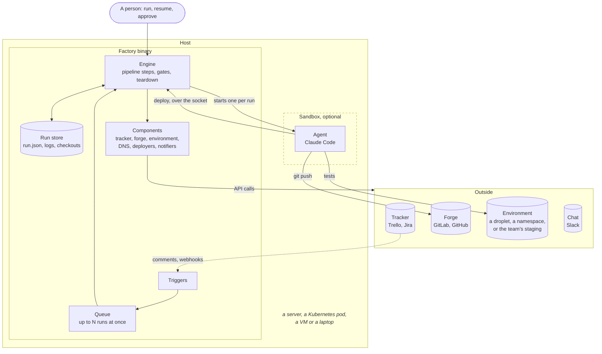
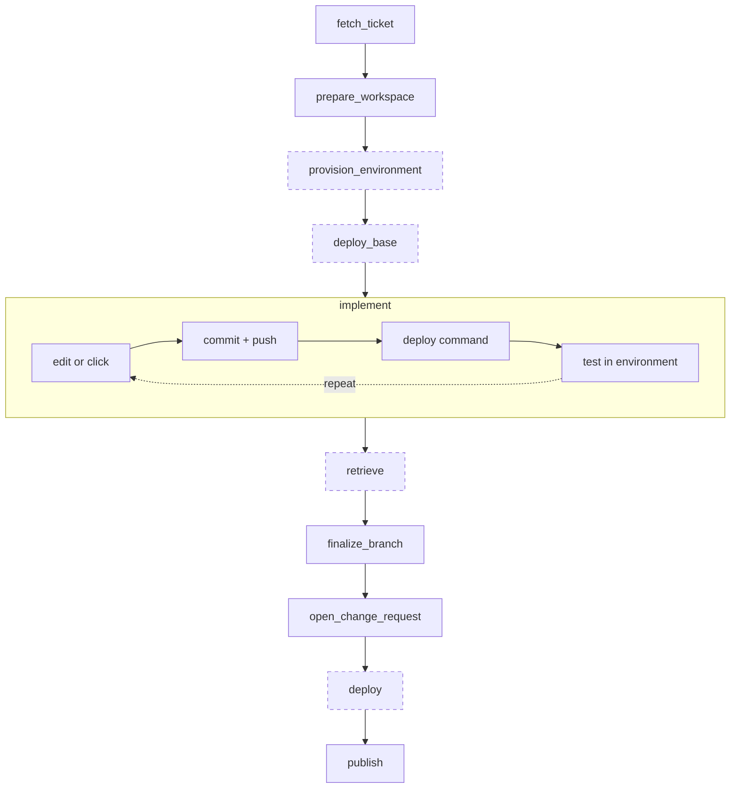
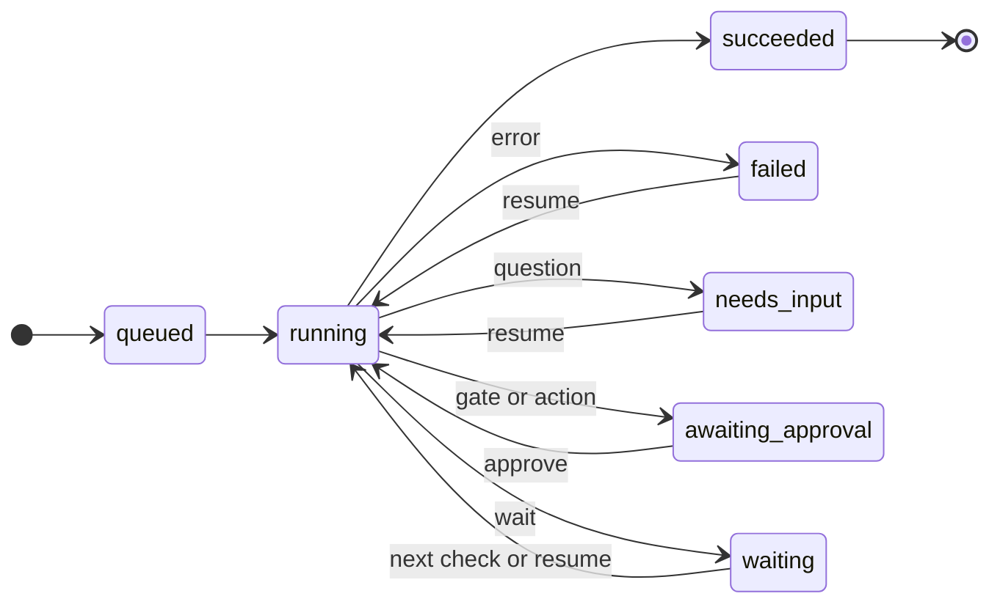

# Hinziel

*Specification — draft v0.3*

Hinziel is a toolkit for building **software factories**: programs made for one
team's tickets, repositories and deployment. Hand a factory a ticket and it
comes back as merge requests, deployed where you can try it: an environment
of its own, or wherever the team tries changes today. Hinziel comes in two parts:

1. **A Go library for building software factories**: the pipeline, run
   state, interfaces and ready-made components a factory is made of.
2. **The build-a-factory skill**, which works out with a team what previewing
   an autonomous change means for them, and then writes and tests the team's
   factory with the library.

A team uses the skill; the skill uses the library. The library is still an
ordinary Go library, open to any team that would rather write its factory by
hand.

> Note: the name is both a play on *hinzielen* (German: to aim at, to work toward), and
inspired by the Heinzelmännchen of Cologne, house spirits who did the
townsfolk's work while they slept.

### The library

A factory takes a ticket and, without human help:

1. creates a branch
2. provisions an environment, or takes the one the team already tests in
3. implements the ticket with a coding agent, testing it in that environment
4. opens merge/pull requests
5. deploys the result
6. reports back (MRs, ticket, people)

A factory is an ordinary Go program that wires components together:

```go
func main() {
	hinziel.Main(hinziel.Factory{
		Name:    "blanktracker",
		Tracker: trello.New(trello.Options{Board: "FbGOL7Wb", Token: hinziel.Env("TRELLO_TOKEN")}),
		Repos: []hinziel.Repo{{
			Name: "app", TargetBranch: "develop",
			Forge: gitlab.New(gitlab.Options{Project: "blanktracker/app", Token: hinziel.Env("GITLAB_TOKEN")}),
		}},
		Agent:       claudecode.New(claudecode.Options{Model: "claude-opus-5-5"}),
		Environment: digitalocean.New(digitalocean.Options{Region: "fra1", Size: "s-2vcpu-4gb"}),
		Deployers: []hinziel.Deployer{
			{Name: "api", Repo: "app", Deployer: dockercompose.New(dockercompose.Options{Files: []string{"vibe.docker-compose.yaml"}})},
			{Name: "web", Repo: "app", Deployer: mycompany.SPADeployer{}}, // the team's own code
		},
		Notifiers: []hinziel.Notifier{{On: notify.Finished, Notifier: slack.New(hinziel.Env("SLACK_WEBHOOK"))}},
	})
}
```

`hinziel.Main` gives that binary the whole CLI (`run`, `daemon`, `status`, …).
Every component is either a ready-made one from this repository or the team's
own code implementing the same interface. The compiler checks the wiring.

The coding agent (Claude Code, OpenHands, …) is a component like any other:
the factory aims it at the ticket. The library's value is the pipeline, the
run state, the interfaces, and a growing **library of ready-made components**.

### The skill

**Hinziel's killer feature is working out, with the team, what it means to
preview a change nobody wrote by hand.** An agent's change is worth something
only once someone can try it, and "try it" means something different for
every team: an environment of its own per ticket, a namespace in a preview
cluster, a scratch org, or simply a deploy to the one staging environment
they have ([scenario E](#scenario-e-in-more-detail)). Which of these fits
depends on how the app is really deployed, and that knowledge is tacit,
scattered and often partly wrong. The **build-a-factory skill** (§5) goes
into a team's repositories and running environments, works out how the app
is really deployed, and then decides with the team what a preview is for
them: what it must be faithful to, what it may share, what it must never
touch, and what it may cost.

Where an environment per ticket is possible and worth it, the skill
reproduces the team's deployment so that every ticket gets one, something
most teams rarely take on by hand. Where it isn't, the preview is what the
team already does by hand, such as deploying to staging, done for them.

The skill then writes the rest of the factory and tests it end to end, so a
team never has to learn the library itself. A team whose previews are new
environments, and that only wants those, can stop there: `env up` gives them
a fresh one on demand, with no tickets or agents involved.

---

## 1. Goals and non-goals

**Goals (v1)**

- Fully autonomous by default: one trigger results in open MRs and a running
  environment with the change deployed.
- Pluggable at every edge: trigger, tracker, forge, agent, environment, DNS,
  deploy, notify. Teams can write their own component for any of them without
  forking Hinziel.
- **The factory adapts to the app, not the other way round.** A factory builds
  and deploys an app the way the team already does: their compose files,
  their build scripts, their hosting. Building a factory for a project may need
  a few small changes to the app, never a restructuring. Anything specific to
  previews (an override file, a `.env` template) lives in the factory.
- Type-safe configuration: a factory is Go code, so wiring mistakes are
  compile errors, and `Main` reports the rest (missing repos, missing
  environment variables, …) all at once before doing anything.
- One ticket may span several repositories, each on its own forge. A run then
  opens one MR per repository it changed.
- A factory builds into a single static binary for Linux. No required
  external services (run state is stored on the local filesystem).
- Resumable and idempotent. A failed run can be resumed from the step that
  failed, and re-running a step does not duplicate branches, MRs or droplets.
- Optional approval gates for teams that don't want full autonomy.

**Working assumption: the agent has everything it needs.** Every agent runs
on the factory's host, in a [sandbox](#the-agents-sandbox) if the factory
asks for one (from M2), and works against a provisioned environment: it
deploys to it, reaches it over SSH or its tools, and tests it through its
URLs. It has whatever access it needs: tools, credentials, the running app
or org. A factory keeps its own credentials
from the agent (design rule 7), and a sandbox keeps the factory's host
from it, but nothing limits what its work can reach: the environment, the
forge, the APIs its `AgentEnv` opens. Limiting that makes every scenario much harder, so it's out of
scope until we choose to revisit it.

**Non-goals (v1)**

- A zero-code setup. A YAML front end over the ready-made components may come
  later, once the library is rich enough (§10).
- Reacting to review comments on MRs. Iterating on feedback in the ticket is
  planned for M4 ([Iteration](#iteration)); comments on the MR may follow.
- Multi-tenant/public SaaS deployment.
- Production rollout. A factory's work ends at reviewed MRs and a working
  preview. Merging, canaries, feature flags and production deploys stay the
  team's own pipeline ([Scenario D](#11-reference-scenarios)).

---

## 2. Concepts

- **Factory.** A Go value (`hinziel.Factory`) that wires a tracker, one or more
  repos, an agent, an environment, DNS, deployers, triggers and notifiers
  together. A binary can hold several factories; one is the common case.
- **Component.** A value implementing one of Hinziel's interfaces, e.g.
  `gitlab.New(...)` is a `forge.Forge`. Components come from this repository,
  from third-party modules, or from the team's own code.
- **Repo.** One repository of a factory, on its own forge. All of a run's
  repos are checked out side by side on the same branch name. Repos the run
  doesn't change get no MR.
- **Endpoint.** A named public URL of an environment (`api`, `web`). All
  endpoints are decided when the environment is provisioned, before anything
  is deployed.
- **Run.** One execution of the pipeline for one ticket in one factory. It has
  an ID, a status, per-step results and a log, and is persisted after every step.
- **Step.** One idempotent unit of the pipeline (`implement`, `deploy`, …).
  Step names are typed constants (`hinziel.StepDeploy`).
- **Gate.** An optional pause before a step. The run waits in
  `awaiting_approval` until someone runs `approve`.
- **Action.** Something a human must do for an environment that the factory
  can't, such as registering its URLs with a third party. It may hold back a
  later step until someone confirms it's done ([Human actions](#human-actions)).
- **Host.** Where the factory runs: an always-on machine it's installed on
  with [`host install-daemon`](#hosting-a-factory), a pod, or a laptop running
  `run`. It runs the engine and each run's agent, directly or in a
  sandbox. What it needs grows with the sandbox: nothing, Docker, or
  Docker and Sysbox; `host install-daemon` needs Docker in any case, as it runs
  the factory itself as a container.
- **Daemon.** The factory's binary running continuously
  (`<factory> daemon`, [The daemon](#the-daemon)). It runs the triggers,
  executes the runs they start, up to `--runs N` at once, and tears down
  environments by the factory's [`Teardown`](#teardown).
- **Engine.** The part of Hinziel that executes a run's pipeline step by
  step, inside the daemon or a CLI command. It provisions the environment,
  starts the sandbox if there is one, calls the agent, and owns the final
  commit, deploy and MRs.
- **Agent.** The component that does `implement`. It works on the host or
  in the sandbox: edits and tests the checkouts, commits and pushes its run
  branch with `git`, and asks the engine to deploy the pushed commits
  (`$HINZIEL_BIN deploy`, [Agent loop](#agent-loop)), then tests against
  the environment. It never creates environments, runs deployers itself or
  opens MRs.
- **Sandbox.** An optional container per run in which the agent works
  ([The agent's sandbox](#the-agents-sandbox)). It sees only its run's
  checkouts, and is removed with everything in it when `implement` ends.

### Architecture



One process does the work: the factory binary, running as the
[daemon](#the-daemon) or as a single CLI command. Its engine runs each
run's pipeline and calls the components, which talk to the tracker, the
forges, the environment's provider, DNS and chat. For `implement` it
starts the agent, in a [sandbox](#the-agents-sandbox) if the factory asks
for one (dashed) or as a plain process on the host if not. The agent works
on the run's checkouts, pushes the run branch itself, and asks the engine
to deploy over a Unix socket; it never holds the factory's credentials.
The host is wherever the binary runs: a server set up by
[`host install-daemon`](#hosting-a-factory), a pod in the team's cluster,
a VM or a laptop.

### Pipeline



Dashed steps are skipped when the factory has no environment (`retrieve` also
when no deployer implements `Retriever`).

| Step | Does | Persisted output |
|---|---|---|
| `fetch_ticket` | `Tracker.Fetch`; download files attached to the ticket (`AttachmentFetcher`) into the run's directory, since the agent has no tracker credentials; optionally move the ticket to "in progress" | `Ticket` (with local attachment paths) |
| `prepare_workspace` | clone every repo side by side and create the run branch in each from its target branch, locally only: it reaches the forge when someone pushes a change to it, so repos the ticket doesn't touch get no remote branch, MR or CI run | `Branch` |
| `provision_environment` | `Provisioner.Ensure`, then compute the factory's endpoint URLs and create their DNS records (`dns.Provider.Ensure`). Collect the environment's [human actions](#human-actions) and emit `run.action_required` for each new one | `Environment` (with `Endpoints` and `Actions`) |
| `deploy_base` | every deployer, in order, deploys its repo's unchanged branch, so the environment starts identical to the target branches | `Deployments` |
| `implement` | `Agent.Implement` in the workspace (all repos), with `Task.Environment` set. The agent loops: edit, commit, push, deploy, test (see [Agent loop](#agent-loop)) | `Outcome`, `Deployments` (latest) |
| `retrieve` | each deployer that implements `Retriever` pulls changes made directly in the environment (e.g. Salesforce clicks) into its repo's checkout. Skipped if none does | — |
| `finalize_branch` | per repo, a safety net: commit anything `retrieve` pulled in or the agent left uncommitted, and push. Repos without changes are dropped and their run branch deleted. No changes in any repo means `needs_input` | `Commits` |
| `open_change_request` | `Forge.OpenChangeRequest` for every changed repo (idempotent per branch). With several, each MR links to the others | `ChangeRequests` |
| `deploy` | every deployer deploys its repo's final commit, so what testers see is exactly what's in the MRs. A deployer is skipped if the agent already deployed that commit | `Deployments` |
| `publish` | add the endpoint URLs to every MR and the ticket, move the ticket to "in review" | — |

The environment comes first because the agent works in it. A consequence: if
provisioning fails, the run fails before any code is written and no MR is
opened.

### Agent loop

The agent tests its work in the environment many times during `implement`,
so these deploys are not pipeline steps. The factory gives the agent two
commands of its own binary. The engine passes the binary's path in `HINZIEL_BIN`,
the run in `HINZIEL_RUN_ID` and the engine's socket in `HINZIEL_SOCKET`:

- **`$HINZIEL_BIN deploy`** runs every deployer on its repo's pushed HEAD and
  blocks until done, printing the results and the deploy logs. It refuses if
  any repo has uncommitted changes or an unpushed HEAD: **A factory only ever
  deploys pushed commits.** For each deployer that implements `Retriever`, it
  first retrieves from the environment and refuses if that produced
  uncommitted changes ("the environment has changes not in git; commit and
  push them first"). This stops a deploy from overwriting clicks that haven't
  been saved to git.
- **`$HINZIEL_BIN retrieve`** pulls changes made directly in the environment
  (e.g. Salesforce clicks) into the working tree, for the agent to review,
  commit and push.

Both commands send their request to the running engine, which listens only
while `implement` runs. They don't call the components themselves, so the
agent never holds the factory's credentials, the engine enforces the deploy
rules above whatever the agent's prompt says, it records every deployment in
the run state, and only one process ever writes `run.json`.

**Why a Unix socket.** It's an ordinary HTTP API (`POST /deploy`,
`POST /retrieve`, JSON replies) served on a socket file in the run's agent
directory instead of a TCP port:

- **Access is who can reach the file:** the factory's user, and the run's
  own sandbox, which has that directory mounted. A port on localhost would
  be open to every process on the host, other runs' agents included, and
  need a token per run.
- **No ports to allocate:** parallel runs and the agent's dev stack can't
  collide with it.
- **Nothing on the network,** where a published port can end up open to the
  internet (§10, question 5).
- **The same in and out of the sandbox:** a bind-mounted file needs no
  network path from the container to the host.
- **It lives as long as `implement`:** the engine removes it afterwards.

The cost: engine and agent must share a machine, and socket paths are
limited to about 108 bytes, so a long one falls back to the system temp
directory. An agent on another machine would need TCP with a per-run token
(open question 14); the handlers wouldn't change.

Notifications are **events**, not a step. The engine emits `run.started`,
`run.succeeded`, `run.failed`, `run.needs_input`, `run.awaiting_approval` and
`run.action_required`. Each notifier is subscribed to a set of these.

### Human actions

Some environments can't be finished by software. An app's previews may need
their OAuth redirect URIs added in Google Cloud Console, which has no API for
it (BlankTracker's did, until it got an OAuth relay: §12.2). A Salesforce
sandbox lease might need an admin's approval. The library
supports this as **actions**: requests for a human, raised while the
environment is provisioned.

```go
// package env
type Action struct {
	ID     string `json:"id"`     // stable per environment; makes notifying and confirming idempotent
	Title  string `json:"title"`
	Body   string `json:"body"`   // CommonMark: exactly what to do
	Before string `json:"before"` // step that waits until it's done; "" = notify only
}
// Environment.Actions []Action is set by the Provisioner, for needs of the provider.

// package hinziel: needs of the app, added to the provisioner's.
EnvironmentActions func(e *env.Environment) []env.Action // Factory field
```

1. At the end of `provision_environment`, the engine collects the actions
   and emits `run.action_required` once for each one it hasn't announced
   before. The run carries on, so the human works while the agent does.
2. `approve <run-id>` confirms every pending action, at any time: also while
   the run executes, so a human who is done before the run gets there never
   holds it up. The executing process can't be interrupted to change the
   run, so the confirmation is stored next to it and applied before the next
   step. Later, a trigger can do the same through its `Dispatcher`.
3. When the run reaches an action's `Before` step and nobody has confirmed the
   action, the run waits in `awaiting_approval`, exactly like a gate, and
   `approve` confirms it and continues.
4. Confirmations are kept per environment name. A new run that reuses the
   environment doesn't ask again.
5. The actions, and whether they're done, are listed in the MR description and
   in `publish`'s report. `env destroy` prints them as a reminder to undo
   them (remove the redirect URIs).

Pick `Before` by who needs the result. The agent never needs Google login on
a BlankTracker preview, so that action held back only `publish`, which tells
testers the environment is ready. An environment the agent can't use without
the human holds back `implement`.

### Run status



`cancel` moves any run that hasn't finished (`queued`, `running`,
`awaiting_approval`, `waiting`, `failed`, `needs_input`) to `cancelled`; it's left out of
the diagram to keep it readable. `resume` and `approve` are the CLI commands of
the same name.

`needs_input` posts the agent's question as a comment on the ticket. Resuming
from `needs_input` fetches the ticket again before re-running the step that
stopped, so the agent sees the answer in the ticket's comments. Resuming from
`failed` just re-runs the failed step.

`waiting` means a step is waiting on someone or something else: a CI
pipeline building an image, a store build, an environment booking, an
approval in another system. The step returns `core.WaitError{Reason, After}`
("not yet, look again in `After`"); it's not a failure. The run records what
it waits for and when to check again, and no process stays attached to it.
Whoever drives the run checks again by running the step again, which is
safe because steps are idempotent:

- the CLI's `run`, `resume` and `approve` keep following in the foreground
  and check again at the time given; Ctrl-C leaves the run `waiting`, not
  `failed`;
- `resume` checks right away, whatever the time given;
- the daemon (M2) will schedule the checks;
- inside `implement`, the agent's `$HINZIEL_BIN deploy` waits inline instead,
  since the agent is blocked on it anyway, within the step's timeout.

A new reason emits `run.waiting`; checking again on the same one doesn't.
How long to keep waiting before giving up is the component's decision: it
returns an ordinary error when it stops expecting the wait to end.

### Iteration

*Planned for M4.* A run ends with MRs and a preview, but that's rarely the
end of a ticket. Someone tries the preview and comments on the ticket:
"make the button green", "this breaks when the list is empty", "why does
it sort by date?". The factory picks the comment up and continues the same
work: the same branch, environment and MRs. It changes what was asked,
deploys, and replies on the ticket. People iterate with the factory the way
they would with a colleague, in the tracker they already use.

**An iteration is a new run for the same ticket** that continues where the
last one ended. Most of that already holds: `prepare_workspace` starts from
the run branch when it exists, `deploy_base` deploys the checkouts as they
are (so the preview keeps the last iteration's state), and provisioning,
DNS and change requests are idempotent by name. What's new:

1. **Feedback.** At `fetch_ticket`, the comments added since the previous
   run published are the feedback, minus those the factory wrote itself.
   Trackers mark those (`tracker.Comment.Mine`, from comparing the author
   with the tracker's own credentials, plus a stable `ID`), so the factory
   can never answer itself in a loop. A factory can require a mention (e.g.
   `@hinziel`) for a comment to count, and caps iterations per ticket.
2. **Who may steer it.** A comment becomes part of the agent's prompt, so
   only people who may start runs count: members of the board, for Trello
   (open question 11).
3. **The prompt** carries the previous run's summary and MRs, and lists the
   feedback as the changes to make, asking the agent to change only that.
   `agent.Task` gets `Previous *Outcome` and `Feedback []tracker.Comment`.
   An agent component may resume its previous session for full context:
   `Outcome.Session` (opaque to the engine, e.g. Claude Code's session ID)
   is handed back as `Task.Session`.
4. **Answers without code.** Not every comment asks for a change. The agent
   can reply instead (`Outcome.Reply`). An iteration with a reply and no
   commits succeeds, where a first run with no changes asks for input.
5. **Replies on the ticket.** When an iteration starts, the factory comments
   that it's on it. When it ends, it replies with what changed (or the
   answer), the preview link and the commits. The MR description is
   updated with the new summary (`ChangeRequestUpdater`), and the MR gets a
   comment listing what this iteration changed.
6. **Starting one.** From the CLI, `run <ticket>` on a ticket whose last
   run succeeded is an iteration, if there is new feedback. With the daemon,
   the comment trigger (`trigger/trellocomments`, which already starts first
   runs) starts one as soon as someone comments. A comment that
   arrives while a run is in progress is picked up when it ends.

This is also the answer to open question 4: a new run continues the
existing branch. Starting fresh stays possible by closing the MR and
deleting the branch.

---

## 3. Go interfaces

The interfaces are code, not prose. The code is the source of truth and this
section only maps out the packages. Each interface package holds the interface
and the plain data types around it.

### Package map

| Package | Defines | Imports (Hinziel) |
|---|---|---|
| [`core`](./core) | `Message`, `Link`, `NeedsInputError`, `RetryableError`, `WaitError`, `Checker`, `NeedTools` | — |
| [`tracker`](./tracker/tracker.go) | `Tracker` + optional `StageMover`, `Linker`, `AttachmentFetcher`, `DoneChecker`; `Ticket`, `TicketRef`, `Stage` | core |
| [`forge`](./forge/forge.go) | `Forge` + optional `ChangeRequestUpdater`; `GitRemote`, `ChangeRequest`, `ChangeRequestInput` | core |
| [`agent`](./agent/agent.go) | `Agent`; `Task`, `Checkout`, `Outcome`, `Usage` | tracker, env |
| [`env`](./env/env.go) | `Provisioner` + optional `Lister`; `Spec`, `Environment` (with `Endpoints`, `Actions`), `Host`, `SSHAccess`, `Action` | — |
| [`dns`](./dns/dns.go) | `Provider`; `Record` | — |
| [`cert`](./cert/cert.go) | `Issuer`; `NewRequest`, `Current` | — |
| [`deploy`](./deploy/deploy.go) | `Deployer` + optional `Retriever`, `Destroyer`; `Source`, `Deployment` | env, tracker |
| [`run`](./run/run.go) | `ID`, `Request`, `Status`, `Snapshot`, `Run`, `StepRecord`, `Store`, `Filter` | tracker, forge, env, deploy, agent |
| [`notify`](./notify/notify.go) | `Notifier`; `Event`, `EventType`, the `Finished` / `Problems` event sets | core, run |
| [`trigger`](./trigger/trigger.go) | `Trigger`, `Dispatcher` | run, tracker |
| [`hinziel`](./factory.go) (root) | `Factory`, `Repo`, `Endpoint`, `DNSTarget` (+ `HostAddress`, `CNAME`), `Deployer`, `Notifier`, `Trigger`, `Teardown`, `Step`, `Main`, `Run`, `Env` | all of the above |

Imports only point down the table. `run` is its own package so that `notify`
and `trigger` can use `run.Snapshot` without importing the root package, which
imports them.

### Where components go

A component lives under the interface it implements: `forge/gitlab`,
`env/digitalocean`, `dns/cloudflare`, `deploy/cfworkers`, `notify/ticket`. A
component that implements several interfaces lives under the one it's mainly
about: `deploy/sshnginx` and `deploy/scratchorg` are also `env.Provisioner`s.
Each component package has a `New(Options)` constructor, and a factory only
compiles in the components it imports.

**Components in this repository are generic.** None of them knows about a
particular team, app or project. Everything specific (names, URLs, compose
files, `.env` templates, instructions) comes in through options from the
factory, which lives with the app. BlankTracker appears in this document and
in tests only as the worked example; nothing here depends on it. If a
component seems to need one app's knowledge, that knowledge belongs in an
option, or in the factory's own code.

**Components document what they need.** Every component's package
documentation has a `Credentials` section: each secret, file or one-time
setup it needs, the least access that works, and exactly where to create
it. The build-a-factory skill (§5) assembles its list for the team from
these sections, so a component isn't finished without one.

Components outside this repository (in a team's factory code or a
third-party module) follow the same interfaces and are used the same way.

### Test packages and internals

| Package | Purpose |
|---|---|
| [`tracker/trackertest`](./tracker/trackertest), [`forge/forgetest`](./forge/forgetest), [`env/envtest`](./env/envtest), [`dns/dnstest`](./dns/dnstest), [`cert/certtest`](./cert/certtest), [`deploy/deploytest`](./deploy/deploytest), [`notify/notifytest`](./notify/notifytest) | public: an in-memory `Fake` and a conformance suite `Run(t, …)` per interface (§8) |
| [`agent/agenttest`](./agent/agenttest) | public: a scriptable fake agent. No conformance suite; agents are tested end to end |
| [`internal/engine`](./internal/engine) | pipeline, steps, run state machine, gates, retries, the agent's Unix socket |
| [`internal/store`](./internal/store) | `run.Store` on the filesystem, plus the per-run lock |
| [`internal/sandbox`](./internal/sandbox) | the agent's sandbox: the image (Hinziel's base plus `Factory.Sandbox`), a container per run in the host's Docker, `docker exec` for the agent's commands |
| [`internal/workspace`](./internal/workspace) | git via the git CLI: clone, branch, commit, push, "is it pushed?", deploy worktrees |
| [`core/remote`](./core/remote) | SSH exec, file writes and directory upload through the system `ssh`; `remotetest.LocalSSH` runs them locally in tests. Public, because components outside this repository need it too |
| [`internal/apiclient`](./internal/apiclient) | the JSON-over-HTTP client the components here share; 429 and 5xx become `core.RetryableError` |

There is no `trigger/triggertest` yet.

### Design rules

These rules keep the interfaces from fighting each other:

1. **Small required interfaces, optional capabilities through type
   assertion** (the `io.WriterTo` pattern). A tracker that can't move tickets
   between columns simply doesn't implement `tracker.StageMover`. The engine
   checks and skips.
2. **The zero value is useful.** Every optional part of a `Factory` can be
   left out, and that part of the pipeline is then silently a no-op: no
   `Notifiers` means nobody is notified, no `Environment` means nothing is
   provisioned or deployed, no `DNS` means no records, no `Triggers` means
   runs only start from the CLI, empty `Gates` means fully autonomous, and an
   empty `On` means every event. Only `Name`, `Tracker`, `Agent` and at least
   one `Repo` with a `Forge` are required, because without them there is
   nothing to run. A setting that only makes sense with a missing component
   (an endpoint `DNSTarget` without a `DNS` provider, `Deployers` without an
   `Environment`) is still an error: it almost always means something was
   forgotten, and ignoring it would hide the mistake.
3. **Every mutating call is idempotent** with a natural key: branch name for
   MRs, environment name for provisioning, commit for deploys, host name for
   DNS records. This is what makes `resume` safe.
4. **Components never see each other.** The engine passes data between them
   as plain structs from the interface packages. The env→deploy hand-off is
   `env.Environment`. A component may *wrap* another one it's given (e.g.
   `notify/ticket` posts through the factory's `Tracker`), but never imports
   another component's package.
5. **Everything persisted is JSON-serialisable.** No funcs or interfaces inside
   the data types in `run`, `env`, `deploy`, `forge` and `tracker`. Functions
   are fine in the factory's own wiring (`Endpoint.URL`).
6. **Constructors don't fail.** `New(Options)` returns the component; bad
   options and credentials surface in `Check` (`core.Checker`) or on first use.
   `Check` also names every command the component runs on the factory's host
   that isn't installed (`core.NeedTools`), so one `check` on a fresh host
   lists everything it's missing. A credential that is empty is reported as
   such (`core.NeedSettings`), not as whatever the API says about it.
   That keeps a factory a single readable expression.
7. **The engine owns the workflow; the agent owns the work.** The agent has
   full access to its work (see the working assumption in §1), but not to
   the factory's credentials: its process gets a minimal environment (PATH,
   HOME, locale), the agent component's own credentials and what the
   factory declares in `AgentEnv`, nothing else. On Linux the factory also
   makes itself non-dumpable, so the agent can't read the factory's
   environment from `/proc`. From M2 a [sandbox](#the-agents-sandbox) goes
   further: the agent sees only its run's checkouts, not the factory's files. The agent commits and pushes, but
   **only to its own run branch**, and it deploys only through the `deploy`
   command. The engine creates the branch, makes the final commit and push
   (`finalize_branch`), opens the MRs and owns the final deploy. That keeps
   every run's outcome consistent and resumable. `forge.GitRemote` credentials
   are tagged `json:"-"` and never persisted.
8. **Only pushed commits are deployed.** `deploy.Source.Commit` is required and
   must exist in the forge, so an environment always runs something reviewable.
9. **The public API is versioned.** Factories outside this repository depend on
   these interfaces, so they only change in a new minor version while we're
   at v0.x, and are frozen at v1.
10. **Components take the app as it is.** A component's options point at what
    the team already has (a compose file, a build script, a `wrangler.jsonc`)
    and layer previews on top: files the component writes outside git,
    environment variables, name overrides. A component that only works if the app is
    restructured for it is the wrong component.

### Behaviour the types alone don't show

- **Forge.** Branch creation and pushing go through `internal/workspace` (git
  CLI), not the forge API. `git push` works the same on every host, so only MR
  operations need per-forge code. `OpenChangeRequest` returns the existing
  open CR for the branch if there is one.
- **Agent.** It commits and pushes to the run branch, and deploys with the
  `deploy` command ([Agent loop](#agent-loop)). The engine commits whatever is
  left over. Anything it couldn't do goes in `Outcome.ManualSteps`. Browser
  access, MCP servers and skills are options of the agent component, not
  interface.
- **The repo's own agent instructions.** Most `CLAUDE.md` / `AGENTS.md` files
  are written for a person working with an agent by hand: "push to `vibe` to
  deploy", "ask before every git operation". Hinziel can't expect teams to
  change them. The agent component therefore gives the factory's workflow the
  highest priority it can (for Claude Code: the system prompt, not the user
  prompt) and says that it replaces any branching, deploying or
  confirmation rules in the project's instructions. Everything else in them,
  such as coding conventions and how to run the tests, still applies.
- **What the agent leaves running.** The agent starts things to test its
  work: a dev stack, a database, a server. In a
  [sandbox](#the-agents-sandbox), they go with it: the sandbox is removed
  when `implement` ends, whether it succeeded or not, and when a run is
  cancelled, containers of the sandbox's own Docker included. Without one,
  they outlive the run, so a factory whose agent starts anything has a
  sandbox, or a host that goes away after the run.
- **Several repos.** Each repo has its own forge, so one factory can span
  GitLab and GitHub. The agent sees all checkouts (`Task.Repos`). Each
  deployer is bound to one repo and gets that repo's `Source`.
- **Several deployers, one environment.** Deployers run in order and all
  receive the same `Environment`. Because every endpoint URL is known before
  the first deploy, a deployer can use any other part's URL
  (`e.Endpoints["api"]`).
- **DNS.** For each endpoint with a `DNSTarget`, the engine calls
  `dns.Provider.Ensure` with the endpoint URL's host. Records are identified
  by name, so teardown needs no stored state. Provider options like Cloudflare
  proxying are component options. A provider working in a zone that also
  holds production records takes a guard option (`AllowedNames: "hz-*"`) and
  refuses every other name, because DNS tokens usually can't be scoped to
  single records.
- **Env + deploy in one component.** `deploy/sshnginx` and
  `deploy/scratchorg` implement both `env.Provisioner` and `deploy.Deployer`.
  The factory passes the same value to `Environment` and to a `Deployer`.
- **Environments without servers.** A scratch org has no hosts and no SSH. Its
  org username and instance URL go in `Environment.State` and `Hosts` stays
  empty.
- **What a deployer remembers.** Some deployers need to know what they did
  to an environment before: whether one-time setup (loading data) already
  ran, or what was deployed last, so `Retrieve` brings back only what
  changed since. They return it in `Deployment.State`; the engine merges it
  into `Environment.State` and keeps it with the environment, so later runs
  that get the same environment back from `Ensure` (same ID) see it too. An
  environment that was torn down, or recreated under the same name, starts
  empty.
- **Stages are the tracker's to show.** The engine reports three abstract
  stages (in progress, in review, blocked), and reads a fourth, done, which
  only people set (`tracker.DoneChecker`, for [teardown](#teardown)). How a team shows them varies
  with every board: list or column names in any spelling, labels instead of
  columns, or not at all. That mapping is the tracker component's option,
  matched leniently (case and spacing don't matter, IDs survive renames)
  and checked by `check`, which names the board's own lists or statuses
  when one doesn't match. A factory never creates lists, labels or statuses.
- **Notify.** `notify/ticket` turns events into comments on the run's ticket,
  through the factory's tracker. This way "tell the tester on the Trello card"
  uses the same routing as "tell the dev channel on Slack".
- **Triggers belong to a factory.** Each trigger gets a `Dispatcher` scoped to
  its factory, and `daemon` mounts its HTTP handlers under
  `/triggers/<factory>/<trigger>/`. Besides starting runs, a trigger can ask
  for a ticket's environment to be torn down (`Dispatcher.Teardown`).
- **Actions.** A provisioner, or the factory, asks a human to do something the
  environment needs ([Human actions](#human-actions)). Unlike
  `Outcome.ManualSteps`, which arrive at the end of a run, actions are raised
  while the environment is set up, and can hold back a later step.
- **Errors.** `core.NeedsInputError` makes the engine post the question on the
  ticket, set the run to `needs_input` and emit `run.needs_input`.
  `core.RetryableError` makes the engine retry the step with backoff.
  `core.WaitError` parks the run in `waiting` until the step is checked
  again ([Run status](#run-status)). Any other error fails the step and the
  run, which can then be resumed.

---

## 4. Writing a factory

A factory is a `main` package with its own `go.mod`. **By default it lives
in a dedicated factory repository** (e.g. `acme/hinziel-factory`), owned by
whoever owns how the system is built and run. That works for one repo or
fifty, keeps Hinziel's code and dependencies out of the apps, and gives the
factory its own review and history. **The exception is a monorepo:** there
the factory lives in a directory of it (e.g. `hinziel/`), next to the app it
builds, as in Scenario A. The examples below follow the
[reference scenarios](#11-reference-scenarios).

Secrets come from the environment through `hinziel.Env`. A missing variable
doesn't fail on the spot: `Main` lists every missing one at once and exits
before doing anything (`check` lists them among its other results). That
only covers what is read while the `Factory` is built, so read every
variable there, not inside a func the factory holds (a deployer's `Env`, an
endpoint's `URL`): those run during a run, and a variable found missing
there fails the step that read it.

### Scenario A: BlankTracker

Every component below exists.
[`examples/blanktracker`](./examples/blanktracker/main.go) compiles this
factory against the real packages.

```go
package main

import (
	_ "embed"
	"strings"

	"github.com/Tight-Line/hinziel"
	"github.com/Tight-Line/hinziel/agent/claudecode"
	originca "github.com/Tight-Line/hinziel/cert/cloudflare"
	"github.com/Tight-Line/hinziel/deploy"
	"github.com/Tight-Line/hinziel/deploy/cfworkers"
	"github.com/Tight-Line/hinziel/deploy/dockercompose"
	"github.com/Tight-Line/hinziel/dns/cloudflare"
	"github.com/Tight-Line/hinziel/env"
	"github.com/Tight-Line/hinziel/env/digitalocean"
	"github.com/Tight-Line/hinziel/forge/gitlab"
	"github.com/Tight-Line/hinziel/notify"
	"github.com/Tight-Line/hinziel/notify/slack"
	"github.com/Tight-Line/hinziel/notify/ticket"
	"github.com/Tight-Line/hinziel/tracker"
	"github.com/Tight-Line/hinziel/tracker/trello"
	"github.com/Tight-Line/hinziel/trigger/trellocomments"
)

const (
	zone          = "blanktracker.com"
	previewWorker = "blanktracker-frontend-preview" // a Worker used only for previews
	workers       = "blanktracker"                  // the account's workers.dev subdomain
	// Every preview's Google login calls back to the app's OAuth relay, which
	// sends the browser on to the preview that started it. Its callback URLs
	// are registered once in the OAuth client.
	oauthRelay = "https://auth-relay." + zone
)

// Settings for every preview: no third-party API keys, paid integrations
// switched off, mail to the log. The deployer adds the per-environment values.
//
//go:embed preview.env
var previewEnv string

// Applied on top of the repository's vibe.docker-compose.yaml. Drops the cron
// service, because the nightly schedule calls paid APIs.
//
//go:embed preview.override.yaml
var previewOverride string

func main() {
	// Read here, not in the deployer's Env func below, so Main checks them.
	googleID := hinziel.Env("PREVIEW_GOOGLE_CLIENT_ID")
	googleSecret := hinziel.Env("PREVIEW_GOOGLE_CLIENT_SECRET")

	board := trello.New(trello.Options{
		Board:  "FbGOL7Wb",
		APIKey: hinziel.Env("TRELLO_API_KEY"),
		Token:  hinziel.Env("TRELLO_TOKEN"),
		// A finished run goes to QA, where the team reviews it on the
		// preview. The board has no list for blocked, and gets none: that
		// stage shows in comments only. Another board might map stages to
		// lists, labels or both (trello.Stage). Done is where people put a
		// card once it's in production; the factory never moves it there.
		Stages: map[tracker.Stage]trello.Stage{
			tracker.StageInProgress: {List: "In progress"},
			tracker.StageInReview:   {List: "Deployed to QA / staging"},
			tracker.StageDone:       {List: "Done / Verified on production"},
		},
	})

	hinziel.Main(hinziel.Factory{
		Name:    "blanktracker",
		Tracker: board,
		Repos: []hinziel.Repo{{
			Name:         "app",
			TargetBranch: "develop",
			Forge: gitlab.New(gitlab.Options{
				Project: "blanktracker/app",
				Token:   hinziel.Env("GITLAB_TOKEN"),
			}),
		}},
		Agent: claudecode.New(claudecode.Options{Model: "claude-opus-5-5", MaxTurns: 200}),
		Instructions: "Run `./toolkit check` before you finish. It runs in the repository's dev stack on " +
			"this host, not on the environment, and the stack is stopped after you finish. Google login " +
			"works on the environment, but not for you: you have no Google account there, so log in with " +
			"a Sanctum token created with `php artisan tinker` in the app container over SSH.",
		EnvName: func(t *tracker.Ticket) string { return "hz-" + strings.ToLower(t.Key) }, // Trello shortLink

		Environment: digitalocean.New(digitalocean.Options{
			Token:      hinziel.Env("DO_TOKEN"),
			Region:     "fra1",
			Size:       "s-2vcpu-4gb", // the first build compiles every PHP extension
			Image:      "docker-20-04", // the Docker 1-Click; its slug predates its Ubuntu
			SSHKeys:    []string{"ab:cd:…"},          // fingerprints of keys in the DO account
			SSHKeyPath: hinziel.Env("HINZIEL_SSH_KEY"), // the matching private key on the factory's host
		}),
		DNS: cloudflare.New(cloudflare.Options{
			Token:        hinziel.Env("CLOUDFLARE_DNS_TOKEN"),
			Zone:         zone,
			Proxied:      true,
			AllowedNames: "hz-*", // the production zone: never touch any other record
		}),
		Endpoints: []hinziel.Endpoint{
			{Name: "api", URL: previewURL("-api"), DNS: hinziel.HostAddress(0)},
			{Name: "nova", URL: previewURL("-nova"), DNS: hinziel.HostAddress(0)},
			{Name: "web", URL: func(e *env.Environment) string {
				return cfworkers.PreviewURL(e.Name, previewWorker, workers)
			}},
		},
		Deployers: []hinziel.Deployer{
			{Name: "api", Repo: "app", Deployer: dockercompose.New(dockercompose.Options{
				Files:    []string{"vibe.docker-compose.yaml"}, // the team's own, unchanged
				Override: previewOverride,
				EnvFile:  previewEnv,
				Env: func(e *env.Environment) map[string]string {
					return map[string]string{
						"APP_URL":              e.Endpoints["api"],
						"FRONTEND_URL":         e.Endpoints["web"],
						"GOOGLE_REDIRECT_HOST": oauthRelay,
						"GOOGLE_CLIENT_ID":     googleID,
						"GOOGLE_CLIENT_SECRET": googleSecret,
					}
				},
				TLS: &dockercompose.TLS{
					// A Cloudflare Origin CA certificate per preview, for its
					// own hostnames, revoked on teardown.
					Issuer: originca.New(originca.Options{
						Token:        hinziel.Env("CLOUDFLARE_CERT_TOKEN"),
						Zone:         zone,
						AllowedNames: "hz-*", // never production's certificates
					}),
					Hostnames: dockercompose.EndpointHosts("api", "nova"), // web is on workers.dev
					Upstream:  "nginx:80",
					Network:   "blanktracker", // the network vibe.docker-compose.yaml puts nginx on
					// Names the preview a login started on, for the relay, on the
					// paths where Nova's and the SPA's Google logins start.
					ReturnCookie: &dockercompose.ReturnCookie{
						Domain: "." + zone,
						Paths:  []string{"/auth/google", "/api/auth/google"},
					},
				},
				PostDeploy: []dockercompose.Exec{
					{Service: "app", Command: "php artisan migrate --force"},
					{Service: "app", Command: "php artisan optimize"},
				},
			})},
			{Name: "web", Repo: "app", Deployer: cfworkers.New(cfworkers.Options{
				AccountID:    hinziel.Env("CLOUDFLARE_ACCOUNT_ID"),
				Token:        hinziel.Env("CLOUDFLARE_WORKERS_TOKEN"),
				Worker:       previewWorker, // overrides the name in wrangler.jsonc; created on first use
				PreviewAlias: func(e *env.Environment) string { return e.Name },
				Build:        "npm ci && ./cloudflare-build.sh", // the team's own build script
				BuildEnv: func(e *env.Environment, src *deploy.Source) map[string]string {
					return map[string]string{ // what Cloudflare's CI would set
						"API_URL":                e.Endpoints["api"] + "/api",
						"NOVA_URL":               e.Endpoints["nova"] + "/nova",
						"WORKERS_CI_COMMIT_SHA":  src.Commit,
						"VITE_EMAIL_TRACKER_URL": "https://email-tracker.invalid", // empty would fall back to production
					}
				},
			})},
		},

		// The agent runs the repository's dev stack to test (`./toolkit check`),
		// so its sandbox has a Docker daemon of its own.
		Sandbox: &hinziel.Sandbox{Docker: true},

		// The daemon destroys a card's preview once the card is done.
		Teardown: hinziel.Teardown{WhenDone: true},

		// "@hinzielsoftwarefactory implement" in a comment on a card starts a
		// run; "@hinzielsoftwarefactory teardown" destroys the card's preview.
		Triggers: []hinziel.Trigger{{Name: "trello", Trigger: trellocomments.New(trellocomments.Options{
			APIKey: hinziel.Env("TRELLO_API_KEY"),
			Token:  hinziel.Env("TRELLO_TOKEN"),
			Board:  "FbGOL7Wb",
		})}},
		Notifiers: []hinziel.Notifier{
			// Failures, questions, actions and teardowns, on the card.
			{On: append(notify.Problems, notify.EventEnvironmentDestroyed), Notifier: ticket.New(board)},
			{On: notify.Finished, Notifier: slack.New(hinziel.Env("SLACK_DEV_WEBHOOK"))},
		},
	})
}

func previewURL(suffix string) func(*env.Environment) string {
	return func(e *env.Environment) string { return "https://" + e.Name + suffix + "." + zone }
}
```

The two embedded files live next to `main.go` in the factory's repository:

```yaml
# preview.override.yaml
services:
  cron:
    profiles: [disabled] # the nightly schedule calls paid APIs
```

```sh
# preview.env (excerpt)
ONSOCIAL_DISABLED=true
SCRAPECREATORS_DISABLED=true
MAIL_MAILER=log
YOUTUBE_API_KEY=
```

### Scenario B: one component for environment and deploy

```go
host := sshnginx.New(sshnginx.Options{
	Host:      "shared.acme.internal",
	User:      "deploy",
	KeyPath:   "~/.ssh/hinziel_deploy",
	Root:      func(e *env.Environment) string { return "/srv/previews/" + e.Name },
	Domain:    func(e *env.Environment) string { return e.Name + ".preview.acme.internal" },
	PortRange: [2]int{20000, 20999},
	Build:     "CGO_ENABLED=0 go build -o dist/app ./cmd/server",
	Run:       func(e *env.Environment) string { return "./app --addr 127.0.0.1:" + e.State["port"] },
})

hinziel.Main(hinziel.Factory{
	Name:        "go-service",
	Tracker:     jira.New(jira.Options{BaseURL: "https://acme.atlassian.net", Token: hinziel.Env("JIRA_TOKEN")}),
	Repos:       []hinziel.Repo{{Name: "go-service", TargetBranch: "main", Forge: forgejo.New(forgejo.Options{…})}},
	Agent:       claudecode.New(claudecode.Options{Model: "claude-opus-5-5"}),
	Environment: host,
	Deployers:   []hinziel.Deployer{{Name: "app", Repo: "go-service", Deployer: host}},
})
```

### Scenario C: an agent with Salesforce tools

```go
org := scratchorg.New(scratchorg.Options{
	DevHub:         "client-devhub", // sf alias, authorised on the factory's host via JWT
	Definition:     "../config/project-scratch-def.json",
	Packages:       []string{"04tKA000000cCA1YAM"}, // installed before the first deploy
	PermissionSets: []string{"Client_Admin"},
	Setup:          []string{"sf data import tree --plan data/plan.json"}, // once per org
})

hinziel.Main(hinziel.Factory{
	Name:    "salesforce-client",
	Tracker: jira.New(jira.Options{…}),
	Repos:   []hinziel.Repo{{Name: "salesforce", TargetBranch: "main", Forge: github.New(github.Options{Repo: "client/salesforce", …})}},
	Agent: claudecode.New(claudecode.Options{
		Model:      "claude-opus-5-5",
		Skills:     []string{"forcedotcom/sf-skills"},
		MCPServers: []string{"salesforce-dx", "playwright"}, // playwright = headless browser for clicks
	}),
	Instructions: "Prefer writing metadata over clicking. Click in the scratch org only when " +
		"writing the metadata by hand is impractical. Never touch any other org.",
	Environment: org,
	Deployers:   []hinziel.Deployer{{Name: "org", Repo: "salesforce", Deployer: org}}, // also a Retriever
})
```

Repository-side files are optional and read from each checkout:
`.hinziel/prompt.md` (extra agent instructions for that repo). The agent also
picks up the repo's own `AGENTS.md` / `CLAUDE.md` as usual.

---

## 5. Building a factory with an agent

Teams shouldn't have to read this document. Upstream Hinziel ships a
**build-a-factory guide and a Claude skill**
([`skills/build-a-factory`](./skills/build-a-factory/SKILL.md), a first
draft): point an agent at a team's repositories and tools, and it builds,
tests and hands over their factory. This section is the outline; the skill
holds the method in full.
The factory lives in a dedicated factory repository, or in the app's repository when it's a monorepo (§4).

Two parts carry most of the friction. **Deciding what a preview is, and
building it,** is the hardest part and the most valuable one, and it has its own section
below ([Learning how the app is deployed](#learning-how-the-app-is-deployed)).
**Collecting credentials** is the most tedious part, and a missing one stalls
everything after it. The skill settles both **before it writes any code**,
and works in two phases.

### Phase 1: plan and requirements (no code yet)

1. **Discover the system and the process.** First: one repository or
   several? A monorepo gets the factory in a directory of it; anything else
   gets a dedicated factory repository (§4). With several, ask which repos
   make up the system and start from the one that knows how they run
   together (an infra, deploy or platform repo), if there is one. Then work
   out how the app is deployed and write down the
   [environment model](#learning-how-the-app-is-deployed). Read the rest
   from the repos (`CLAUDE.md`, contributing guides) and ask about what's
   left: where tickets live, which domains, who should hear about what.
   Ask too **what the team's own agents can reach today**, and which of it
   the factory's agent should get: a read-only replica of production
   data, internal APIs, MCP servers, the skills in the repo and the access
   they assume. A developer's agent finds these through the developer's own
   SSH config and credentials; the factory's agent, on its own host, gets
   only what the factory gives it, so each one is wired in on purpose or
   left out on purpose. (BlankTracker's agent answered a ticket's question
   about real data from the production replica the team keeps for agents,
   through a repo skill that reaches it over the developer's SSH access.)
2. **Choose components.** Use ready-made ones where they fit; name any that
   must be written.
3. **List everything needed from people**, in one message. For each item:
   what it is, which component needs it and why, the least access that
   works, exactly where and how to create it, and the environment variable or
   file it goes in. The sources are:
   - each component's **Credentials** section in its package documentation
     (every component in this repository has one; see
     [Where components go](#where-components-go));
   - what the **app** needs to run in an environment: its `.env.example`,
     secrets its deploy scripts expect, OAuth clients;
   - **one-time setup** that isn't a secret: a Cloudflare zone for the
     daemon's URL, a webhook to register, a Slack channel, a test
     ticket and a sandbox repository for the integration tests;
   - **human actions** each environment will need (§2), so nobody is
     surprised by them later.
4. **Ask for confirmation**, in this shape:

   > Here's my plan: (components, the environment model, what a preview is
   > for you and how it differs from your staging, what triggers runs, who gets notified). Here's what I need from you and how to get each
   > one: (the list). I'll write `~/.config/hinziel/<factory>.env` with a
   > commented placeholder for every value, so you only fill it in. Shall I
   > proceed to build?

   Secrets go into that file, never into the chat. The skill only reads the
   file into a command's environment.

### Phase 2: build and prove

5. **Write the factory**, and any missing components, against the
   interfaces. Run each one's conformance suite (`trackertest.Run(t,
   myTracker)`, …) until it passes.
6. **Collect the credentials one at a time**, checking each as it arrives.
   For each component: say exactly where to click and what to choose, wait
   until the person says the value is in the file, then verify it with
   `check <component>` (`check tracker`, `check "deployer api"`) before
   moving on. A check limited to some components only notes the variables
   still empty elsewhere, so the file fills up one component at a time.
   Values that aren't secret and can be looked up once a credential works
   (account IDs, subdomains) the skill fills in itself. A final `check`
   with no arguments runs everything.
7. **Bring up an environment** for the target branches alone with `env up`,
   and iterate until it provisions, deploys and passes the
   [parity check](#learning-how-the-app-is-deployed).
8. **Prove the whole flow.** Ask for a small test feature, run it as a real
   ticket, and verify the result together: branch, MRs, a working environment
   with the change, notifications. Fix and repeat until it works.
9. **Hand over** the factory, with a short README of what was built, the
   environment model, every credential it uses and how to rotate it, and any
   components worth contributing upstream.

### Learning how the app is deployed

Writing the tracker, forge and agent parts of a factory is mostly
mechanical. Deciding where an autonomous change gets previewed is not, and
neither is reproducing an environment: the knowledge of how the app
actually gets deployed is tacit, scattered and often partly wrong. BlankTracker
is the easy case. Its deploy scripts are in the repository and its owner
could explain the rest. Most teams have none of that written down, and this
is where the skill earns its keep.

**Dig through the evidence, layer by layer.** Each layer is less reliable
than the one before it, and the skill reads all of them:

1. **Declared infrastructure**: Terraform, Helm charts, compose files,
   Kubernetes manifests, `wrangler` and similar configs.
2. **Procedures**: CI pipelines and deploy scripts. They show what really
   runs, in what order, with which variables, and what runs after a deploy
   (migrations, cache warm-ups, seeding).
3. **The running environments**, inspected **read-only**: DNS records,
   machines and their sizes, running containers and their environment,
   cron jobs, a namespace dump, the cloud console's resources. This is where
   the steps someone once did by hand turn up.
4. **People.** What the evidence doesn't settle becomes a question for the
   user, with a recommended answer. The skill never fills a gap with a
   silent default.

**What differs between environments is the template.** Comparing staging
with production shows what varies per environment (hostnames, databases,
keys, sizes, feature flags) and what is fixed. The varying parts become the
preview's parameters. A team with a single environment gives no such
comparison, and the skill must say so and ask more questions, not guess.

**Then decide with the team what a preview is.** The evidence shows what's
possible; the team decides what's worth it. The skill asks what reviewers
need to check (the UI, real-looking data, an integration), how many tickets
are in flight at once, what an environment per ticket would cost, and
whether one can be created at all: a licensed product with one test
instance, a partner that allows a single host, or data that can't be copied
rules it out. Then it recommends one of the shapes the reference scenarios
cover, and says what each gives up:

- **the staging environment the team already has**
  ([scenario E](#scenario-e-in-more-detail)): nothing to build, one ticket
  at a time, the last deploy wins;
- **a light copy on shared infrastructure**, such as a folder and a vhost
  (scenario B) or a namespace (scenario D);
- **a full environment per ticket** (scenarios A and C): the most faithful,
  and the most to build and pay for.

**Write the environment model before building the preview.** It is an inventory of
every service, what it depends on, where each piece of its configuration
comes from, its external integrations, where its data comes from, and every
step done by hand. The skill reasons from it, the user confirms it in Phase 1,
and it stays in the factory repository. For many teams it is the first
written description of their own deployment, and worth having even without
the factory.

For a preview that's a new environment, the model also records what it
needs that staging doesn't have. These are the friction points we already
know of:

- **hostnames baked into the app**: CORS, cookie domains, OAuth redirect URIs;
- **where preview data comes from**: seeds, fixtures, a sanitised dump;
- **side effects a preview must not cause**: paid APIs, emails to real
  people, cron jobs, webhooks into shared systems;
- **resources shared between environments**: one database, queue or bucket
  that a preview must not write to;
- **setup only a person can do**, which becomes a
  [human action](#human-actions);
- **secrets in the wrong places**: real keys in `.env.example` or in CI
  variables shared with production.

**Check parity, not just liveness.** An environment that answers on its URLs
isn't necessarily faithful to the original. The skill checks a preview
against the environment it copies: the same endpoints respond, a user can
log in, the team's smoke or end-to-end tests pass, and every background job
and integration either works or is switched off on purpose, as the model
says.

**Touch nothing the factory didn't create.** Inspecting live environments
needs broad read access next to production. The skill only reads existing
environments. The components it chooses follow the same rule when they
write, as `dns/cloudflare` does with its `hz-*` names.

What makes this work is that a factory is small, typed Go code with
conformance suites to check it against, and that every component documents
what it needs. Every case study (§12) is the kind of material the skill
learns from.

---

## 6. CLI

`hinziel.Main` provides these commands. The binary is the team's factory, e.g.
`blanktracker-factory`.

```sh
<factory> run [--factory F] <ticket-id> [--gate STEP]...
<factory> status [run-id]              # list runs or show one
<factory> logs [-f] <run-id>
<factory> resume <run-id>              # continue a failed, needs_input or interrupted run
<factory> approve <run-id>             # confirm pending actions (any time, also mid-run); at a gate, pass it and continue
<factory> cancel <run-id>              # cancel a run that isn't executing
<factory> check [component]...         # test credentials and the tools this host needs (git, ssh, node, claude, …);
                                       # components: hinziel, tracker, agent, repo, environment, dns, deployer,
                                       # trigger, notifier, or one by name ("deployer api")
<factory> daemon [--listen ADDR] [--runs N]   # run triggers and execute the runs they start, N at a time (default 1);
                                       # tear down environments by the factories' Teardown
<factory> host install-daemon --env-file F [--binary B] [--runs N] [--ssh-key K] [--force] <[user@]host[:port]>
                                       # install or update the factory on a server
<factory> env up [--factory F] [key]   # provision + deploy the target branches, without a ticket
<factory> env list [--all]             # environments the runs know (--all: destroyed ones too), and orphans
<factory> env destroy [--factory F] <run-id | env-name | ticket>   # tear one down

# used by the agent inside a run (engine found via $HINZIEL_SOCKET)
$HINZIEL_BIN deploy                    # deploy every repo's pushed HEAD to the run's environment
$HINZIEL_BIN retrieve                  # pull environment changes into the working tree
```

`--factory` is only needed when the binary holds more than one factory.
`run`, `resume` and `approve` execute the run in the foreground, streaming its
progress, until it finishes or pauses; a `waiting` run is followed to its
next check and beyond. A run executing in one process is
locked; `resume` and `cancel` refuse it until that process stops (Ctrl-C
leaves the run `failed`, ready to resume, or still `waiting` if it was). A run whose process died is not
locked and resumes normally. Running in the background arrives with [`daemon`](#the-daemon).

`env up` brings up an environment with no ticket and no agent: a run that
checks out the target branches, provisions the environment a ticket with
`key` (default `base`) would get, so the factory's naming and DNS limits
apply, and deploys to it. Running it again for the same key deploys the
target branches' latest commits to the same environment. It notifies nobody;
`status`, `logs`, `resume`, `env list` and `env destroy` work as for any run.

[`examples/demo`](./examples/demo) is a factory built entirely from fakes, to
try the CLI without any accounts.

---

## 7. Operational behaviour

- **State:** `$HINZIEL_STATE_DIR`, else `$XDG_STATE_HOME/hinziel`, else
  `~/.local/state/hinziel`. Each run has
  `runs/<run-id>/{run.json,log.txt,lock,repos/<name>/,deploy/<deployer>/,attachments/}`.
  `run.json` is written atomically after every step. Every repo is a fresh
  clone per run, which costs time but avoids state bleeding between runs.
  Deployers build in their own worktree (`deploy/<deployer>/`) at the
  commit being deployed, so build output never shows up as uncommitted
  changes in the agent's checkout.
- **Concurrency:** at most one unfinished run per (factory, ticket). `daemon
  --runs N` limits how many execute at once.
- **Re-triggering a ticket that already has a run:** refused while that run is
  unfinished (queued, running, awaiting approval, waiting, needs input or
  failed): resume or cancel it first. After a run succeeded or was cancelled,
  a new run continues the existing branch if it is still on the forge, and
  reuses the environment and MRs (thanks to the idempotent keys). From M4,
  that new run is an [iteration](#iteration) on the ticket's feedback.
- **Agent access:** the agent component's own credentials, including push
  access to the forges, plus whatever the factory declares in `AgentEnv`
  (design rule 7). Within its work the agent isn't restricted (§1).
- **Logging:** one timestamped line per event (`2026-10-09T09:12:31Z
  [deploy_base] done`), written to the run log and to the CLI's output. The
  agent's transcript and the output of its `deploy`/`retrieve` commands go to
  the run log only.
- **Timeouts:** per step. Defaults: implement 60m, provision 15m, deploy and
  deploy_base 20m, prepare_workspace 15m, the rest 2–10m. Not yet
  configurable.
- **Retries:** a step that returns `core.RetryableError` is retried up to 3
  times, with backoff starting at 5s and doubling.

---

### The daemon

`daemon` is the factory running continuously, as opposed to one CLI
command at a time. It:

- **runs the triggers.** Some receive HTTP: webhooks from GitLab, GitHub,
  Jira or Slack. Each one's handlers are
  mounted under `/triggers/<factory>/<trigger>/`, served on `--listen`.
  Others are pollers, such as `trigger/trellocomments` (a comment
  `@<member> implement` on a card), which need no inbound traffic at all,
  so the daemon can run on a laptop;
- **executes runs in the background**, up to `--runs N` at once (default
  1). The [sandbox](#the-agents-sandbox) is what makes parallel runs safe:
  each agent has its own container, ports and Docker. Without one, parallel
  agents share the host, which is safe only for agents that start nothing.
  Size N to the host: every run
  in progress holds a sandbox, often with the app's whole dev stack inside,
  and an environment in the cloud. Parallel agents also share the agent's subscription limits,
  if it has them. Two runs for the same ticket never run together; the
  engine refuses the second. A run that
  waits (on CI, say) is checked again in the background, so it doesn't hold
  up the queue. Runs started from the CLI still execute in the foreground,
  outside the queue, so they can run alongside the daemon's.

  The queue is in memory only (64 runs). A run is stored as `queued` when
  it's submitted, but its place in the queue isn't: after the daemon
  restarts, queued runs stay `queued` until someone `resume`s them, and
  the run that was executing is interrupted, also to be resumed by hand.
  `trigger/trellocomments` replies "started run …" even when the run waits
  behind another;
- **tears down environments** by the factories' [`Teardown`](#teardown),
  when it starts and every 10 minutes, and when a trigger asks;
- later, **does the factory's other ongoing work**, such as confirming human
  actions from a trigger.

It's one process, so a factory needs no queue or other external service
between receiving a request and executing the run.

### Teardown

An environment costs money while it exists, and nothing a run does removes
it. Tearing one down runs every deployer's `Destroy` (`deploy.Destroyer`,
for what a deploy created outside the environment), deletes the endpoints'
DNS records, then calls the provisioner's `Destroy`. If a deployer or a
record fails, the environment stays, so trying again finds its hosts; every
part is idempotent. The runs that used the environment record that it's
gone. Resuming one provisions a new environment and deploys to it again, and
so does a new run for the ticket.

Three things tear one down:

- **`env destroy <run-id | env-name | ticket>`**, by hand. `env list` shows
  the environments the runs know, and orphans: those a provisioner with
  `env.Lister` has but no run knows, such as one left behind by a crash.
  `env destroy` takes an orphan's name too.
- **A trigger**, through `Dispatcher.Teardown`. `trigger/trellocomments`
  does it for a comment such as `@hinzielsoftwarefactory teardown`, and
  replies on the card only if it fails.
- **The factory's `Teardown`**, applied by `daemon`. `WhenDone` destroys an
  environment once its ticket is done, as the tracker reports it
  (`tracker.DoneChecker`; for Trello, the card is in `tracker.StageDone`'s
  list or has its label, or is archived or deleted). `After` destroys it a
  while after the ticket's latest run last changed, a backstop for tickets
  that never get done. Environments from `env up` have no ticket, so only
  `After` applies to them.

None of them destroys an environment while its ticket has an unfinished run,
other than a failed one: cancel the run first. A run that reaches
provisioning while the same daemon tears down its environment waits until
it's gone. Every teardown emits `environment.destroyed`, so `notify/ticket`
can say on the ticket that the preview is gone and why, listing the
environment's [human actions](#human-actions) as a reminder to undo them.

### Hosting a factory

The daemon needs an always-on host: a server that
`host install-daemon` prepares, or a container platform the team already runs.
On a server, installing it is the same everywhere; only routing traffic to
it differs, and only when a trigger receives HTTP.

**What the host needs depends on how the factory runs there**, not only on
the [sandbox](#the-agents-sandbox):

| The factory runs | The host needs |
|---|---|
| as a plain binary (`run`, or `daemon` on a laptop or VM) | what the sandbox needs: nothing beyond the agent's tools without one, Docker for one, Docker and Sysbox for Docker inside |
| as a container set up by `host install-daemon` | Docker always, because the factory itself is a container; Sysbox only for a sandbox with Docker inside |
| as a container on the team's own platform | nothing on the nodes: no sandbox, so no Docker socket and no privileges |

With `host install-daemon`, the factory ships as a container image holding the
binary, every tool its own steps need (git, ssh, Node for
`deploy/cfworkers`) and what Hinziel's sandbox base image gives an agent
(Claude Code, …). Without a sandbox, each run's agent works in the
factory's container, so its project needs nothing more than that image; one
that does, such as PHP or a dev stack, asks for a sandbox. With one, each
run's agent works in a second container, run with the
[Sysbox](https://github.com/nestybox/sysbox) runtime if it has Docker
inside. Ubuntu 22.04 and 24.04 are the reference, but any Linux that Docker
(and Sysbox) supports works.

With sandboxes, the factory's container gets the host's Docker socket,
because it starts them. That makes the factory root on its host, and it
already holds every credential the factory has, so a host shared with other
work must trust it. The agent never gets the socket: without sandboxes, the
factory's container doesn't have it either, and `host install-daemon` refuses a
binary whose factories mix the two.

**`host install-daemon --env-file F <[user@]host[:port]>`**, run from a machine
that has the factory binary and its env file, over SSH as root or a user
with passwordless sudo (`internal/hostinstall`):

1. check for Docker, and Sysbox if a sandbox has Docker inside, and install
   what's missing (Docker's official script, Sysbox's package on Ubuntu and
   Debian). Installing Sysbox restarts Docker, which stops the containers already running on the
   host, so with containers running it needs `--force`;
2. create a non-root `hinziel` user;
3. copy the env file to `/etc/hinziel/<factory>/env` (root only) and every
   file a variable names, such as the SSH key and certificates, to
   `/etc/hinziel/<factory>/files/` (the factory's user only), pointing the
   variables at the copies. Every variable the factory reads must have a value;
4. upload the factory binary to `/var/lib/hinziel/<factory>/bin/`. It must
   be a static Linux build (`CGO_ENABLED=0`; `--binary` gives another file
   than the running one, such as a cross-compiled build from a Mac);
5. build the factory's image on the host from a Dockerfile Hinziel embeds:
   the tools of the factory's own steps, not the binary, which is mounted.
   Building on the host needs no registry and no Docker on the machine you
   install from. The first `check` builds the sandbox's image, if any, the same way;
6. start `daemon --runs N` in the factory's container, `hinziel-<factory>`,
   with a restart policy, as the `hinziel` user, with the host's Docker
   socket if there are sandboxes, the config read-only and `/var/lib/hinziel/<factory>` (binary,
   home, state). Both directories are mounted at the same paths inside as on
   the host, because the sandboxes mount from them and the host's Docker
   resolves host paths;
7. set up routing (below), if any trigger receives HTTP (*not yet*);
8. run `check` in the container and report.

Running it again updates in place, so it's also the upgrade command. It
refuses while runs are executing, or with `--force` interrupts them (to be
resumed). The daemon's log is the container's: `docker logs -f hinziel-<factory>`. It works on any machine you point it at; the factory doesn't
create its own host. What it can't do: Claude Code's login (run
`claude setup-token` once and put the token in the env file as
`CLAUDE_CODE_OAUTH_TOKEN`), and registering the public URL wherever the
trigger's sender needs it (a webhook in GitLab's project settings, …).

**On a container platform** the team already runs, such as a dev
Kubernetes cluster, the factory is one long-lived container running
`daemon`, and there's nothing to install: the platform does what
`host install-daemon` does on a server.

| `host install-daemon` does | On Kubernetes |
|---|---|
| builds the factory's image on the host | the team's CI builds it, `internal/hostinstall/factory.Dockerfile` plus the static binary, and pushes it to their registry |
| copies the env file, and the files its variables name, to `/etc/hinziel/<factory>` | a Secret: the variables through `envFrom`, the files (SSH key, certificates) mounted as a volume, with the variables pointing at the mounted paths |
| keeps state in `/var/lib/hinziel/<factory>` | a PersistentVolumeClaim mounted at `HINZIEL_STATE_DIR` |
| restarts the container, logs with `docker logs` | the Deployment restarts the pod; `kubectl logs` |
| runs `check` after starting | `kubectl exec deploy/<factory> -- <factory> check`, or an init container |

```yaml
apiVersion: apps/v1
kind: Deployment
metadata: {name: blanktracker}
spec:
  replicas: 1
  strategy: {type: Recreate}      # never two daemons at once, even during a rollout
  selector: {matchLabels: {app: blanktracker}}
  template:
    metadata: {labels: {app: blanktracker}}
    spec:
      securityContext: {runAsUser: 1000, runAsGroup: 1000, fsGroup: 1000}
      containers:
        - name: factory
          image: registry.example.com/blanktracker-factory:1.2.3
          args: [daemon, --runs, "1"]
          envFrom: [{secretRef: {name: blanktracker-env}}]
          env:
            - {name: HINZIEL_STATE_DIR, value: /state}
            - {name: HOME, value: /state/home}
            - {name: SSH_KEY_PATH, value: /secrets/id_ed25519} # a variable the factory reads, pointing at a mounted file
          volumeMounts:
            - {name: state, mountPath: /state}
            - {name: files, mountPath: /secrets, readOnly: true}
      volumes:
        - {name: state, persistentVolumeClaim: {claimName: blanktracker-state}}
        - {name: files, secret: {secretName: blanktracker-files, defaultMode: 0400}}
```

The factory has no [sandbox](#the-agents-sandbox), so the pod needs no
Docker socket, no privileges and no special RuntimeClass. The agent runs in
the factory's container, so `--runs` stays at 1 unless the agent starts
nothing. What differs from a server:

- **`Recreate`, not a rolling update.** A rolling update briefly runs two
  daemons, and both answer the same trigger.
- **A rollout interrupts runs.** `host install-daemon` refuses to update while a
  run executes; a rollout kills the pod, and the interrupted run waits to
  be `resume`d, as after any daemon restart. Roll out between runs, or give
  the pod a pre-stop hook that waits.
- **Files by hand.** `host install-daemon` finds the files the env file names and
  rewrites their paths; here the Secret's volume and the variables pointing
  into it are written by hand.

*Not yet tried*: Hinziel has never run in a pod, and builds neither the
image nor the manifest. If clusters become a common target, the next step
is a command such as `<factory> kube manifest --env-file F`, doing
`host install-daemon`'s analysis but printing a Dockerfile, a Secret and a
Deployment, so the team only builds, pushes and applies. A pod per run
would need run state outside the pod (a shared `run.Store`) and a daemon
that starts a pod per run instead of executing it; neither exists yet.

**Routing.** HTTP triggers need a fixed public HTTPS URL: senders are
configured with it once, and most refuse plain HTTP (Trello, Slack and
GitHub all do). The daemon itself only serves plain HTTP on a port. On top
of it:

| | Needs | Fits |
|---|---|---|
| **Cloudflare Tunnel** (default) | the domain's DNS on Cloudflare (the free plan is enough); `cloudflared` runs in the container and connects out, so no open ports, no certificates, no web server on the host | any host: dedicated, a container on a shared box, behind NAT, a laptop |
| Listening on 443 | an A record; an Origin CA certificate behind Cloudflare's proxy, or Let's Encrypt | a dedicated host, where nothing else uses 443 |
| The host's reverse proxy | a server block in the host's nginx, Caddy or Traefik, added once by hand | shared hosts that already have one |

The tunnel is the default because it's the same everywhere and needs nothing
from the host, and its hostname is fixed. Cloudflare's account-less "quick
tunnels" change their address on every restart, so they don't qualify.

The hostname is internal plumbing: only the senders' settings ever see it,
so it doesn't need to be on the team's own domain. Any domain whose DNS is
on Cloudflare works, such as a cheap spare one. A CNAME from a domain hosted
elsewhere does *not* work: a tunnel's `cfargotunnel.com` address only serves
DNS records in the same Cloudflare account. (Cloudflare for SaaS custom
hostnames might get around that, but it's extra setup for no benefit here.)

A factory whose triggers only poll, such as BlankTracker's
`trigger/trellocomments`, needs no routing, so the first version of
`host install-daemon` comes without it.

### The agent's sandbox

A factory chooses how much isolation its agent gets, and
each level asks more of the host:

| `Factory.Sandbox` | The agent runs | The host needs |
|---|---|---|
| nil (the default) | on the factory's host, as the factory's user | only the agent's tools: Claude Code and what the project needs |
| `&hinziel.Sandbox{}` | in a container of its own per run, Hinziel's base image plus the factory's `Dockerfile` lines | Docker |
| `&hinziel.Sandbox{Docker: true}` | the same, with a Docker daemon of its own inside, for the app's dev stack | Docker and [Sysbox](https://github.com/nestybox/sysbox) |

That's what the sandbox asks; how the factory itself runs may ask more
(`host install-daemon` always needs Docker; see [Hosting a factory](#hosting-a-factory)).

**Without a sandbox** the host is the sandbox. That fits a host that holds
the factory alone and one run at a time, such as a pod in a cluster the team
already runs ([Hosting a factory](#hosting-a-factory)), and a laptop
trying out a factory whose agent only edits, pushes and tests against its
environment. The agent's process still gets only `Task.Env` (design rule 7),
but it sees every file the factory's user can read, and what it starts
outlives `implement`. BlankTracker showed what that costs on a long-lived
host (§10, question 5). Its agent started the app's dev stack to run
`./toolkit check`. The stack's published ports were open to the internet,
because Docker's port publishing bypasses ufw. Two such runs at once would
have collided on the same ports and the same Compose project name. And every
file the factory's user can read, the env file included unless it's
root-only, was readable to the agent. A factory whose agent starts anything,
or that runs several runs at once on a shared host, wants a sandbox.

**With a sandbox** the engine starts it before `implement` and removes it,
with everything started in it, when `implement` ends, whether it succeeded or
not, and when the run is cancelled. Hinziel's base image has what every
agent needs: git, ssh, Node and Claude Code. The factory adds what its
project needs:

```go
Sandbox: &hinziel.Sandbox{
	Docker: true, // a Docker daemon of its own, with Compose: the app's dev stack runs inside
	Dockerfile: `RUN apt-get install -y --no-install-recommends php-cli`, // appended to the base image
},
```

The runtime follows from the contents: Docker's default `runc`, or
`sysbox-runc` with Docker inside. Sysbox maps root in the container to an
unprivileged user on the host and still lets a Docker daemon run inside, so
`Docker: true` works without `--privileged`; Hinziel never runs a sandbox
`--privileged`, and `check` refuses `Docker: true` without Sysbox. So a
factory that needs Docker inside runs only on a Linux host with Sysbox, the
factory's own laptop included. A host may choose another runtime with
`HINZIEL_SANDBOX_RUNTIME`, such as gVisor's `runsc`.

What's mounted, always at the same path as outside so the paths in the prompt
stay valid: the run's checkouts, the agent's socket, the factory binary
(`$HINZIEL_BIN`), and read-only the environment's SSH key and
`known_hosts`. Nothing else of the factory's host is inside: not its env
file, not its other runs, not the host's Docker. What the agent publishes
from its own Docker stays inside its container, so nothing reaches the host's
network and concurrent runs don't see each other. The agent's environment is
still `Task.Env`. An agent component runs its process through the task's
sandbox (`Task.Sandbox`, which wraps an `exec.Cmd` to run inside, and is nil
without one); `agent/claudecode` does.

`check` builds the sandbox's image and verifies the runtime; without a
sandbox, the agent's check verifies that its tools are installed on the
host. The image is cached by its contents, so a run doesn't rebuild it.

Removing the sandbox removes whatever the agent left running, so a factory
has nothing to clean up after the agent. (Before the sandbox, factories
stopped the agent's dev stack with a `Cleanup` component; it is gone.)

---

## 8. Testing strategy

- `internal/engine` is tested end to end with fakes: two repos (one
  unchanged), the agent deploying over the socket, resume after a failure,
  retries, gates, needs-input with a re-fetched ticket, the deploy guards
  (uncommitted, unpushed, unretrieved environment changes) and a factory
  without an environment.
- **Conformance suites are public**, one per interface: `forge/forgetest`,
  `env/envtest`, `deploy/deploytest`, … They check the contract (idempotency,
  `Destroy` on a missing env, a missing DNS record is not an error, …). Every
  component in this repository runs its suite against a real sandbox, guarded
  by an env var such as `HINZIEL_IT_GITLAB=1`. Without it, a component's
  tests run its suite against an `httptest` fake of its API, and remote
  commands run locally through `remotetest.LocalSSH`. The switches:
  `HINZIEL_IT_TRELLO`, `HINZIEL_IT_GITLAB`, `HINZIEL_IT_CLOUDFLARE`,
  `HINZIEL_IT_DIGITALOCEAN`, `HINZIEL_IT_SLACK` and `HINZIEL_IT_CLAUDECODE`;
  each test's skip message names the credentials it needs. Components written by teams or
  agents run the same suites, which is what makes writing your own component
  safe (§5).
- BlankTracker, the guinea-pig project, is the end-to-end acceptance test.

---

## 9. Milestones

| # | Deliverable |
|---|---|
| M0 ✅ | interface packages and the root `hinziel` package; conformance suites and fakes; engine (multi-repo), file store, git workspace; `run` / `status` / `logs` / `resume` / `approve` / `cancel` / `check`; the agent's `deploy` / `retrieve`; `examples/demo` |
| M1 ✅ | Components and human actions, each passing its conformance suite against a fake of its API, and a real end-to-end run from BlankTracker's repository. Scenario A end to end from the CLI: `tracker/trello`, `forge/gitlab`, `agent/claudecode`, `env/digitalocean`, `dns/cloudflare`, `deploy/dockercompose`, `deploy/cfworkers`, `notify/ticket`, `notify/slack`, [human actions](#human-actions). The BlankTracker factory itself lives in BlankTracker's repository (`hinziel/`), not here |
| M2 | [`daemon`](#the-daemon) ✅ (with `trigger/trellocomments`); [teardown](#teardown) ✅ (`deploy.Destroyer`, `env list` / `env destroy`, `Factory.Teardown`, `teardown` comments); the factory as a container image and [`host install-daemon`](#hosting-a-factory) ✅ (Cloudflare Tunnel routing deferred: polling triggers don't need it); the [agent's sandbox](#the-agents-sandbox) ✅ (optional: a container per run, with Docker inside when the factory asks) and parallel runs (`daemon --runs N`) ✅; [per-environment certificates](#per-environment-certificates) ✅ (`cert.Issuer`, `cert/cloudflare`); `env up` ✅ |
| M3 | Build-a-factory guide + Claude skill, and the conformance suites it relies on. Accepted when an agent rebuilds BlankTracker's factory from scratch with it |
| M4 | [Iteration](#iteration): BlankTracker's factory takes feedback from comments on the Trello card and iterates on the same branch, environment and MRs, replying on the card. Feedback and own-comment detection in trackers, `Previous`/`Feedback`/`Session` for agents, `Outcome.Reply`, iteration requests in `trigger/trellocomments` |
| M5 | Scenario B: `tracker/jira`, `forge/forgejo`, `deploy/sshnginx` |
| M6 | Gates/approve, hardening |
| M7 | Scenario C: `forge/github`, `deploy/scratchorg` ✅, `retrieve` step, browser tooling for `agent/claudecode` |
| M8 | Scenario D: the core changes D2–D5 (D1, lazy branches, is done), `env/k8snamespace`, `deploy/helm` |

---

## 10. Open questions

1. **Environment teardown policy** (resolved: [Teardown](#teardown)). The
   ticket being done, with a TTL as a backstop, plus `env destroy` and
   trigger requests. Still open: on MR merged or closed, which needs the
   forge to report a change request's state.
2. **Merge order across repos.** When one ticket changes several repos, some
   MRs may need to merge before others (API before SPA). For now a factory only
   links the MRs to each other and states the dependency in their
   descriptions. Should it enforce an order?
3. **Scenario B process model.** How does the Go binary keep running on the
   shared host: a systemd unit per preview, a supervisor, or something else?
   Who allocates ports (proposed: the provisioner, stored in `Environment.State`)?
4. **Re-trigger semantics** (resolved by [Iteration](#iteration)). A new run
   for a ticket continues the existing branch, environment and MRs.
5. **Where the agent process runs** (resolved for M2: on the factory's
   host, or in a [sandbox](#the-agents-sandbox), a container per run, when
   the factory asks for one; it says what's inside, and the contents decide
   the runtime).
   BlankTracker showed why it matters. Its instructions ask for
   `./toolkit check`, which only runs in the repository's local dev stack,
   so the agent started that stack on the host and left it running after
   the run. Its published ports (Postgres, Redis, nginx, …) were open to
   the internet, because Docker's port publishing bypasses ufw; only a
   cloud firewall in front of the host closes them. Two such runs at once
   would also collide: the same fixed host ports, and the same Compose
   project name (`app`, from `runs/<id>/repos/app`), so one run's commands
   could act on the other's containers. A container per run fixes all
   three. Running the agent in the environment instead fits only
   environments that are a single machine, and moves the agent's
   credentials onto a host that runs unreviewed code.
6. **Giving testers access without leaking logins.** A Salesforce "open org"
   URL (`sf org open --url-only`) contains a live session, so it must not be
   posted to chat. Options: create a tester user with a generated password and
   deliver it privately, or post only the login URL and let testers request
   access. This may add an `Access` field to `deploy.Deployment` that is kept
   apart from the public `URL`.
7. **How far to trust browser clicking.** Should a run that relied on browser
   clicks always open a draft PR, or add an automatic gate? Clicked changes
   are still reviewed as diffs, but they're harder to read than code.
8. **Shared sandboxes for scenario C.** Some work (integrations, realistic
   data) needs a full or partial-copy sandbox instead of a scratch org. That
   would be a pool of existing environments that runs lease, not create, which
   is closer to scenario B. [Scenario E](#scenario-e-in-more-detail) is the
   pool of one, and sketches the lease.
9. **A YAML front end.** Once there are enough ready-made components, a
    `hinziel` binary could build a factory from YAML for teams that only use
    those. It would be a thin layer over the library, not a second
    configuration model.
10. **Workers preview aliases or Workers Previews.** `deploy/cfworkers`
    uploads a version with `--preview-alias` (now called a Version URL).
    Cloudflare's docs now say aliases are for inspecting one version, not
    for branch or PR testing, and point to a newer product, Workers
    Previews (`wrangler preview`): per-branch previews with their own
    settings, a delete command, and limits of 100 previews per Worker on
    the Free plan and 500 on Paid, evicting the least recently deployed.
    Their custom domains take the form `<preview>.app.example.com`, two
    levels deep, which Universal SSL doesn't cover. As of October 2026,
    BlankTracker's wrangler (4.87) has it only as a private beta; the docs
    name 4.135 as the minimum. For a static SPA with no bindings, aliases
    work, so M1 keeps them. Moving `deploy/cfworkers` to Previews brings a
    real teardown (`wrangler preview delete`, through
    `deploy.Destroyer`) and known limits, but needs the newer wrangler in
    the app's dependencies. We still don't know whether aliases themselves
    have a limit.
11. **Trust and restricted agents.** §1 assumes the agent has everything it
    needs. That holds when the people who write tickets are trusted and the
    team accepts an agent with full access. It fails for open source, where
    anyone can write an issue that becomes the prompt (12.6), and for
    regulated organisations that won't grant an agent full access (12.7).
    Options, cheapest first: start runs only from trusted people (the
    trigger already decides that), but treat ticket text as untrusted
    anyway; pass the agent only the variables it needs (done: `AgentEnv`
    and a minimal base, though files the factory's user can read stay
    readable to the agent); run the agent in its own container per
    run, with only the environment's access (D2) and a push token for the
    run's repositories. The last is the real answer. The
    [sandbox](#the-agents-sandbox) (M2) is its first half: the agent sees
    only its run's files. The push token is still the factory's.
12. **Forks.** Teams whose bots can't push to the upstream repository work
    from forks (12.6). `forge.GitRemote` would get an upstream to fetch base
    branches from, separate from the remote the factory pushes to, and forge
    components a `Fork` option that opens the change request from the fork
    to the upstream.
13. **Waiting on others** (resolved: `core.WaitError` and the `waiting`
    status, see [Run status](#run-status)). CI pipelines, app-store builds,
    environment bookings and change approvals take minutes to days (D4,
    12.5, 12.7). Still open: the daemon's scheduling of the checks (M2).
14. **An agent on a machine of its own.** Today the agent runs next to its
    engine, on the host or in a sandbox there, and reaches it over a Unix
    socket ([Agent loop](#agent-loop)). Teams on Kubernetes will want a pod
    per agent, or per run: the agent's resources sized and limited on their
    own, and many runs spread over a cluster. That needs the engine's API
    over TCP with a token per run, the run's checkouts on the agent's side
    (cloned there, or a shared volume), and, for a pod per run, run state
    outside the pod (a shared `run.Store`, see
    [Hosting a factory](#hosting-a-factory)). The socket is enough until a
    team asks.

### Per-environment certificates

A TLS certificate shared by every environment puts the same key on every
host that runs unreviewed code, and when it's a wildcard for the
production zone, the key is valid for production's hostnames too. So
`deploy/dockercompose` can get a certificate per environment from a
`cert.Issuer` instead (`TLS.Issuer`); `cert/cloudflare` is one, for
Cloudflare's Origin CA:

- **Issue.** On a deploy, the deployer generates a key, sends a CSR for exactly
  the environment's hostnames (`TLS.Hostnames`, by default the hosts of
  every endpoint) and writes the key and certificate to the environment's
  host. The key never leaves the deployer and that host. A leaked key
  exposes one preview, for as long as it exists.
- **Reuse.** Later deploys reuse the key and certificate on the host while
  they match the hostnames and more than a third of the certificate's
  lifetime is left (Origin CA certificates last 90 days by default). If
  they're lost, as with a recreated droplet, the issuer revokes the old
  certificate, found by its hostnames, and issues a new one. Nothing is
  kept on the factory's host.
- **Revoke.** Teardown revokes the certificate through `deploy.Destroyer`,
  which runs before the provisioner's `Destroy`. `deploy/cfworkers` can use
  the same hook for its aliases (open question 10).
- **Credentials.** A Cloudflare token with Zone → SSL and Certificates → Edit
  on the zone, in place of the certificate files. `AllowedNames` keeps the
  issuer away from production's certificates, as it keeps `dns/cloudflare`
  away from production's records. The shared certificate (`CertFile`,
  `KeyFile`) stays available for teams without such a token.

---

## 11. Reference scenarios

| | **A: BlankTracker (guinea pig)** | **B: Go service** | **C: Salesforce client** | **D: Microservices on Kubernetes** | **E: One shared staging** |
|---|---|---|---|---|---|
| Repos | one (monorepo) | one | one | eight, plus a dedicated factory repo | one or several |
| Tracker | Trello | Jira | Jira | Jira | Jira |
| Forge | GitLab | Forgejo (self-hosted) | GitHub | GitHub | GitLab |
| Agent | Claude Code | Claude Code | Claude Code + Salesforce skills, DX MCP server, headless browser | Claude Code + `kubectl` | Claude Code |
| Environment | New DigitalOcean droplet per ticket + Cloudflare DNS records in the production zone (`hz-*` names only) | Folder + nginx vhost on a shared server | New scratch org per ticket | A namespace per ticket in a preview cluster, wildcard DNS and certificate | The team's one existing staging environment: nothing created, nothing destroyed |
| Deploy | API: the team's own compose file on the droplet over SSH, plus an override and `.env` from the factory. SPA: the team's own build script, then `wrangler versions upload` to a preview alias of a previews-only Worker | build locally, rsync, restart, reload nginx | `sf project deploy start`, assign permission sets, import seed data | wait for CI to build each changed service's image, set the tags with Helm, wait for the rollout; unchanged services run their target branch's image | the team's own staging deploy (a script or CI job), with the run branch |
| Human steps | — (Google login goes through a shared OAuth relay) | — | — | — | — |
| Trigger | CLI + a Trello comment (`@<member> implement`) | CLI | CLI (Jira trigger later) | Jira webhook | CLI |
| Notify | Trello comment + Slack | Jira comment + chat | Jira comment + chat | Jira comment + chat, CI state in the MR | Jira comment + chat, saying which ticket staging now runs |

Any design decision that makes one column awkward is wrong.

### Scenario A in more detail

BlankTracker is one GitLab repository (`blanktracker/app`) holding a Laravel
API with a Nova admin, and a Vue SPA, both at the repository root. Work merges
into `develop`; `master` is production. Every deployed environment
(production, staging, vibe) is three hostnames: the SPA on Cloudflare Workers
static assets, and `api` and `nova`, which both reach one Docker Compose stack
on a droplet. A preview environment looks like this:

| Part | Where | URL |
|---|---|---|
| API and Nova | new droplet, the repository's own `vibe.docker-compose.yaml` | `https://<env>-api.blanktracker.com`, `https://<env>-nova.blanktracker.com` (proxied A records to the droplet) |
| SPA | preview alias `<env>` of `blanktracker-frontend-preview`, a Worker used only for previews | `https://<env>-blanktracker-frontend-preview.<account>.workers.dev` |

- **All URLs are decided in `provision_environment`, before any deploy**
  (`env.Environment.Endpoints`). A Workers preview alias URL is predictable,
  so the SPA's URL is too. The two deployers don't depend on each other's
  output, and their order doesn't matter.
- **The SPA is built by the factory, with the team's own script.** The deployer
  runs `cloudflare-build.sh` with the variables Cloudflare's CI would set
  (`API_URL`, `NOVA_URL`, `WORKERS_CI_COMMIT_SHA`) and uploads with
  `--name blanktracker-frontend-preview`, so `wrangler.jsonc` is used as it is.
  Workers Builds can't do this: it bakes one API URL into every branch.
- **The SPA stays on `workers.dev`.** Preview aliases can't have a custom
  domain, and the SPA doesn't need one: it authenticates with a Sanctum token,
  not a cookie, and the API allows any origin.
- **The API and Nova need hostnames in the production zone.** An HTTPS SPA
  can't call a plain-HTTP API, and Google rejects redirect URIs on bare IPs.
  Names are one level deep (`<env>-api`, not `api.<env>`), which Cloudflare's
  free Universal SSL certificate covers. This is safe because production sets
  no `SESSION_DOMAIN`, so its cookies are host-only and never reach a preview.
  A Cloudflare token can't be limited to some records of a zone, so
  `dns/cloudflare` refuses any name outside `hz-*`: a bug must not be able to
  rewrite `api.blanktracker.com`.
- **TLS to the droplet.** The zone is in Full (strict) mode with proxied
  records, so the droplet needs a certificate Cloudflare trusts.
  `deploy/dockercompose` adds a TLS proxy in front of the stack's own nginx,
  with a Cloudflare Origin CA certificate for exactly the preview's two
  hostnames and a key generated for it (see
  [Per-environment certificates](#per-environment-certificates)). Each
  droplet runs unreviewed code, so a key that leaks from one exposes that
  preview only, and only until its teardown. The first runs copied one
  certificate for `*.blanktracker.com` to every droplet instead.
- **Previews are cheap and quiet.** The compose stack reads `.env`, which the
  deployer writes from a template in the factory: no third-party API keys,
  `ONSOCIAL_DISABLED` and `SCRAPECREATORS_DISABLED` set, mail to the log. An
  override file drops the `cron` service, because the nightly schedule calls
  paid APIs. Postgres runs in the stack, seeded from the dump the repository
  already uses for vibe.
- **Google login goes through a relay.** Login is Google OAuth, through a
  dedicated "previews" OAuth client. Google has no API for adding redirect
  URIs, so every preview calls back to one OAuth relay whose URLs were
  registered once, and the relay sends the browser on to the preview the login
  started on (§12.2). The agent doesn't need Google login: it creates a
  Sanctum token with `artisan tinker` over SSH.
- **The app's code needs no changes.** The only addition to the
  repository is the factory's directory. See §12.3.

### Scenario C in more detail

The client's work is about 70% code (Apex, Lightning Web Components) and 30%
clicks in Salesforce Setup (Flows, objects, fields, layouts, permissions).
Almost every click produces **metadata**. Metadata can be written as XML,
deployed, and pulled back out of a scratch org with `sf project retrieve start`,
because scratch orgs track every change made in them. So the factory puts the
clicks through git and PR review too, not only the code.

The agent has three ways to handle a change, in order of preference:

1. **Write the source or metadata directly**, then deploy it to the scratch org
   to compile and test it. Apex only compiles inside an org, which is one
   reason the environment always exists before the agent starts.
2. **Click in the scratch org through a headless browser** (Playwright MCP),
   for things that are impractical to write by hand, like complex Flows or
   Lightning pages. The changes are then pulled back into the working tree
   (`deploy.Retriever`) and committed. This is slower and more fragile than
   option 1, so it's the fallback.
3. **Changes the Metadata API can't deploy** become a manual checklist for a
   human (`agent.Outcome.ManualSteps`), shown in the PR and the notifications.
   The factory never clicks in production or in shared sandboxes.

---

### Scenario D in more detail

*A design exercise: no team has run this yet. It exists to keep the core
interfaces honest for the most common shape of a larger system.*

**The system.** "Shopfront" is a typical microservice setup across eight
GitHub repositories in the `acme` organisation:

| Repo | What | CI (GitHub Actions) |
|---|---|---|
| `web` | Next.js storefront | lint, unit tests, build image |
| `gateway` | API gateway (Go) | tests, build image |
| `orders`, `catalog`, `payments`, `notifications` | services in Go, Python, Java and Node | tests, contract tests, build and sign an image tagged with the commit, push it to the registry: 15–40 minutes |
| `proto` | shared gRPC contracts, a library the services depend on by version | generate clients, publish a version on release |
| `platform` | Helm charts, Argo CD applications, Terraform | policy checks |

Production and staging run on Kubernetes. Deploying means committing image
tags to `platform`; Argo CD syncs them, and Argo Rollouts does a canary with
automated analysis in production. Database migrations run as pre-sync hooks,
secrets come from Vault through External Secrets, and risky features hide
behind feature flags. Every repo has required status checks and CODEOWNERS.

**The factory lives in its own repository**, `acme/hinziel-factory` (§4),
owned by the platform team. It lists all eight repos; the agent sees them
all, and only the ones it changes get a branch and an MR.

**What a preview is.** A namespace per ticket, `hz-<key>`, in a dedicated
preview cluster, reachable at `https://<key>.preview.acme.dev`. A wildcard DNS
record and a wildcard certificate (cert-manager) point at the cluster's
ingress, so no per-environment DNS is needed.

- **Provisioner:** creates the namespace with a resource quota, an
  ExternalSecret that copies the preview secrets in, and a database seeded
  from a sanitised snapshot (a Postgres operator). For the agent it writes a
  kubeconfig limited to that namespace.
- **Deployers:** one per service repo. A deploy waits until CI has built the
  image for the commit, then sets that service's tag in the namespace and
  waits until its rollout is healthy. Services the ticket doesn't touch run
  the image of their target branch, which CI has already built. A system
  deployer bound to `platform` renders the Helm umbrella chart with every
  service's tag.
- **No canaries in previews.** A preview has one user and no traffic. The
  production rollout (canaries, analysis, flags, migrations in production)
  stays the team's pipeline, after a human merges. The factory's job ends at
  reviewed MRs and a working preview (non-goal in §1).

**How a run goes, and what it asks of the core.**

| Step | What happens | Fits today? |
|---|---|---|
| `prepare_workspace` | eight clones; the run branch in each | **Yes**, since branches became lazy (D1): only the repos the agent changes get a remote branch and CI runs. Still slow: eight full clones per run, where a cached mirror per repo would help |
| `provision_environment` | namespace, secrets, database, kubeconfig | Yes. `Hosts` stays empty, as for a scratch org |
| `deploy_base` | every service at its target branch's image | Yes, if a deployer can see every repo's commit (D3) |
| `implement` | the agent edits `orders` and `proto`, runs unit tests locally, pushes, deploys, tests against the preview with `kubectl` | **Partly.** The agent has no way to reach a cluster (D2). Each deploy waits 15–40 minutes for CI, so the agent should test locally first and deploy sparingly; the default timeouts are too short (D5). It can't see why CI failed (D4) |
| `finalize_branch`, `open_change_request` | two MRs, linked | Yes. CODEOWNERS picks the reviewers. The `proto` MR must merge first (open question 2) |
| `deploy` | final commits, after CI | Yes, with D4 and D5 |
| `publish` | MR links, preview URL, CI state | **Partly.** "Ready for review" while CI is red is misleading (D4) |
| teardown | delete the namespace, the images, the database | Yes, with `deploy.Destroyer` for the images and a [`Teardown`](#teardown) policy; a cluster's cost makes an `After` backstop worth setting |

**What it asks of the core**, proposed and not built:

- **D1. Lazy run branches** (done). `prepare_workspace` creates the run branch
  locally in every repo but pushes nothing. The agent pushes the repos it
  changes, and `finalize_branch` pushes whatever it left. A repo nobody
  changed never gets a remote branch, an MR or a CI run, and it deploys from
  its target branch's commit, which is pushed already. An engine change; no
  interface changes. It also helps every multi-repo factory.
- **D2. Agent access beyond SSH.** `env.Environment` gets
  `Access []Access{Name, Description, Env}`: what the agent may use to reach
  the environment, as environment variables and a sentence for its prompt.
  A Kubernetes provisioner sets `KUBECONFIG` to a namespace-limited file; a
  scratch org (Scenario C) sets the `sf` target org. Like SSH key paths, the
  values are references to files or aliases, never secrets themselves, so
  they can be persisted. SSH hosts stay as they are.
- **D3. Deployers that see every repo.** `deploy.Source` gets
  `Commits map[string]string`: the commit being deployed in every repo of
  the factory, not only the deployer's own. A system deployer (an umbrella
  chart in `platform`) needs all the image tags at once. `Deployer.Repo`
  stays the repo whose checkout it gets.
- **D4. CI status.** An optional forge capability, `forge.CheckReader`:
  `Checks(ctx, commit) ([]Check, error)`, with each check's name, state and
  URL. The agent gets a `$HINZIEL_BIN checks` command to see failing
  pipelines and their links, and `publish` reports the checks, waiting for
  them to finish if the factory asks. CI-gated deployers can use the same
  capability to wait for an image's build, or poll the registry themselves.
- **D5. Configurable timeouts.** Per step, in the factory
  (`Timeouts: map[hinziel.Step]time.Duration`), because a factory whose
  deploys wait for CI needs hours, not the default 20 minutes. Deploy logs
  also need a channel (`Deploy` has none today), so a 30-minute wait shows
  progress. Waiting on CI is better modelled as its own step outcome
  than as a long timeout (open question 13), which would leave timeouts for
  steps that are really stuck.
  Done: `Factory.Timeouts`, first needed by BlankTracker, whose agent builds
  a dev stack and runs the full test suite inside implement's 60 minutes.
  The deploy log channel is still open.
- **D6. Merge order.** MRs already link each other; with a shared library
  the order matters (`proto` before `orders`). The MR description states it,
  and the agent says so in its summary. Enforcing it stays open question 2.

**What doesn't change.** The interfaces for tracker, agent, DNS and
notifiers, and the pipeline's steps. Every component Shopfront needs is a
new component, not a new kind: `forge/github` (M7), `tracker/jira` (M5),
`env/k8snamespace`, `deploy/helm` (waits for CI images, sets tags, waits for
the rollout) and possibly `deploy/argocd` for teams that preview through an
ApplicationSet. A platform that only creates previews from open MRs (an
Argo CD pull-request generator) would also need draft MRs opened early, a
factory option and not an interface change; a branch-name generator on
`hinziel/*` avoids that.

### Scenario E in more detail

*A design exercise: no team has run this yet. Many teams can't bring up an
environment of their own per ticket, and test every change on the one
staging environment they have.*

**Why there's only one.** The system depends on something that can't be
copied: a licensed product with one test instance, an appliance or a
mainframe, a partner's integration that allows a single host, or data too
large or too sensitive to copy. Staging exists, it works, and the team
deploys branches to it by hand today.

**How it maps.** The factory doesn't provision anything; it deploys to
staging:

| Piece | Implementation |
|---|---|
| Environment | a provisioner whose `Ensure` returns staging as it is: its fixed URLs as endpoints and its hosts, with whatever access the deployers and the agent need. `Destroy` does nothing. A generic `env/static`, configured with the URLs and hosts, would cover most teams (not built) |
| DNS | none: staging's names already exist |
| Deployers | the team's own staging deploy, run for the run branch's commit: their script over SSH, or their CI job |
| Teardown | none: `Factory.Teardown` stays zero, and `env up` changes nothing |

Everything else is unchanged: the agent loop and `$HINZIEL_BIN deploy`, the
final deploy, the MRs and the notifications. `env list` shows staging once
per ticket that used it.

**What the team accepts.** These are the trade-offs a team on one staging
lives with already; the factory makes them visible, not worse.

- **The last deploy wins.** Two tickets in progress overwrite each other on
  staging, and so does a developer's own deploy. `daemon --runs 1` keeps
  runs from interleaving, but a ticket's preview still lasts only until the
  next ticket deploys. Reviewers look soon, or redeploy the branch (a new
  run for the ticket does).
- **Data doesn't roll back.** Redeploying the target branch restores the
  code, not the database: a branch's migrations and a test's writes stay.
  The factory's `Instructions` say what the agent may do to staging's data,
  and the agent tests as much as it can locally first, in a
  [sandbox](#the-agents-sandbox) with the app's dev stack if it has one.
- **Throughput is one ticket at a time** wherever staging is involved.

**If that's not enough.** Only once a team asks, and with what it actually
needs:

- **A lease.** `Ensure` claims staging for one ticket, marked on staging
  itself so people see it, and returns `core.WaitError` while another
  ticket holds it, so runs queue instead of overwriting. `Destroy`
  releases it and redeploys the target branch (`deploy.Destroyer`), with
  `Teardown.After` as the backstop for a forgotten review. Ideally the
  lease is the lock the team already uses.
- **Provisioning late.** Today the environment exists before `implement`,
  so a lease would cover the agent's whole session. An option to provision
  after `implement` would hold staging only for the deploy, the checks and
  the review.
- **Telling the previous ticket.** When staging moves to another ticket,
  a comment on the one it left says its preview is gone.

---

## 12. Case studies

Real and hypothetical setups used to test the design against real-world
messiness. A case study passes if it fits the existing interfaces without
changing them.

### 12.1 Guinea pig: starting runs from a Trello comment

**The setup.** BlankTracker, the guinea-pig project (scenario A: Laravel API +
SPA, GitLab, Trello, DigitalOcean, Cloudflare). People on the Trello board
start a run from the card itself and see its progress there, without
touching the CLI.

**What the factory delivers.** A comment on a card that mentions the
factory's Trello member and says "implement" (`@hinzielsoftwarefactory
implement`) starts a run. The factory replies on the card with the run it
started, or why it couldn't start one, moves the card through the board's
lists as the run goes, and comments there when it fails, has a question or
needs a human. Its preview is destroyed once the card reaches `Done /
Verified on production`, or earlier on a comment that says "teardown"
(`@hinzielsoftwarefactory teardown`).

**How it maps.**

| Piece | Implementation |
|---|---|
| Trigger | `trigger/trellocomments`, listed in the factory's `Triggers`. It polls the board's comments, every 30 seconds by default |
| Who it answers to | the member the factory's Trello token belongs to, so each installation answers to its own name without configuration. Its own comments never count |
| Which factory | the trigger belongs to one factory, and its `Dispatcher` is scoped to it, so no board-to-factory mapping is needed |
| Requester | the commenter's username, in the run's `RequestedBy` |
| Progress | the tracker's stages (`In progress`, then `Deployed to QA / staging`) and `notify/ticket` comments |
| Teardown | `Teardown{WhenDone: true}` with `tracker.StageDone` mapped to the done list, and the trigger's "teardown" word; `notify/ticket` comments when the preview is gone |

**Design points this case confirms.**

- **Triggers are not limited to the CLI.** A trigger only needs the
  `Dispatcher` to talk to the engine.
- **A trigger belongs to one factory.** The engine doesn't need to know about
  Trello boards.
- **A poller needs no inbound traffic.** The comment trigger needs no
  public URL and no HTTPS, so the daemon runs anywhere, a
  laptop included. Comments made while the daemon is stopped are missed.

### 12.2 A preview that needs a human: Google login

**The setup.** BlankTracker logs users in with Google OAuth only. Google
checks every redirect URI against a list on the OAuth client, accepts no
wildcards, and offers no API to edit that list. Each preview has new
hostnames, so until someone adds them, nobody can log in to it.

**What the factory delivers.** As soon as the environment exists, a message on the
Trello card and in a Slack channel says exactly which two URIs to add to the
"BlankTracker previews" OAuth client. The run carries on. It waits only before
`publish`, the step that tells testers the environment is ready, until
someone runs `approve`.

**How it maps.**

| Piece | Implementation |
|---|---|
| The request | `Factory.EnvironmentActions` returns one `env.Action` built from `e.Endpoints["api"]`, with `Before: publish` |
| Telling people | `run.action_required`, routed like any other event: `notify/ticket` for the card, `notify/slack` for whoever has Console access |
| Waiting | the engine's gate machinery: `awaiting_approval` before `publish`, `approve` confirms |
| The agent | not affected: it logs in with a Sanctum token from `artisan tinker` |
| Teardown | `env destroy` prints the action as a reminder to remove the URIs |

**Design points this case confirms.**

- **This case needed an addition.** It's the first that didn't fit the
  existing interfaces: `core.NeedsInputError` stops the run at once and can't
  tell on resume whether the human acted, and `Outcome.ManualSteps` comes from
  the agent, at the end. A request for a human that starts early and blocks
  late is a concept of its own ([Human actions](#human-actions)).
- **The app or the provider can ask.** Google login is BlankTracker's need,
  not DigitalOcean's, so this action comes from the factory. A provider with
  its own manual step (a sandbox lease an admin approves) sets
  `Environment.Actions` instead.
- **Waiting is per step.** Blocking at provisioning would leave the agent
  idle for something it doesn't need.

**Then the human action went away.** On the first real runs the action
worked, and it still meant a person in Google Cloud Console for every
preview. BlankTracker's login is stateless (Socialite's `stateless()`) and
its redirect URI comes from one setting, so every environment that opts in
now shares one callback host, an **OAuth relay**
(`auth-relay.blanktracker.com`) whose two callback URLs were registered
once. When a login starts, a ten-minute cookie on `.blanktracker.com`,
`oauth_return`, names the host it started on, and the relay sends Google's
callback there, path and query unchanged, to hosts under the domain only.
The owner chose to make it independent of Hinziel: the app sets the cookie
itself (a middleware, off unless configured), and the relay is a Worker in
the app's repository, so a staging copy or an environment made by hand uses
it just like a preview. Hinziel's pieces are for teams that want the same
without changing their app: `dockercompose.TLS.ReturnCookie` sets the
cookie in the preview's proxy, and `deploy/cfoauthrelay` keeps the relay
Worker running. An action per environment is the fallback for flows a relay
can't serve (state kept in a session cookie on the app's own host, say).

### 12.3 A factory for an app that wasn't built for it

**The setup.** BlankTracker as it really is, not as Scenario A first imagined
it: API and SPA in one repository root, the SPA on Cloudflare Workers (not
Pages), three hostnames per environment, no preview domain, a `CLAUDE.md`
written for non-developers who drive Claude by hand, and a nightly schedule
that spends money on third-party APIs.

**What the factory delivers.** Previews with no changes to the app's code. The
only addition to the repository is the factory, in `hinziel/`.

**How it maps.**

| What the app has | How the factory uses it |
|---|---|
| `vibe.docker-compose.yaml`, a self-contained stack with its own Postgres | used unchanged; an override from the factory drops `cron` |
| `.env` read through `env_file` | written by `deploy/dockercompose` from a template in the factory, with no third-party keys |
| `cloudflare-build.sh`, which reads `API_URL` and `NOVA_URL` | run by `deploy/cfworkers` with the variables Cloudflare's CI would set |
| `wrangler.jsonc` naming production Workers | used as it is; `--name` points the upload at a previews-only Worker |
| Production zone `blanktracker.com`, no `SESSION_DOMAIN` | preview hostnames `hz-*` in that zone, guarded by `AllowedNames` |
| `CLAUDE.md`: "push to `vibe`", "ask before every git operation" | overridden by the factory's workflow in the agent's system prompt |

**Design points this case confirms.**

- **The factory adapts to the app** (§1, design rule 10). Every gap was
  closed with a component option or a file in the factory, not a change to
  the app.
- **An app's own agent instructions will contradict the factory's.** They were
  written for a person at a keyboard. Handling that belongs in the agent
  component, for every team, not in each repository.
- **Preview hosting may sit next to production.** Guards against touching
  production records belong in the components that hold the tokens.

### 12.4 The Salesforce team that only clicks

**The team.** A Salesforce team with no source-driven development at all.
They implement a ticket by clicking in a shared dev org, then repeat the same
clicks by hand, from memory, in production. Git is not part of their process.

**What the factory delivers.** For each ticket: the change made in an isolated
org, an exact record of what changed, and a step-by-step `instructions.md` a
human follows to repeat the change in production. The factory never clicks in
production.

**How it maps.**

| Piece | Implementation |
|---|---|
| Tracker, forge | whatever they use (a repo is created for the factory's output if they have none) |
| Environment | a fresh scratch org, or a dedicated dev sandbox, **per ticket**. Not the team's shared dev org |
| Agent | Claude Code clicking in that org through a headless browser |
| `Retriever` | a component in the team's own factory code that (1) runs `sf project retrieve start` to get the exact metadata the clicks produced, then (2) has an LLM turn that diff into click-by-click instructions, written to `instructions.md` |
| `Deployer` | a no-op. Nothing is deployed from git; the clicks already live in the org. The `deploy` command's guard still works: after a click, retrieve produces uncommitted files, so the agent commits and pushes them before deploying |
| Change request | contains `instructions.md` plus the retrieved metadata; a human reviews it and carries out the steps in production |

**Design points this case confirms.**

- **Team-specific components are ordinary code.** The instructions-writing
  `Retriever` is exactly the kind of component a team (or the build-a-factory
  agent) writes in its own factory, without changing Hinziel.
- **`Retriever` is not limited to source code.** Its contract is "bring
  changes made in the environment into the working tree as files, so they're
  committed and reviewed". Instructions for a human meet that contract.
- **Components may use an LLM internally.** The interfaces don't care how a
  component produces its result.
- **The instructions must come from the org's actual changes, not the agent's
  memory.** An agent describing what it remembers clicking will leave steps
  out. A metadata diff is ground truth, and reviewers can check the
  instructions against it.
- **Isolation per ticket is required.** In a shared dev org, retrieve also
  picks up colleagues' unfinished clicks, and the instructions would contain
  changes nobody asked for.
- **`agent.Outcome.ManualSteps` stays separate.** It is the agent's short
  "also do this by hand" list. Here `instructions.md` is the deliverable
  itself, generated from the org.

**Side benefit: a migration path.** The retrieved metadata is committed
alongside the instructions, even though nobody deploys it at first. The team
gets an exact history of every change and can later switch to deploying the
metadata instead of re-clicking, moving towards source-driven development
one ticket at a time.

**Caveat.** The instructions will be good, not perfect. Salesforce's Setup UI
changes between releases and some settings are deeply nested, so whoever
follows them in production still needs basic Salesforce knowledge.

### 12.5 A mobile product: iOS, Android and a backend

**The setup.** Three repositories, three teams: `ios` (Swift), `android`
(Kotlin) and `backend` (a Rails API on Heroku-like hosting). Mobile builds
need signing keys and, for iOS, a macOS machine; CI builds them (GitHub
Actions with macOS runners) and ships internal builds through TestFlight and
Firebase App Distribution. A product manager writes tickets in Linear;
most features touch the backend and one or both apps.

**How it maps.**

| Piece | Implementation |
|---|---|
| Factory | a dedicated repository listing all three repos (§4) |
| Environment | a preview of the backend per ticket, like Scenario A or B |
| Deployers | `backend`: as usual. `ios`, `android`: wait for CI to build the commit with the preview API URL baked in, then hand over the build's install link (TestFlight, Firebase) as `Deployment.URL` |
| Agent | edits all three, runs unit tests where its host can (Kotlin, Ruby; Swift needs macOS), deploys, tests the API against the preview |
| Publish | MR links, the backend URL and an install link per app |

**What fits.** Repos on separate teams are just repos; a ticket that only
changes `android` gets one MR. A mobile build is a deployment whose "URL" is
an install link, and its endpoint a store link. Build signing stays in CI,
where the keys already live, so the factory never holds them.

**What doesn't, yet.** The mobile deployers are CI-gated, so they need CI
status (Scenario D, D4), and wait with `core.WaitError` while CI builds. The agent can't run an iOS
simulator on a Linux host, nor tap through either app, so UI verification
becomes manual test steps in the outcome, or a device cloud the agent drives
through an MCP server, an agent option. No interface changes.

**Verdict: fits**, given D4.

### 12.6 An open-source SDK family

**The setup.** One OpenAPI specification in `api-spec` generates client
libraries in six repositories (`sdk-go`, `sdk-python`, `sdk-js`, …).
Maintainers are a small team; most issues and pull requests come from
outside contributors. Tracker and forge are both GitHub (issues and PRs).
Branches can't be pushed to the upstream repositories by bots: everyone,
including the maintainers' automation, works from forks. There is nothing to
deploy: CI tests every PR on a matrix of language versions and publishes
pre-release packages for merged changes.

**How it maps.**

| Piece | Implementation |
|---|---|
| Factory | a dedicated repository listing `api-spec` and the six SDKs |
| Tracker, forge | `tracker/github` (issues) and `forge/github`, two components on one token |
| Environment | none: provision, deploy and retrieve are skipped (design rule 2) |
| Trigger | a webhook trigger that only accepts a `hinziel` label added by a maintainer |
| Agent | changes the spec, regenerates the SDKs it affects, runs their tests locally; CI's matrix is the real check (D4) |

**What fits.** No environment is a supported shape: the zero value skips
those steps. A spec change that fans out to seven repos is the multi-repo
case, and needs lazy branches (D1) so the SDKs it doesn't touch see nothing.

**What doesn't.**

- **Forks.** The engine clones `Forge.Remote` and branches from its target
  branch, and the forge opens the change request in the same repository.
  With forks, the factory pushes to `hinziel-bot/sdk-go` but must branch from,
  and open the PR against, `acme/sdk-go`. `forge.GitRemote` needs an
  upstream to fetch the base from, besides the remote it pushes to, and the
  forge component a `Fork` option. A small interface change (open question
  12).
- **Untrusted ticket authors.** Anyone can open an issue, and the issue is
  the agent's prompt. Restricting who can *start* a run (the maintainer's
  label) doesn't stop the issue *text* from steering an agent that holds a
  push token and runs with full access. Hinziel's working assumption (§1)
  holds only when the people who write tickets are trusted. This is the real
  impedance mismatch (open question 11).

**Verdict: fits structurally; mismatched on trust.** Usable today only with
tickets written or rewritten by maintainers.

### 12.7 A regulated enterprise with a separate operations team

**The setup.** A bank's internal lending platform: a Java monolith and two
services, in Bitbucket, tracked in Jira. Developers may not deploy anything.
Environments (`dev1`–`dev6`, `uat`) are long-lived, shared and booked through
the ops team; a booking can take a day. Deploying to any of them means
raising a change in ServiceNow that ops executes through their own pipeline.
Every change needs two approvals, an audit trail, and nothing may touch
customer data outside production.

**How it maps.**

| Piece | Implementation |
|---|---|
| Factory | a dedicated repository, run by the platform team on an approved host |
| Environment | a provisioner that leases one of `dev1`–`dev6` from a pool (open question 8): `Ensure` books it, `Destroy` releases it, and a provider action asks ops to confirm the booking, with `Before: implement` |
| Deployers | raise a ServiceNow change for the commit, then wait until ops has executed it, and report the change number in `Deployment.Info` |
| Gates | `Gates: [deploy]` for the second approval before the final deploy |
| Audit | the run's log and `run.json` record every step, deployment and approval |

**What fits.** Every part is a component or an option. Human actions and
gates express "ops must confirm" and "a second person approves". Deployers
may use any system (ServiceNow) as long as they are idempotent: "is there
already a change for this commit?" is the natural key. The factory never deploys
anything itself here, and the interfaces don't require it to.

**What doesn't.**

- **Waiting days, not minutes** (resolved). A booking or an executed change
  can take a day. Such a step returns `core.WaitError` ("not yet, look
  again in an hour"), and the run waits in `waiting` without holding a
  process until it's checked again. The same covers CI waits (D4, D5) and
  the mobile builds of 12.5 (open question 13).
- **Restricted agents.** The bank won't give an agent full access: no
  production-like data, no credentials beyond the booked environment, every
  command logged. Same root as 12.6 (open question 11).

**Verdict: fits structurally; mismatched on agent access.** Long waits were the other mismatch, now resolved by `core.WaitError`: a booking or a ServiceNow change is a deployer or provisioner returning "not yet" until ops has acted.

### What the case studies show together

The pipeline (ticket, branch, environment, implement, MRs, deploy, publish)
and the component boundaries held for every structure so far: monorepo,
multi-repo, microservices, mobile, libraries with no environment, and
organisations where a factory may not deploy. New shapes needed new
*components*, not new *kinds* of component. Three things recur and belong in
the core:

1. **Waiting on others** (CI, app stores, bookings, approvals) as a step
   outcome, not a timeout. Done: `core.WaitError` and the `waiting` status
   (open question 13).
2. **Trust**: who may write the agent's instructions, and how much the agent
   may reach. The working assumption "the agent has everything it needs" is
   the one design decision several real teams can't accept (open question
   11).
3. **Repository topology**: lazy branches (D1), seeing every repo's commit
   (D3), and forks (open question 12).
