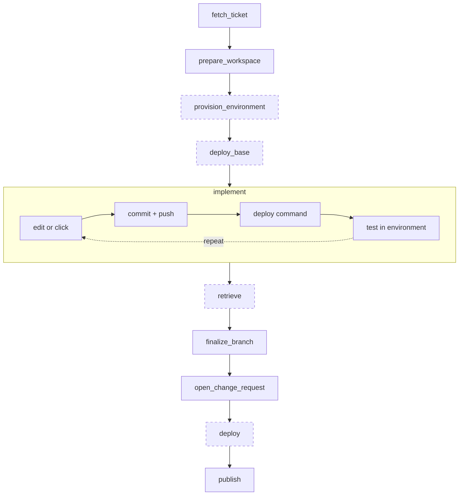
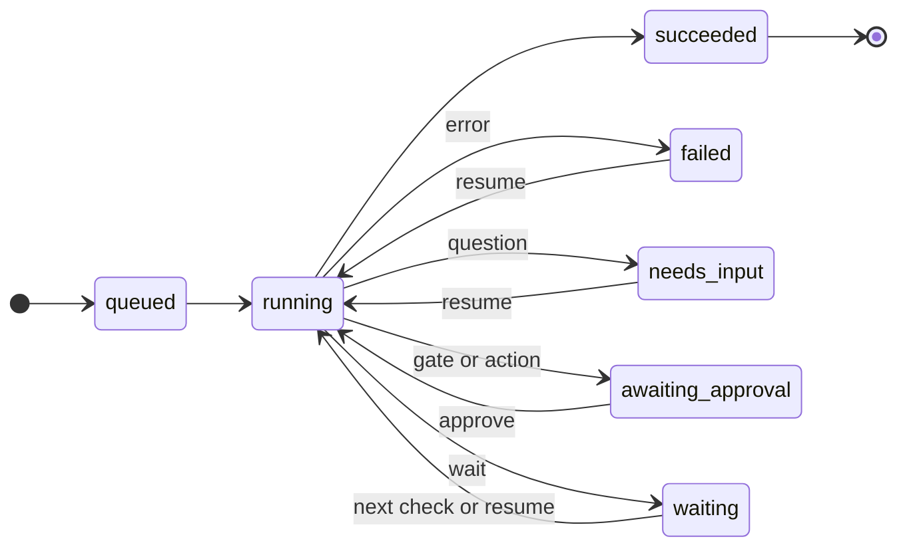

# Hinziel

*Specification — draft v0.3*

> *Heinzelmännchen: in the legend of Cologne, little house spirits who came
> out at night and did the townsfolk's work while they slept. Hinziel is
> derived from Heinzel, and it is also the stem of the German *hinzielen*, to
> aim at: a factory works toward one ticket's goal.*

Hinziel is one of those spirits for a software team: you hand it a ticket
before you leave, and the work is done when you come back. Concretely, it is
a **Go library for building software factories.** A factory takes a ticket
and, without human help:

1. creates a branch
2. provisions an environment
3. implements the ticket with a coding agent, testing it in that environment
4. opens merge/pull requests
5. deploys the result
6. reports back (MRs, ticket, people)

A factory is an ordinary Go program that wires components together:

```go
func main() {
	hinziel.Main(hinziel.Factory{
		Name:    "blanktracker",
		Tracker: trello.New(trello.Options{Board: "FbGOL7Wb", Token: hinziel.Env("TRELLO_TOKEN")}),
		Repos: []hinziel.Repo{{
			Name: "app", TargetBranch: "develop",
			Forge: gitlab.New(gitlab.Options{Project: "blanktracker/app", Token: hinziel.Env("GITLAB_TOKEN")}),
		}},
		Agent:       claudecode.New(claudecode.Options{Model: "claude-opus-5-5"}),
		Environment: digitalocean.New(digitalocean.Options{Region: "fra1", Size: "s-2vcpu-4gb"}),
		Deployers: []hinziel.Deployer{
			{Name: "api", Repo: "app", Deployer: dockercompose.New(dockercompose.Options{Files: []string{"vibe.docker-compose.yaml"}})},
			{Name: "web", Repo: "app", Deployer: mycompany.SPADeployer{}}, // the team's own code
		},
		Notifiers: []hinziel.Notifier{{On: notify.Finished, Notifier: slack.New(hinziel.Env("SLACK_WEBHOOK"))}},
	})
}
```

`hinziel.Main` gives that binary the whole CLI (`run`, `daemon`, `status`, …).
Every component is either a ready-made one from this repository or the team's
own code implementing the same interface. The compiler checks the wiring.

The coding agent (Claude Code, OpenHands, …) is a component like any other.
Hinziel's value is the pipeline, the run state, the interfaces, and a growing
**library of ready-made components**.

**Its killer feature is a new environment whenever you need one.** Most teams
run a handful of environments (production, staging, perhaps a shared dev),
and standing up another one is a project they rarely take on. The hard part
is knowing how the app actually gets deployed, and that knowledge is tacit,
scattered and often partly wrong. Hinziel's **build-a-factory skill** (§6)
goes into a team's repositories and running environments, works out how the
app is really deployed, and reproduces it, so that every ticket gets an
environment of its own. It then writes the rest of the factory and tests it
end to end, so a team never has to learn Hinziel itself. A team that only
wants the environments can stop there: `env up` gives them a fresh one on
demand, with no tickets or agents involved.

---

## 1. Goals and non-goals

**Goals (v1)**

- Fully autonomous by default: one trigger results in open MRs and a running
  environment with the change deployed.
- Pluggable at every edge: trigger, tracker, forge, agent, environment, DNS,
  deploy, notify. Teams can write their own component for any of them without
  forking Hinziel.
- **The factory adapts to the app, not the other way round.** Hinziel builds
  and deploys an app the way the team already does: their compose files,
  their build scripts, their hosting. Installing Hinziel on a project may need
  a few small changes to the app, never a restructuring. Anything specific to
  previews (an override file, a `.env` template) lives in the factory.
- Type-safe configuration: a factory is Go code, so wiring mistakes are
  compile errors, and `Main` reports the rest (missing repos, missing
  environment variables, …) all at once before doing anything.
- One ticket may span several repositories, each on its own forge. A run then
  opens one MR per repository it changed.
- A factory builds into a single static binary for Linux. No required
  external services (run state is stored on the local filesystem).
- Resumable and idempotent. A failed run can be resumed from the step that
  failed, and re-running a step does not duplicate branches, MRs or droplets.
- Optional approval gates for teams that don't want full autonomy.

**Working assumption: the agent has everything it needs.** Every agent works
inside a provisioned environment and has whatever access it needs: tools,
credentials, the running app or org. Hinziel does not sandbox the agent or
restrict its credentials. Limiting the agent's access makes every scenario much
harder, so it's out of scope until we choose to revisit it.

**Non-goals (v1)**

- A zero-code setup. A YAML front end over the ready-made components may come
  later, once the library is rich enough (§11).
- Reacting to review comments on MRs. Iterating on feedback in the ticket is
  planned for M4 ([Iteration](#iteration)); comments on the MR may follow.
- Automatic environment teardown policy (§11). Teardown is supported in the
  interfaces and through a manual CLI command.
- Multi-tenant/public SaaS deployment.
- Production rollout. Hinziel's work ends at reviewed MRs and a working
  preview. Merging, canaries, feature flags and production deploys stay the
  team's own pipeline (Scenario D).

---

## 2. Reference scenarios

| | **A: BlankTracker (guinea pig)** | **B: Go service** | **C: Salesforce client** | **D: Microservices on Kubernetes** |
|---|---|---|---|---|
| Repos | one (monorepo) | one | one | eight, plus a dedicated factory repo |
| Tracker | Trello | Jira | Jira | Jira |
| Forge | GitLab | Forgejo (self-hosted) | GitHub | GitHub |
| Agent | Claude Code | Claude Code | Claude Code + Salesforce skills, DX MCP server, headless browser | Claude Code + `kubectl` |
| Environment | New DigitalOcean droplet per ticket + Cloudflare DNS records in the production zone (`hz-*` names only) | Folder + nginx vhost on a shared server | New scratch org per ticket | A namespace per ticket in a preview cluster, wildcard DNS and certificate |
| Deploy | API: the team's own compose file on the droplet over SSH, plus an override and `.env` from the factory. SPA: the team's own build script, then `wrangler versions upload` to a preview alias of a previews-only Worker | build locally, rsync, restart, reload nginx | `sf project deploy start`, assign permission sets, import seed data | wait for CI to build each changed service's image, set the tags with Helm, wait for the rollout; unchanged services run their target branch's image |
| Human steps | add the environment's OAuth redirect URIs in Google Cloud Console | — | — | — |
| Trigger | CLI + Trello Power-Up button | CLI | CLI (Jira trigger later) | Jira webhook |
| Notify | Trello comment + Slack | Jira comment + chat | Jira comment + chat | Jira comment + chat, CI state in the MR |

Any design decision that makes one column awkward is wrong.

### Scenario A in more detail

BlankTracker is one GitLab repository (`blanktracker/app`) holding a Laravel
API with a Nova admin, and a Vue SPA, both at the repository root. Work merges
into `develop`; `master` is production. Every deployed environment
(production, staging, vibe) is three hostnames: the SPA on Cloudflare Workers
static assets, and `api` and `nova`, which both reach one Docker Compose stack
on a droplet. A preview environment looks like this:

| Part | Where | URL |
|---|---|---|
| API and Nova | new droplet, the repository's own `vibe.docker-compose.yaml` | `https://<env>-api.blanktracker.com`, `https://<env>-nova.blanktracker.com` (proxied A records to the droplet) |
| SPA | preview alias `<env>` of `blanktracker-frontend-preview`, a Worker used only for previews | `https://<env>-blanktracker-frontend-preview.<account>.workers.dev` |

- **All URLs are decided in `provision_environment`, before any deploy**
  (`env.Environment.Endpoints`). A Workers preview alias URL is predictable,
  so the SPA's URL is too. The two deployers don't depend on each other's
  output, and their order doesn't matter.
- **The SPA is built by Hinziel, with the team's own script.** The deployer
  runs `cloudflare-build.sh` with the variables Cloudflare's CI would set
  (`API_URL`, `NOVA_URL`, `WORKERS_CI_COMMIT_SHA`) and uploads with
  `--name blanktracker-frontend-preview`, so `wrangler.jsonc` is used as it is.
  Workers Builds can't do this: it bakes one API URL into every branch.
- **The SPA stays on `workers.dev`.** Preview aliases can't have a custom
  domain, and the SPA doesn't need one: it authenticates with a Sanctum token,
  not a cookie, and the API allows any origin.
- **The API and Nova need hostnames in the production zone.** An HTTPS SPA
  can't call a plain-HTTP API, and Google rejects redirect URIs on bare IPs.
  Names are one level deep (`<env>-api`, not `api.<env>`), which Cloudflare's
  free Universal SSL certificate covers. This is safe because production sets
  no `SESSION_DOMAIN`, so its cookies are host-only and never reach a preview.
  A Cloudflare token can't be limited to some records of a zone, so
  `dns/cloudflare` refuses any name outside `hz-*`: a bug must not be able to
  rewrite `api.blanktracker.com`.
- **TLS to the droplet.** The zone is in Full (strict) mode with proxied
  records, so the droplet needs a certificate Cloudflare trusts. One
  Cloudflare Origin CA certificate for `*.blanktracker.com` is kept on the
  Hinziel host, and `deploy/dockercompose` adds a TLS proxy in front of the
  stack's own nginx. Every droplet gets the same key, and each runs
  unreviewed code, so one leak exposes them all. That's acceptable for the
  first runs only: certificates per environment are planned for M2 (see
  [Per-environment certificates](#per-environment-certificates)).
- **Previews are cheap and quiet.** The compose stack reads `.env`, which the
  deployer writes from a template in the factory: no third-party API keys,
  `ONSOCIAL_DISABLED` and `SCRAPECREATORS_DISABLED` set, mail to the log. An
  override file drops the `cron` service, because the nightly schedule calls
  paid APIs. Postgres runs in the stack, seeded from the dump the repository
  already uses for vibe.
- **Google login needs a human.** Login is Google OAuth, through a dedicated
  "previews" OAuth client. Google has no API for adding redirect URIs, so each
  new environment produces a [human action](#human-actions) asking someone to
  add its two callback URLs. The agent doesn't need Google login: it creates a
  Sanctum token with `artisan tinker` over SSH.
- **The app's code needs no changes.** Installing Hinziel only adds the
  factory's directory to the repository. See §12.3.

### Scenario C in more detail

The client's work is about 70% code (Apex, Lightning Web Components) and 30%
clicks in Salesforce Setup (Flows, objects, fields, layouts, permissions).
Almost every click produces **metadata**. Metadata can be written as XML,
deployed, and pulled back out of a scratch org with `sf project retrieve start`,
because scratch orgs track every change made in them. So Hinziel puts the
clicks through git and PR review too, not only the code.

The agent has three ways to handle a change, in order of preference:

1. **Write the source or metadata directly**, then deploy it to the scratch org
   to compile and test it. Apex only compiles inside an org, which is one
   reason the environment always exists before the agent starts.
2. **Click in the scratch org through a headless browser** (Playwright MCP),
   for things that are impractical to write by hand, like complex Flows or
   Lightning pages. The changes are then pulled back into the working tree
   (`deploy.Retriever`) and committed. This is slower and more fragile than
   option 1, so it's the fallback.
3. **Changes the Metadata API can't deploy** become a manual checklist for a
   human (`agent.Outcome.ManualSteps`), shown in the PR and the notifications.
   Hinziel never clicks in production or in shared sandboxes.

---

### Scenario D in more detail

*A design exercise: no team has run this yet. It exists to keep the core
interfaces honest for the most common shape of a larger system.*

**The system.** "Shopfront" is a typical microservice setup across eight
GitHub repositories in the `acme` organisation:

| Repo | What | CI (GitHub Actions) |
|---|---|---|
| `web` | Next.js storefront | lint, unit tests, build image |
| `gateway` | API gateway (Go) | tests, build image |
| `orders`, `catalog`, `payments`, `notifications` | services in Go, Python, Java and Node | tests, contract tests, build and sign an image tagged with the commit, push it to the registry: 15–40 minutes |
| `proto` | shared gRPC contracts, a library the services depend on by version | generate clients, publish a version on release |
| `platform` | Helm charts, Argo CD applications, Terraform | policy checks |

Production and staging run on Kubernetes. Deploying means committing image
tags to `platform`; Argo CD syncs them, and Argo Rollouts does a canary with
automated analysis in production. Database migrations run as pre-sync hooks,
secrets come from Vault through External Secrets, and risky features hide
behind feature flags. Every repo has required status checks and CODEOWNERS.

**The factory lives in its own repository**, `acme/hinziel-factory` (§5),
owned by the platform team. It lists all eight repos; the agent sees them
all, and only the ones it changes get a branch and an MR.

**What a preview is.** A namespace per ticket, `hz-<key>`, in a dedicated
preview cluster, reachable at `https://<key>.preview.acme.dev`. A wildcard DNS
record and a wildcard certificate (cert-manager) point at the cluster's
ingress, so no per-environment DNS is needed.

- **Provisioner:** creates the namespace with a resource quota, an
  ExternalSecret that copies the preview secrets in, and a database seeded
  from a sanitised snapshot (a Postgres operator). For the agent it writes a
  kubeconfig limited to that namespace.
- **Deployers:** one per service repo. A deploy waits until CI has built the
  image for the commit, then sets that service's tag in the namespace and
  waits until its rollout is healthy. Services the ticket doesn't touch run
  the image of their target branch, which CI has already built. A system
  deployer bound to `platform` renders the Helm umbrella chart with every
  service's tag.
- **No canaries in previews.** A preview has one user and no traffic. The
  production rollout (canaries, analysis, flags, migrations in production)
  stays the team's pipeline, after a human merges. Hinziel's job ends at
  reviewed MRs and a working preview (non-goal in §1).

**How a run goes, and what it asks of the core.**

| Step | What happens | Fits today? |
|---|---|---|
| `prepare_workspace` | eight clones; the run branch in each | **Yes**, since branches became lazy (D1): only the repos the agent changes get a remote branch and CI runs. Still slow: eight full clones per run, where a cached mirror per repo would help |
| `provision_environment` | namespace, secrets, database, kubeconfig | Yes. `Hosts` stays empty, as for a scratch org |
| `deploy_base` | every service at its target branch's image | Yes, if a deployer can see every repo's commit (D3) |
| `implement` | the agent edits `orders` and `proto`, runs unit tests locally, pushes, deploys, tests against the preview with `kubectl` | **Partly.** The agent has no way to reach a cluster (D2). Each deploy waits 15–40 minutes for CI, so the agent should test locally first and deploy sparingly; the default timeouts are too short (D5). It can't see why CI failed (D4) |
| `finalize_branch`, `open_change_request` | two MRs, linked | Yes. CODEOWNERS picks the reviewers. The `proto` MR must merge first (open question 2) |
| `deploy` | final commits, after CI | Yes, with D4 and D5 |
| `publish` | MR links, preview URL, CI state | **Partly.** "Ready for review" while CI is red is misleading (D4) |
| teardown | delete the namespace, the images, the database | Needs `deploy.Destroyer` (planned) and a teardown policy (open question 1), which a cluster's cost makes urgent |

**What it asks of the core**, proposed and not built:

- **D1. Lazy run branches** (done). `prepare_workspace` creates the run branch
  locally in every repo but pushes nothing. The agent pushes the repos it
  changes, and `finalize_branch` pushes whatever it left. A repo nobody
  changed never gets a remote branch, an MR or a CI run, and it deploys from
  its target branch's commit, which is pushed already. An engine change; no
  interface changes. It also helps every multi-repo factory.
- **D2. Agent access beyond SSH.** `env.Environment` gets
  `Access []Access{Name, Description, Env}`: what the agent may use to reach
  the environment, as environment variables and a sentence for its prompt.
  A Kubernetes provisioner sets `KUBECONFIG` to a namespace-limited file; a
  scratch org (Scenario C) sets the `sf` target org. Like SSH key paths, the
  values are references to files or aliases, never secrets themselves, so
  they can be persisted. SSH hosts stay as they are.
- **D3. Deployers that see every repo.** `deploy.Source` gets
  `Commits map[string]string`: the commit being deployed in every repo of
  the factory, not only the deployer's own. A system deployer (an umbrella
  chart in `platform`) needs all the image tags at once. `Deployer.Repo`
  stays the repo whose checkout it gets.
- **D4. CI status.** An optional forge capability, `forge.CheckReader`:
  `Checks(ctx, commit) ([]Check, error)`, with each check's name, state and
  URL. The agent gets a `$HINZIEL_BIN checks` command to see failing
  pipelines and their links, and `publish` reports the checks, waiting for
  them to finish if the factory asks. CI-gated deployers can use the same
  capability to wait for an image's build, or poll the registry themselves.
- **D5. Configurable timeouts.** Per step, in the factory
  (`Timeouts: map[hinziel.Step]time.Duration`), because a factory whose
  deploys wait for CI needs hours, not the default 20 minutes. Deploy logs
  also need a channel (`Deploy` has none today), so a 30-minute wait shows
  progress. Waiting on CI is better modelled as its own step outcome
  than as a long timeout (open question 13), which would leave timeouts for
  steps that are really stuck.
- **D6. Merge order.** MRs already link each other; with a shared library
  the order matters (`proto` before `orders`). The MR description states it,
  and the agent says so in its summary. Enforcing it stays open question 2.

**What doesn't change.** The interfaces for tracker, agent, DNS and
notifiers, and the pipeline's steps. Every component Shopfront needs is a
new component, not a new kind: `forge/github` (M7), `tracker/jira` (M5),
`env/k8snamespace`, `deploy/helm` (waits for CI images, sets tags, waits for
the rollout) and possibly `deploy/argocd` for teams that preview through an
ApplicationSet. A platform that only creates previews from open MRs (an
Argo CD pull-request generator) would also need draft MRs opened early, a
factory option and not an interface change; a branch-name generator on
`hinziel/*` avoids that.

---

## 3. Concepts

- **Factory.** A Go value (`hinziel.Factory`) that wires a tracker, one or more
  repos, an agent, an environment, DNS, deployers, triggers and notifiers
  together. A binary can hold several factories; one is the common case.
- **Component.** A value implementing one of Hinziel's interfaces, e.g.
  `gitlab.New(...)` is a `forge.Forge`. Components come from this repository,
  from third-party modules, or from the team's own code.
- **Repo.** One repository of a factory, on its own forge. All of a run's
  repos are checked out side by side on the same branch name. Repos the run
  doesn't change get no MR.
- **Endpoint.** A named public URL of an environment (`api`, `web`). All
  endpoints are decided when the environment is provisioned, before anything
  is deployed.
- **Run.** One execution of the pipeline for one ticket in one factory. It has
  an ID, a status, per-step results and a log, and is persisted after every step.
- **Step.** One idempotent unit of the pipeline (`implement`, `deploy`, …).
  Step names are typed constants (`hinziel.StepDeploy`).
- **Gate.** An optional pause before a step. The run waits in
  `awaiting_approval` until someone runs `approve`.
- **Action.** Something a human must do for an environment that Hinziel
  can't, such as registering its URLs with a third party. It may hold back a
  later step until someone confirms it's done ([Human actions](#human-actions)).

### Pipeline



Dashed steps are skipped when the factory has no environment (`retrieve` also
when no deployer implements `Retriever`).

| Step | Does | Persisted output |
|---|---|---|
| `fetch_ticket` | `Tracker.Fetch`; download files attached to the ticket (`AttachmentFetcher`) into the run's directory, since the agent has no tracker credentials; optionally move the ticket to "in progress" | `Ticket` (with local attachment paths) |
| `prepare_workspace` | clone every repo side by side and create the run branch in each from its target branch, locally only: it reaches the forge when someone pushes a change to it, so repos the ticket doesn't touch get no remote branch, MR or CI run | `Branch` |
| `provision_environment` | `Provisioner.Ensure`, then compute the factory's endpoint URLs and create their DNS records (`dns.Provider.Ensure`). Collect the environment's [human actions](#human-actions) and emit `run.action_required` for each new one | `Environment` (with `Endpoints` and `Actions`) |
| `deploy_base` | every deployer, in order, deploys its repo's unchanged branch, so the environment starts identical to the target branches | `Deployments` |
| `implement` | `Agent.Implement` in the workspace (all repos), with `Task.Environment` set. The agent loops: edit, commit, push, deploy, test (see [Agent loop](#agent-loop)) | `Outcome`, `Deployments` (latest) |
| `retrieve` | each deployer that implements `Retriever` pulls changes made directly in the environment (e.g. Salesforce clicks) into its repo's checkout. Skipped if none does | — |
| `finalize_branch` | per repo, a safety net: commit anything `retrieve` pulled in or the agent left uncommitted, and push. Repos without changes are dropped and their run branch deleted. No changes in any repo means `needs_input` | `Commits` |
| `open_change_request` | `Forge.OpenChangeRequest` for every changed repo (idempotent per branch). With several, each MR links to the others | `ChangeRequests` |
| `deploy` | every deployer deploys its repo's final commit, so what testers see is exactly what's in the MRs. A deployer is skipped if the agent already deployed that commit | `Deployments` |
| `publish` | add the endpoint URLs to every MR and the ticket, move the ticket to "in review" | — |

The environment comes first because the agent works in it. A consequence: if
provisioning fails, the run fails before any code is written and no MR is
opened.

### Agent loop

The agent tests its work in the environment many times during `implement`,
so these deploys are not pipeline steps. Hinziel gives the agent two commands
of the factory binary. The engine passes the binary's path in `HINZIEL_BIN`,
the run in `HINZIEL_RUN_ID` and the engine's socket in `HINZIEL_SOCKET`:

- **`$HINZIEL_BIN deploy`** runs every deployer on its repo's pushed HEAD and
  blocks until done, printing the results and the deploy logs. It refuses if
  any repo has uncommitted changes or an unpushed HEAD: **Hinziel only ever
  deploys pushed commits.** For each deployer that implements `Retriever`, it
  first retrieves from the environment and refuses if that produced
  uncommitted changes ("the environment has changes not in git; commit and
  push them first"). This stops a deploy from overwriting clicks that haven't
  been saved to git.
- **`$HINZIEL_BIN retrieve`** pulls changes made directly in the environment
  (e.g. Salesforce clicks) into the working tree, for the agent to review,
  commit and push.

Both commands send their request to the running engine over a Unix socket
(in the system temp directory, because socket paths are limited to about 108
bytes). They don't call the components themselves, so the engine
records every deployment in the run state and only one process ever writes
`run.json`.

Notifications are **events**, not a step. The engine emits `run.started`,
`run.succeeded`, `run.failed`, `run.needs_input`, `run.awaiting_approval` and
`run.action_required`. Each notifier is subscribed to a set of these.

### Human actions

Some environments can't be finished by software. BlankTracker's previews need
their OAuth redirect URIs added in Google Cloud Console, which has no API for
it. A Salesforce sandbox lease might need an admin's approval. Hinziel
supports this as **actions**: requests for a human, raised while the
environment is provisioned.

```go
// package env
type Action struct {
	ID     string `json:"id"`     // stable per environment; makes notifying and confirming idempotent
	Title  string `json:"title"`
	Body   string `json:"body"`   // CommonMark: exactly what to do
	Before string `json:"before"` // step that waits until it's done; "" = notify only
}
// Environment.Actions []Action is set by the Provisioner, for needs of the provider.

// package hinziel: needs of the app, added to the provisioner's.
EnvironmentActions func(e *env.Environment) []env.Action // Factory field
```

1. At the end of `provision_environment`, the engine collects the actions
   and emits `run.action_required` once for each one it hasn't announced
   before. The run carries on, so the human works while the agent does.
2. When the run reaches an action's `Before` step and nobody has confirmed the
   action, the run waits in `awaiting_approval`, exactly like a gate.
   `approve <run-id>` confirms every pending action. Later, a button in Trello
   or Slack can do the same through the trigger's `Dispatcher`.
3. Confirmations are kept per environment name. A new run that reuses the
   environment doesn't ask again.
4. The actions, and whether they're done, are listed in the MR description and
   in `publish`'s report. `env destroy` prints them as a reminder to undo
   them (remove the redirect URIs).

Pick `Before` by who needs the result. The agent never needs Google login on
a BlankTracker preview, so that action holds back only `publish`, which tells
testers the environment is ready. An environment the agent can't use without
the human holds back `implement`.

### Run status



`cancel` moves any run that hasn't finished (`queued`, `running`,
`awaiting_approval`, `waiting`, `failed`, `needs_input`) to `cancelled`; it's left out of
the diagram to keep it readable. `resume` and `approve` are the CLI commands of
the same name.

`needs_input` posts the agent's question as a comment on the ticket. Resuming
from `needs_input` fetches the ticket again before re-running the step that
stopped, so the agent sees the answer in the ticket's comments. Resuming from
`failed` just re-runs the failed step.

`waiting` means a step is waiting on someone or something else: a CI
pipeline building an image, a store build, an environment booking, an
approval in another system. The step returns `core.WaitError{Reason, After}`
("not yet, look again in `After`"); it's not a failure. The run records what
it waits for and when to check again, and no process stays attached to it.
Whoever drives the run checks again by running the step again, which is
safe because steps are idempotent:

- the CLI's `run`, `resume` and `approve` keep following in the foreground
  and check again at the time given; Ctrl-C leaves the run `waiting`, not
  `failed`;
- `resume` checks right away, whatever the time given;
- the daemon (M2) will schedule the checks;
- inside `implement`, the agent's `$HINZIEL_BIN deploy` waits inline instead,
  since the agent is blocked on it anyway, within the step's timeout.

A new reason emits `run.waiting`; checking again on the same one doesn't.
How long to keep waiting before giving up is the component's decision: it
returns an ordinary error when it stops expecting the wait to end.

### Iteration

*Planned for M4.* A run ends with MRs and a preview, but that's rarely the
end of a ticket. Someone tries the preview and comments on the ticket:
"make the button green", "this breaks when the list is empty", "why does
it sort by date?". Hinziel picks the comment up and continues the same
work: the same branch, environment and MRs. It changes what was asked,
deploys, and replies on the ticket. People iterate with Hinziel the way
they would with a colleague, in the tracker they already use.

**An iteration is a new run for the same ticket** that continues where the
last one ended. Most of that already holds: `prepare_workspace` starts from
the run branch when it exists, `deploy_base` deploys the checkouts as they
are (so the preview keeps the last iteration's state), and provisioning,
DNS and change requests are idempotent by name. What's new:

1. **Feedback.** At `fetch_ticket`, the comments added since the previous
   run published are the feedback, minus those Hinziel wrote itself.
   Trackers mark those (`tracker.Comment.Mine`, from comparing the author
   with the tracker's own credentials, plus a stable `ID`), so Hinziel can
   never answer itself in a loop. A factory can require a mention (e.g.
   `@hinziel`) for a comment to count, and caps iterations per ticket.
2. **Who may steer it.** A comment becomes part of the agent's prompt, so
   only people who may start runs count: members of the board, for Trello
   (open question 11).
3. **The prompt** carries the previous run's summary and MRs, and lists the
   feedback as the changes to make, asking the agent to change only that.
   `agent.Task` gets `Previous *Outcome` and `Feedback []tracker.Comment`.
   An agent component may resume its previous session for full context:
   `Outcome.Session` (opaque to the engine, e.g. Claude Code's session ID)
   is handed back as `Task.Session`.
4. **Answers without code.** Not every comment asks for a change. The agent
   can reply instead (`Outcome.Reply`). An iteration with a reply and no
   commits succeeds, where a first run with no changes asks for input.
5. **Replies on the ticket.** When an iteration starts, Hinziel comments
   that it's on it. When it ends, it replies with what changed (or the
   answer), the preview link and the commits. The MR description is
   updated with the new summary (`ChangeRequestUpdater`), and the MR gets a
   comment listing what this iteration changed.
6. **Starting one.** From the CLI, `run <ticket>` on a ticket whose last
   run succeeded is an iteration, if there is new feedback. With the daemon,
   a tracker webhook (`trigger/trellowebhook`, Trello's webhooks on the
   board's comments) starts one as soon as someone comments. A comment that
   arrives while a run is in progress is picked up when it ends.

This is also the answer to open question 4: a new run continues the
existing branch. Starting fresh stays possible by closing the MR and
deleting the branch.

---

## 4. Go interfaces

The interfaces are code, not prose. The code is the source of truth and this
section only maps out the packages. Each interface package holds the interface
and the plain data types around it.

### Package map

| Package | Defines | Imports (Hinziel) |
|---|---|---|
| [`core`](./core) | `Message`, `Link`, `NeedsInputError`, `RetryableError`, `WaitError`, `Checker`, `NeedTools` | — |
| [`tracker`](./tracker/tracker.go) | `Tracker` + optional `StageMover`, `Linker`, `AttachmentFetcher`; `Ticket`, `TicketRef`, `Stage` | core |
| [`forge`](./forge/forge.go) | `Forge` + optional `ChangeRequestUpdater`; `GitRemote`, `ChangeRequest`, `ChangeRequestInput` | core |
| [`agent`](./agent/agent.go) | `Agent`; `Task`, `Checkout`, `Outcome`, `Usage` | tracker, env |
| [`env`](./env/env.go) | `Provisioner` + optional `Lister`; `Spec`, `Environment` (with `Endpoints`, `Actions`), `Host`, `SSHAccess`, `Action` | — |
| [`dns`](./dns/dns.go) | `Provider`; `Record` | — |
| [`deploy`](./deploy/deploy.go) | `Deployer` + optional `Retriever`; `Source`, `Deployment` | env, tracker |
| [`run`](./run/run.go) | `ID`, `Request`, `Status`, `Snapshot`, `Run`, `StepRecord`, `Store`, `Filter` | tracker, forge, env, deploy, agent |
| [`notify`](./notify/notify.go) | `Notifier`; `Event`, `EventType`, the `Finished` / `Problems` event sets | core, run |
| [`trigger`](./trigger/trigger.go) | `Trigger`, `Dispatcher` | run, tracker |
| [`hinziel`](./factory.go) (root) | `Factory`, `Repo`, `Endpoint`, `DNSTarget` (+ `HostAddress`, `CNAME`), `Deployer`, `Notifier`, `Trigger`, `Step`, `Main`, `Run`, `Env` | all of the above |

Imports only point down the table. `run` is its own package so that `notify`
and `trigger` can use `run.Snapshot` without importing the root package, which
imports them.

### Where components go

A component lives under the interface it implements: `forge/gitlab`,
`env/digitalocean`, `dns/cloudflare`, `deploy/cfworkers`, `notify/ticket`. A
component that implements several interfaces lives under the one it's mainly
about: `deploy/sshnginx` and `deploy/scratchorg` are also `env.Provisioner`s.
Each component package has a `New(Options)` constructor, and a factory only
compiles in the components it imports.

**Components in this repository are generic.** None of them knows about a
particular team, app or project. Everything specific (names, URLs, compose
files, `.env` templates, instructions) comes in through options from the
factory, which lives with the app. BlankTracker appears in this document and
in tests only as the worked example; nothing here depends on it. If a
component seems to need one app's knowledge, that knowledge belongs in an
option, or in the factory's own code.

**Components document what they need.** Every component's package
documentation has a `Credentials` section: each secret, file or one-time
setup it needs, the least access that works, and exactly where to create
it. The build-a-factory skill (§6) assembles its list for the team from
these sections, so a component isn't finished without one.

Components outside this repository (in a team's factory code or a
third-party module) follow the same interfaces and are used the same way.

### Test packages and internals

| Package | Purpose |
|---|---|
| [`tracker/trackertest`](./tracker/trackertest), [`forge/forgetest`](./forge/forgetest), [`env/envtest`](./env/envtest), [`dns/dnstest`](./dns/dnstest), [`deploy/deploytest`](./deploy/deploytest), [`notify/notifytest`](./notify/notifytest) | public: an in-memory `Fake` and a conformance suite `Run(t, …)` per interface (§9) |
| [`agent/agenttest`](./agent/agenttest) | public: a scriptable fake agent. No conformance suite; agents are tested end to end |
| [`internal/engine`](./internal/engine) | pipeline, steps, run state machine, gates, retries, the agent's Unix socket |
| [`internal/store`](./internal/store) | `run.Store` on the filesystem, plus the per-run lock |
| [`internal/workspace`](./internal/workspace) | git via the git CLI: clone, branch, commit, push, "is it pushed?", deploy worktrees |
| [`core/remote`](./core/remote) | SSH exec, file writes and directory upload through the system `ssh`; `remotetest.LocalSSH` runs them locally in tests. Public, because components outside this repository need it too |
| [`internal/apiclient`](./internal/apiclient) | the JSON-over-HTTP client the components here share; 429 and 5xx become `core.RetryableError` |

There is no `trigger/triggertest` yet; it comes with `daemon` (M2).

### Design rules

These rules keep the interfaces from fighting each other:

1. **Small required interfaces, optional capabilities through type
   assertion** (the `io.WriterTo` pattern). A tracker that can't move tickets
   between columns simply doesn't implement `tracker.StageMover`. The engine
   checks and skips.
2. **The zero value is useful.** Every optional part of a `Factory` can be
   left out, and that part of the pipeline is then silently a no-op: no
   `Notifiers` means nobody is notified, no `Environment` means nothing is
   provisioned or deployed, no `DNS` means no records, no `Triggers` means
   runs only start from the CLI, empty `Gates` means fully autonomous, and an
   empty `On` means every event. Only `Name`, `Tracker`, `Agent` and at least
   one `Repo` with a `Forge` are required, because without them there is
   nothing to run. A setting that only makes sense with a missing component
   (an endpoint `DNSTarget` without a `DNS` provider, `Deployers` without an
   `Environment`) is still an error: it almost always means something was
   forgotten, and ignoring it would hide the mistake.
3. **Every mutating call is idempotent** with a natural key: branch name for
   MRs, environment name for provisioning, commit for deploys, host name for
   DNS records. This is what makes `resume` safe.
4. **Components never see each other.** The engine passes data between them
   as plain structs from the interface packages. The env→deploy hand-off is
   `env.Environment`. A component may *wrap* another one it's given (e.g.
   `notify/ticket` posts through the factory's `Tracker`), but never imports
   another component's package.
5. **Everything persisted is JSON-serialisable.** No funcs or interfaces inside
   the data types in `run`, `env`, `deploy`, `forge` and `tracker`. Functions
   are fine in the factory's own wiring (`Endpoint.URL`).
6. **Constructors don't fail.** `New(Options)` returns the component; bad
   options and credentials surface in `Check` (`core.Checker`) or on first use.
   `Check` also names every command the component runs on the Hinziel host
   that isn't installed (`core.NeedTools`), so one `check` on a fresh host
   lists everything it's missing.
   That keeps a factory a single readable expression.
7. **The engine owns the workflow; the agent owns the work.** The agent has
   full access (see the working assumption in §1). It commits and pushes, but
   **only to its own run branch**, and it deploys only through the `deploy`
   command. The engine creates the branch, makes the final commit and push
   (`finalize_branch`), opens the MRs and owns the final deploy. That keeps
   every run's outcome consistent and resumable. `forge.GitRemote` credentials
   are tagged `json:"-"` and never persisted.
8. **Only pushed commits are deployed.** `deploy.Source.Commit` is required and
   must exist in the forge, so an environment always runs something reviewable.
9. **The public API is versioned.** Factories outside this repository depend on
   these interfaces, so they only change in a new minor version while we're
   at v0.x, and are frozen at v1.
10. **Components take the app as it is.** A component's options point at what
    the team already has (a compose file, a build script, a `wrangler.jsonc`)
    and layer previews on top: files the component writes outside git,
    environment variables, name overrides. A component that only works if the app is
    restructured for it is the wrong component.

### Behaviour the types alone don't show

- **Forge.** Branch creation and pushing go through `internal/workspace` (git
  CLI), not the forge API. `git push` works the same on every host, so only MR
  operations need per-forge code. `OpenChangeRequest` returns the existing
  open CR for the branch if there is one.
- **Agent.** It commits and pushes to the run branch, and deploys with the
  `deploy` command ([Agent loop](#agent-loop)). The engine commits whatever is
  left over. Anything it couldn't do goes in `Outcome.ManualSteps`. Browser
  access, MCP servers and skills are options of the agent component, not
  interface.
- **The repo's own agent instructions.** Most `CLAUDE.md` / `AGENTS.md` files
  are written for a person working with an agent by hand: "push to `vibe` to
  deploy", "ask before every git operation". Hinziel can't expect teams to
  change them. The agent component therefore gives Hinziel's workflow the
  highest priority it can (for Claude Code: the system prompt, not the user
  prompt) and says that it replaces any branching, deploying or
  confirmation rules in the project's instructions. Everything else in them,
  such as coding conventions and how to run the tests, still applies.
- **Several repos.** Each repo has its own forge, so one factory can span
  GitLab and GitHub. The agent sees all checkouts (`Task.Repos`). Each
  deployer is bound to one repo and gets that repo's `Source`.
- **Several deployers, one environment.** Deployers run in order and all
  receive the same `Environment`. Because every endpoint URL is known before
  the first deploy, a deployer can use any other part's URL
  (`e.Endpoints["api"]`).
- **DNS.** For each endpoint with a `DNSTarget`, the engine calls
  `dns.Provider.Ensure` with the endpoint URL's host. Records are identified
  by name, so teardown needs no stored state. Provider options like Cloudflare
  proxying are component options. A provider working in a zone that also
  holds production records takes a guard option (`AllowedNames: "hz-*"`) and
  refuses every other name, because DNS tokens usually can't be scoped to
  single records.
- **Env + deploy in one component.** `deploy/sshnginx` and
  `deploy/scratchorg` implement both `env.Provisioner` and `deploy.Deployer`.
  The factory passes the same value to `Environment` and to a `Deployer`.
- **Environments without servers.** A scratch org has no hosts and no SSH. Its
  org username and instance URL go in `Environment.State` and `Hosts` stays
  empty.
- **Stages are the tracker's to show.** The engine reports three abstract
  stages (in progress, in review, blocked). How a team shows them varies
  with every board: list or column names in any spelling, labels instead of
  columns, or not at all. That mapping is the tracker component's option,
  matched leniently (case and spacing don't matter, IDs survive renames)
  and checked by `check`, which names the board's own lists or statuses
  when one doesn't match. Hinziel never creates lists, labels or statuses.
- **Notify.** `notify/ticket` turns events into comments on the run's ticket,
  through the factory's tracker. This way "tell the tester on the Trello card"
  uses the same routing as "tell the dev channel on Slack".
- **Triggers belong to a factory.** Each trigger gets a `Dispatcher` scoped to
  its factory, and `daemon` mounts its HTTP handlers under
  `/triggers/<factory>/<trigger>/`.
- **Actions.** A provisioner, or the factory, asks a human to do something the
  environment needs ([Human actions](#human-actions)). Unlike
  `Outcome.ManualSteps`, which arrive at the end of a run, actions are raised
  while the environment is set up, and can hold back a later step.
- **Errors.** `core.NeedsInputError` makes the engine post the question on the
  ticket, set the run to `needs_input` and emit `run.needs_input`.
  `core.RetryableError` makes the engine retry the step with backoff.
  `core.WaitError` parks the run in `waiting` until the step is checked
  again ([Run status](#run-status)). Any other error fails the step and the
  run, which can then be resumed.

---

## 5. Writing a factory

A factory is a `main` package with its own `go.mod`. **By default it lives
in a dedicated factory repository** (e.g. `acme/hinziel-factory`), owned by
whoever owns how the system is built and run. That works for one repo or
fifty, keeps Hinziel's code and dependencies out of the apps, and gives the
factory its own review and history. **The exception is a monorepo:** there
the factory lives in a directory of it (e.g. `hinziel/`), next to the app it
builds, as in Scenario A.

Secrets come from the environment through `hinziel.Env`. A missing variable
doesn't fail on the spot: `Main` lists every missing one at once and exits
before doing anything (`check` lists them among its other results). That
only covers what is read while the `Factory` is built, so read every
variable there, not inside a func the factory holds (a deployer's `Env`, an
endpoint's `URL`): those run during a run, and a variable found missing
there fails the step that read it.

### Scenario A: BlankTracker

Every component below exists except `trigger/trellopowerup` (M2).
[`example_test.go`](./example_test.go) compiles this factory, minus the
trigger, against the real packages.

```go
package main

import (
	_ "embed"
	"strings"

	"github.com/Tight-Line/hinziel"
	"github.com/Tight-Line/hinziel/agent/claudecode"
	"github.com/Tight-Line/hinziel/deploy"
	"github.com/Tight-Line/hinziel/deploy/cfworkers"
	"github.com/Tight-Line/hinziel/deploy/dockercompose"
	"github.com/Tight-Line/hinziel/dns/cloudflare"
	"github.com/Tight-Line/hinziel/env"
	"github.com/Tight-Line/hinziel/env/digitalocean"
	"github.com/Tight-Line/hinziel/forge/gitlab"
	"github.com/Tight-Line/hinziel/notify"
	"github.com/Tight-Line/hinziel/notify/slack"
	"github.com/Tight-Line/hinziel/notify/ticket"
	"github.com/Tight-Line/hinziel/tracker"
	"github.com/Tight-Line/hinziel/tracker/trello"
	"github.com/Tight-Line/hinziel/trigger/trellopowerup"
)

const (
	zone          = "blanktracker.com"
	previewWorker = "blanktracker-frontend-preview" // a Worker used only for previews
	workers       = "blanktracker"                  // the account's workers.dev subdomain
)

// Settings for every preview: no third-party API keys, paid integrations
// switched off, mail to the log. The deployer adds the per-environment values.
//
//go:embed preview.env
var previewEnv string

// Applied on top of the repository's vibe.docker-compose.yaml. Drops the cron
// service, because the nightly schedule calls paid APIs.
//
//go:embed preview.override.yaml
var previewOverride string

func main() {
	// Read here, not in the deployer's Env func below, so Main checks them.
	googleID := hinziel.Env("PREVIEW_GOOGLE_CLIENT_ID")
	googleSecret := hinziel.Env("PREVIEW_GOOGLE_CLIENT_SECRET")

	board := trello.New(trello.Options{
		Board:  "FbGOL7Wb",
		APIKey: hinziel.Env("TRELLO_API_KEY"),
		Token:  hinziel.Env("TRELLO_TOKEN"),
		// The board has no list for review or blocked, and gets none: those
		// stages show in comments and notifications only. Another board might
		// map them to lists, labels or both (trello.Stage).
		Stages: map[tracker.Stage]trello.Stage{
			tracker.StageInProgress: {List: "In progress"},
		},
	})

	hinziel.Main(hinziel.Factory{
		Name:    "blanktracker",
		Tracker: board,
		Repos: []hinziel.Repo{{
			Name:         "app",
			TargetBranch: "develop",
			Forge: gitlab.New(gitlab.Options{
				Project: "blanktracker/app",
				Token:   hinziel.Env("GITLAB_TOKEN"),
			}),
		}},
		Agent: claudecode.New(claudecode.Options{Model: "claude-opus-5-5", MaxTurns: 200}),
		Instructions: "Run `./toolkit check` before you finish. Google login doesn't work for you on the " +
			"environment: log in with a Sanctum token created with `artisan tinker` over SSH.",
		EnvName: func(t *tracker.Ticket) string { return "hz-" + strings.ToLower(t.Key) }, // Trello shortLink

		Environment: digitalocean.New(digitalocean.Options{
			Token:      hinziel.Env("DO_TOKEN"),
			Region:     "fra1",
			Size:       "s-2vcpu-4gb", // the first build compiles every PHP extension
			Image:      "docker-24-04",
			SSHKeys:    []string{"ab:cd:…"},          // fingerprints of keys in the DO account
			SSHKeyPath: hinziel.Env("HINZIEL_SSH_KEY"), // the matching private key on the Hinziel host
		}),
		DNS: cloudflare.New(cloudflare.Options{
			Token:        hinziel.Env("CLOUDFLARE_DNS_TOKEN"),
			Zone:         zone,
			Proxied:      true,
			AllowedNames: "hz-*", // the production zone: never touch any other record
		}),
		Endpoints: []hinziel.Endpoint{
			{Name: "api", URL: previewURL("-api"), DNS: hinziel.HostAddress(0)},
			{Name: "nova", URL: previewURL("-nova"), DNS: hinziel.HostAddress(0)},
			{Name: "web", URL: func(e *env.Environment) string {
				return cfworkers.PreviewURL(e.Name, previewWorker, workers)
			}},
		},
		EnvironmentActions: func(e *env.Environment) []env.Action {
			return []env.Action{{
				ID:    "google-oauth",
				Title: "Allow Google login on " + e.Name,
				Body: "In Google Cloud Console, open the **BlankTracker previews** OAuth client and add " +
					"these authorized redirect URIs:\n\n" +
					"- " + e.Endpoints["api"] + "/auth/google/callback\n" +
					"- " + e.Endpoints["api"] + "/api/auth/google/callback\n",
				Before: string(hinziel.StepPublish), // only testers need it, the agent doesn't
			}}
		},
		Deployers: []hinziel.Deployer{
			{Name: "api", Repo: "app", Deployer: dockercompose.New(dockercompose.Options{
				Files:    []string{"vibe.docker-compose.yaml"}, // the team's own, unchanged
				Override: previewOverride,
				EnvFile:  previewEnv,
				Env: func(e *env.Environment) map[string]string {
					return map[string]string{
						"APP_URL":              e.Endpoints["api"],
						"FRONTEND_URL":         e.Endpoints["web"],
						"GOOGLE_REDIRECT_HOST": e.Endpoints["api"],
						"GOOGLE_CLIENT_ID":     googleID,
						"GOOGLE_CLIENT_SECRET": googleSecret,
					}
				},
				TLS: &dockercompose.TLS{ // Cloudflare Origin CA certificate for *.blanktracker.com
					CertFile: hinziel.Env("ORIGIN_CERT_FILE"),
					KeyFile:  hinziel.Env("ORIGIN_KEY_FILE"),
					Upstream: "nginx:80",
					Network:  "blanktracker", // the network vibe.docker-compose.yaml puts nginx on
				},
				PostDeploy: []dockercompose.Exec{
					{Service: "app", Command: "php artisan migrate --force"},
					{Service: "app", Command: "php artisan optimize"},
				},
			})},
			{Name: "web", Repo: "app", Deployer: cfworkers.New(cfworkers.Options{
				AccountID:    hinziel.Env("CLOUDFLARE_ACCOUNT_ID"),
				Token:        hinziel.Env("CLOUDFLARE_WORKERS_TOKEN"),
				Worker:       previewWorker, // overrides the name in wrangler.jsonc; created on first use
				PreviewAlias: func(e *env.Environment) string { return e.Name },
				Build:        "npm ci && ./cloudflare-build.sh", // the team's own build script
				BuildEnv: func(e *env.Environment, src *deploy.Source) map[string]string {
					return map[string]string{ // what Cloudflare's CI would set
						"API_URL":                e.Endpoints["api"] + "/api",
						"NOVA_URL":               e.Endpoints["nova"] + "/nova",
						"WORKERS_CI_COMMIT_SHA":  src.Commit,
						"VITE_EMAIL_TRACKER_URL": "https://email-tracker.invalid", // empty would fall back to production
					}
				},
			})},
		},

		Triggers: []hinziel.Trigger{{Name: "trello", Trigger: trellopowerup.New(trellopowerup.Options{ // M2
			APIKey: hinziel.Env("TRELLO_POWERUP_API_KEY"),
			Boards: []string{"FbGOL7Wb"}, // only cards on these boards can start a run
		})}},
		Notifiers: []hinziel.Notifier{
			{On: notify.Problems, Notifier: ticket.New(board)}, // failures, questions and actions, on the card
			{On: []notify.EventType{notify.EventRunActionRequired}, Notifier: slack.New(hinziel.Env("SLACK_OPS_WEBHOOK"))},
			{On: notify.Finished, Notifier: slack.New(hinziel.Env("SLACK_DEV_WEBHOOK"))},
		},
	})
}

func previewURL(suffix string) func(*env.Environment) string {
	return func(e *env.Environment) string { return "https://" + e.Name + suffix + "." + zone }
}
```

`notify.Problems` includes `run.action_required`, so the card gets the Google
action too. The Slack ops channel is where someone with Google Cloud Console
access sees it.

The two embedded files live next to `main.go` in the factory's repository:

```yaml
# preview.override.yaml
services:
  cron:
    profiles: [disabled] # the nightly schedule calls paid APIs
```

```sh
# preview.env (excerpt)
ONSOCIAL_DISABLED=true
SCRAPECREATORS_DISABLED=true
MAIL_MAILER=log
YOUTUBE_API_KEY=
```

### Scenario B: one component for environment and deploy

```go
host := sshnginx.New(sshnginx.Options{
	Host:      "shared.acme.internal",
	User:      "deploy",
	KeyPath:   "~/.ssh/hinziel_deploy",
	Root:      func(e *env.Environment) string { return "/srv/previews/" + e.Name },
	Domain:    func(e *env.Environment) string { return e.Name + ".preview.acme.internal" },
	PortRange: [2]int{20000, 20999},
	Build:     "CGO_ENABLED=0 go build -o dist/app ./cmd/server",
	Run:       func(e *env.Environment) string { return "./app --addr 127.0.0.1:" + e.State["port"] },
})

hinziel.Main(hinziel.Factory{
	Name:        "go-service",
	Tracker:     jira.New(jira.Options{BaseURL: "https://acme.atlassian.net", Token: hinziel.Env("JIRA_TOKEN")}),
	Repos:       []hinziel.Repo{{Name: "go-service", TargetBranch: "main", Forge: forgejo.New(forgejo.Options{…})}},
	Agent:       claudecode.New(claudecode.Options{Model: "claude-opus-5-5"}),
	Environment: host,
	Deployers:   []hinziel.Deployer{{Name: "app", Repo: "go-service", Deployer: host}},
})
```

### Scenario C: an agent with Salesforce tools

```go
org := scratchorg.New(scratchorg.Options{
	DevHub:       "client-devhub", // sf alias, authorised on the Hinziel host via JWT
	Definition:   "config/project-scratch-def.json",
	DurationDays: 7,
	PostDeploy:   []string{"sf org assign permset --name Client_Admin", "sf data import tree --plan data/plan.json"},
})

hinziel.Main(hinziel.Factory{
	Name:    "salesforce-client",
	Tracker: jira.New(jira.Options{…}),
	Repos:   []hinziel.Repo{{Name: "salesforce", TargetBranch: "main", Forge: github.New(github.Options{Repo: "client/salesforce", …})}},
	Agent: claudecode.New(claudecode.Options{
		Model:      "claude-opus-5-5",
		Skills:     []string{"forcedotcom/sf-skills"},
		MCPServers: []string{"salesforce-dx", "playwright"}, // playwright = headless browser for clicks
	}),
	Instructions: "Prefer writing metadata over clicking. Click in the scratch org only when " +
		"writing the metadata by hand is impractical. Never touch any other org.",
	Environment: org,
	Deployers:   []hinziel.Deployer{{Name: "org", Repo: "salesforce", Deployer: org}}, // also a Retriever
})
```

Repository-side files are optional and read from each checkout:
`.hinziel/prompt.md` (extra agent instructions for that repo). The agent also
picks up the repo's own `AGENTS.md` / `CLAUDE.md` as usual.

---

## 6. Building a factory with an agent

Teams shouldn't have to read this document. Upstream Hinziel ships a
**build-a-factory guide and a Claude skill**: point an agent at a team's
repositories and tools, and it builds, tests and hands over their factory.
The factory lives in a dedicated factory repository, or in the app's repository when it's a monorepo (§5).

Two parts carry most of the friction. **Reproducing the team's environment**
is the hardest part and the most valuable one, and it has its own section
below ([Learning how the app is deployed](#learning-how-the-app-is-deployed)).
**Collecting credentials** is the most tedious part, and a missing one stalls
everything after it. The skill settles both **before it writes any code**,
and works in two phases.

### Phase 1: plan and requirements (no code yet)

1. **Discover the system and the process.** First: one repository or
   several? A monorepo gets the factory in a directory of it; anything else
   gets a dedicated factory repository (§5). With several, ask which repos
   make up the system and start from the one that knows how they run
   together (an infra, deploy or platform repo), if there is one. Then work
   out how the app is deployed and write down the
   [environment model](#learning-how-the-app-is-deployed). Read the rest
   from the repos (`CLAUDE.md`, contributing guides) and ask about what's
   left: where tickets live, which domains, who should hear about what.
2. **Choose components.** Use ready-made ones where they fit; name any that
   must be written.
3. **List everything needed from people**, in one message. For each item:
   what it is, which component needs it and why, the least access that
   works, exactly where and how to create it, and the environment variable or
   file it goes in. The sources are:
   - each component's **Credentials** section in its package documentation
     (every component in this repository has one; see
     [Where components go](#where-components-go));
   - what the **app** needs to run in an environment: its `.env.example`,
     secrets its deploy scripts expect, OAuth clients;
   - **one-time setup** that isn't a secret: a Cloudflare zone for the
     daemon's URL, a webhook or Power-Up to register, a Slack channel, a test
     ticket and a sandbox repository for the integration tests;
   - **human actions** each environment will need (§3), so nobody is
     surprised by them later.
4. **Ask for confirmation**, in this shape:

   > Here's my plan: (components, the environment model and how a preview
   > differs from your staging, what triggers runs, who gets notified). Here's what I need from you and how to get each
   > one: (the list). I'll write `~/.config/hinziel/<factory>.env` with a
   > commented placeholder for every value, so you only fill it in. Shall I
   > proceed to build?

   Secrets go into that file, never into the chat. The skill only reads the
   file into a command's environment.

### Phase 2: build and prove

5. **Write the factory**, and any missing components, against the
   interfaces. Run each one's conformance suite (`trackertest.Run(t,
   myTracker)`, …) until it passes.
6. **Check** with `check` as the values arrive. It reports every bad
   credential and missing tool at once, so the person can fill the file in
   any order, and the skill tells them what's still missing.
7. **Bring up an environment** for the target branches alone with `env up`,
   and iterate until it provisions, deploys and passes the
   [parity check](#learning-how-the-app-is-deployed).
8. **Prove the whole flow.** Ask for a small test feature, run it as a real
   ticket, and verify the result together: branch, MRs, a working environment
   with the change, notifications. Fix and repeat until it works.
9. **Hand over** the factory, with a short README of what was built, the
   environment model, every credential it uses and how to rotate it, and any
   components worth contributing upstream.

### Learning how the app is deployed

Writing the tracker, forge and agent parts of a factory is mostly
mechanical. Reproducing an environment is not: the knowledge of how the app
actually gets deployed is tacit, scattered and often partly wrong. BlankTracker
is the easy case. Its deploy scripts are in the repository and its owner
could explain the rest. Most teams have none of that written down, and this
is where the skill earns its keep.

**Dig through the evidence, layer by layer.** Each layer is less reliable
than the one before it, and the skill reads all of them:

1. **Declared infrastructure**: Terraform, Helm charts, compose files,
   Kubernetes manifests, `wrangler` and similar configs.
2. **Procedures**: CI pipelines and deploy scripts. They show what really
   runs, in what order, with which variables, and what runs after a deploy
   (migrations, cache warm-ups, seeding).
3. **The running environments**, inspected **read-only**: DNS records,
   machines and their sizes, running containers and their environment,
   cron jobs, a namespace dump, the cloud console's resources. This is where
   the steps someone once did by hand turn up.
4. **People.** What the evidence doesn't settle becomes a question for the
   user, with a recommended answer. The skill never fills a gap with a
   silent default.

**What differs between environments is the template.** Comparing staging
with production shows what varies per environment (hostnames, databases,
keys, sizes, feature flags) and what is fixed. The varying parts become the
preview's parameters. A team with a single environment gives no such
comparison, and the skill must say so and ask more questions, not guess.

**Write the environment model before reproducing it.** It is an inventory of
every service, what it depends on, where each piece of its configuration
comes from, its external integrations, where its data comes from, and every
step done by hand. The skill reasons from it, the user confirms it in Phase 1,
and it stays in the factory repository. For many teams it is the first
written description of their own deployment, and worth having even without
the factory.

The model also records what a preview needs that staging doesn't have.
These are the friction points we already know of:

- **hostnames baked into the app**: CORS, cookie domains, OAuth redirect URIs;
- **where preview data comes from**: seeds, fixtures, a sanitised dump;
- **side effects a preview must not cause**: paid APIs, emails to real
  people, cron jobs, webhooks into shared systems;
- **resources shared between environments**: one database, queue or bucket
  that a preview must not write to;
- **setup only a person can do**, which becomes a
  [human action](#human-actions);
- **secrets in the wrong places**: real keys in `.env.example` or in CI
  variables shared with production.

**Check parity, not just liveness.** An environment that answers on its URLs
isn't necessarily faithful to the original. The skill checks a preview
against the environment it copies: the same endpoints respond, a user can
log in, the team's smoke or end-to-end tests pass, and every background job
and integration either works or is switched off on purpose, as the model
says.

**Touch nothing the factory didn't create.** Inspecting live environments
needs broad read access next to production. The skill only reads existing
environments. The components it chooses follow the same rule when they
write, as `dns/cloudflare` does with its `hz-*` names.

What makes this work is that a factory is small, typed Go code with
conformance suites to check it against, and that every component documents
what it needs. Every case study (§12) is the kind of material the skill
learns from.

---

## 7. CLI

`hinziel.Main` provides these commands. The binary is the team's factory, e.g.
`blanktracker-factory`.

```sh
<factory> run [--factory F] <ticket-id> [--gate STEP]...
<factory> status [run-id]              # list runs or show one
<factory> logs [-f] <run-id>
<factory> resume <run-id>              # continue a failed, needs_input or interrupted run
<factory> approve <run-id>             # pass the current gate, confirm pending actions, continue
<factory> cancel <run-id>              # cancel a run that isn't executing
<factory> check                        # test credentials and the tools this host needs (git, ssh, node, claude, …)
<factory> daemon                       # run triggers and execute runs continuously (M2)
<factory> host install <user@host>     # install or update the factory on a server (M2)
<factory> env up [--factory F]         # provision + deploy the target branches, without a ticket (M2)
<factory> env list                     # (M6)
<factory> env destroy <run-id | env-name>   # (M6)

# used by the agent inside a run (engine found via $HINZIEL_SOCKET)
$HINZIEL_BIN deploy                    # deploy every repo's pushed HEAD to the run's environment
$HINZIEL_BIN retrieve                  # pull environment changes into the working tree
```

`--factory` is only needed when the binary holds more than one factory.
`run`, `resume` and `approve` execute the run in the foreground, streaming its
progress, until it finishes or pauses; a `waiting` run is followed to its
next check and beyond. A run executing in one process is
locked; `resume` and `cancel` refuse it until that process stops (Ctrl-C
leaves the run `failed`, ready to resume, or still `waiting` if it was). A run whose process died is not
locked and resumes normally. Running in the background arrives with [`daemon`](#the-daemon).

[`examples/demo`](./examples/demo) is a factory built entirely from fakes, to
try the CLI without any accounts.

---

## 8. Operational behaviour

- **State:** `$HINZIEL_STATE_DIR`, else `$XDG_STATE_HOME/hinziel`, else
  `~/.local/state/hinziel`. Each run has
  `runs/<run-id>/{run.json,log.txt,lock,repos/<name>/,deploy/<deployer>/,attachments/}`.
  `run.json` is written atomically after every step. Every repo is a fresh
  clone per run, which costs time but avoids state bleeding between runs.
  Deployers build in their own worktree (`deploy/<deployer>/`) at the
  commit being deployed, so build output never shows up as uncommitted
  changes in the agent's checkout.
- **Concurrency:** at most one unfinished run per (factory, ticket). A global
  worker limit applies in `daemon`.
- **Re-triggering a ticket that already has a run:** refused while that run is
  unfinished (queued, running, awaiting approval, waiting, needs input or
  failed): resume or cancel it first. After a run succeeded or was cancelled,
  a new run continues the existing branch if it is still on the forge, and
  reuses the environment and MRs (thanks to the idempotent keys). From M4,
  that new run is an [iteration](#iteration) on the ticket's feedback.
- **Agent access:** set through the agent component's options and carries
  whatever the agent needs, including push access to the forges. Hinziel does
  not restrict it (§1).
- **Logging:** one timestamped line per event (`2026-10-09T09:12:31Z
  [deploy_base] done`), written to the run log and to the CLI's output. The
  agent's transcript and the output of its `deploy`/`retrieve` commands go to
  the run log only.
- **Timeouts:** per step. Defaults: implement 60m, provision 15m, deploy and
  deploy_base 20m, prepare_workspace 15m, the rest 2–10m. Not yet
  configurable.
- **Retries:** a step that returns `core.RetryableError` is retried up to 3
  times, with backoff starting at 5s and doubling.

---

### The daemon

*Planned for M2.* `daemon` is the factory running continuously, as opposed
to one CLI command at a time. It:

- **runs the triggers.** Some receive HTTP: webhooks from GitLab, GitHub,
  Jira or Slack, or the Trello Power-Up's button. Each one's handlers are
  mounted under `/triggers/<factory>/<trigger>/`. Others are pollers, such as
  "look for Jira tickets labelled `hinziel` every five minutes", which need
  no inbound traffic at all;
- **executes runs in the background**, with a worker pool and a global limit
  on concurrent runs. Runs started from the CLI still execute in the
  foreground;
- later, **does the factory's other ongoing work**, such as confirming human
  actions from a button and tearing down environments by policy (open
  question 1).

It's one process, so Hinziel needs no queue or other external service
between receiving a request and executing the run.

### Hosting a factory

*Planned for M2.* The daemon needs an always-on host. Installing it is the
same everywhere; only routing traffic to it differs, and only when a trigger
receives HTTP.

**The host needs Docker, nothing else.** The factory ships as a container
image holding the binary and every tool `check` asks for (git, ssh, Node,
Claude Code). Ubuntu 24.04 is the reference, but any Linux with Docker works.
Running the factory in a container also keeps it apart from anything else
on a shared host: no host mounts, no Docker socket, no `--privileged`.

**`host install <user@host>`**, run from a machine that has the factory and
its env file, over SSH (`core/remote`):

1. check for Docker, and install it with Docker's official script if missing;
2. create a non-root `hinziel` user;
3. copy the env file, the SSH key and any certificate files, mode 600;
4. pull the factory image and start `daemon` with a restart policy and a
   volume for run state (`HINZIEL_STATE_DIR`);
5. set up routing (below), if any trigger receives HTTP;
6. run `check` on the host and report.

Running it again updates in place, so it's also the upgrade command. It
works on any machine you point it at; Hinziel doesn't create its own host.
What it can't do: Claude Code's login (run `claude setup-token` once and put
the token in the env file as `CLAUDE_CODE_OAUTH_TOKEN`), and registering the
public URL wherever the trigger's sender needs it (a webhook in GitLab's
project settings, the connector URL in Trello's Power-Up admin, …).

**Routing.** HTTP triggers need a fixed public HTTPS URL: senders are
configured with it once, and most refuse plain HTTP (Trello, Slack and
GitHub all do). The daemon itself only serves plain HTTP on a port. On top
of it:

| | Needs | Fits |
|---|---|---|
| **Cloudflare Tunnel** (default) | the domain's DNS on Cloudflare (the free plan is enough); `cloudflared` runs in the container and connects out, so no open ports, no certificates, no web server on the host | any host: dedicated, a container on a shared box, behind NAT, a laptop |
| Listening on 443 | an A record; an Origin CA certificate behind Cloudflare's proxy, or Let's Encrypt | a dedicated host, where nothing else uses 443 |
| The host's reverse proxy | a server block in the host's nginx, Caddy or Traefik, added once by hand | shared hosts that already have one |

The tunnel is the default because it's the same everywhere and needs nothing
from the host, and its hostname is fixed. Cloudflare's account-less "quick
tunnels" change their address on every restart, so they don't qualify.

The hostname is internal plumbing: only the senders' settings ever see it,
so it doesn't need to be on the team's own domain. Any domain whose DNS is
on Cloudflare works, such as a cheap spare one. A CNAME from a domain hosted
elsewhere does *not* work: a tunnel's `cfargotunnel.com` address only serves
DNS records in the same Cloudflare account. (Cloudflare for SaaS custom
hostnames might get around that, but it's extra setup for no benefit here.)

## 9. Testing strategy

- `internal/engine` is tested end to end with fakes: two repos (one
  unchanged), the agent deploying over the socket, resume after a failure,
  retries, gates, needs-input with a re-fetched ticket, the deploy guards
  (uncommitted, unpushed, unretrieved environment changes) and a factory
  without an environment.
- **Conformance suites are public**, one per interface: `forge/forgetest`,
  `env/envtest`, `deploy/deploytest`, … They check the contract (idempotency,
  `Destroy` on a missing env, a missing DNS record is not an error, …). Every
  component in this repository runs its suite against a real sandbox, guarded
  by an env var such as `HINZIEL_IT_GITLAB=1`. Without it, a component's
  tests run its suite against an `httptest` fake of its API, and remote
  commands run locally through `remotetest.LocalSSH`. The switches:
  `HINZIEL_IT_TRELLO`, `HINZIEL_IT_GITLAB`, `HINZIEL_IT_CLOUDFLARE`,
  `HINZIEL_IT_DIGITALOCEAN`, `HINZIEL_IT_SLACK` and `HINZIEL_IT_CLAUDECODE`;
  each test's skip message names the credentials it needs. Components written by teams or
  agents run the same suites, which is what makes writing your own component
  safe (§6).
- BlankTracker, the guinea-pig project, is the end-to-end acceptance test.

---

## 10. Milestones

| # | Deliverable |
|---|---|
| M0 ✅ | interface packages and the root `hinziel` package; conformance suites and fakes; engine (multi-repo), file store, git workspace; `run` / `status` / `logs` / `resume` / `approve` / `cancel` / `check`; the agent's `deploy` / `retrieve`; `examples/demo` |
| M1 🔨 | Components and human actions ✅, each passing its conformance suite against a fake of its API. Still open: a real end-to-end run, from BlankTracker's repository, once credentials are in place. Scenario A end to end from the CLI: `tracker/trello`, `forge/gitlab`, `agent/claudecode`, `env/digitalocean`, `dns/cloudflare`, `deploy/dockercompose`, `deploy/cfworkers`, `notify/ticket`, `notify/slack`, [human actions](#human-actions). The BlankTracker factory itself lives in BlankTracker's repository (`hinziel/`), not here |
| M2 | [`daemon`](#the-daemon) + `trigger/trellopowerup` (button, badges, confirming actions) as the first HTTP trigger; `env up`; [per-environment certificates](#per-environment-certificates) and the `deploy.Destroyer` teardown hook they need; the factory as a container image and [`host install`](#hosting-a-factory), with a Cloudflare Tunnel as default routing |
| M3 | Build-a-factory guide + Claude skill, and the conformance suites it relies on. Accepted when an agent rebuilds BlankTracker's factory from scratch with it |
| M4 | [Iteration](#iteration): BlankTracker's factory takes feedback from comments on the Trello card and iterates on the same branch, environment and MRs, replying on the card. Feedback and own-comment detection in trackers, `Previous`/`Feedback`/`Session` for agents, `Outcome.Reply`, `trigger/trellowebhook` |
| M5 | Scenario B: `tracker/jira`, `forge/forgejo`, `deploy/sshnginx` |
| M6 | Gates/approve, `env list/destroy`, hardening |
| M7 | Scenario C: `forge/github`, `deploy/scratchorg`, `retrieve` step, browser tooling for `agent/claudecode` |
| M8 | Scenario D: the core changes D2–D5 (D1, lazy branches, is done), `env/k8snamespace`, `deploy/helm` |

---

## 11. Open questions

1. **Environment teardown policy.** Options: on MR merged/closed (needs a forge
   webhook or poller), a TTL, ticket moved to "Done", or manual only. The
   interfaces support all of them (`Provisioner.Destroy`, `env.Lister`,
   `dns.Provider.Delete`). v1 ships only `env destroy`.
2. **Merge order across repos.** When one ticket changes several repos, some
   MRs may need to merge before others (API before SPA). For now Hinziel only
   links the MRs to each other and states the dependency in their
   descriptions. Should it enforce an order?
3. **Scenario B process model.** How does the Go binary keep running on the
   shared host: a systemd unit per preview, a supervisor, or something else?
   Who allocates ports (proposed: the provisioner, stored in `Environment.State`)?
4. **Re-trigger semantics** (resolved by [Iteration](#iteration)). A new run
   for a ticket continues the existing branch, environment and MRs.
5. **Where the agent process runs.** Directly on the Hinziel host (v1,
   simplest), or in a container per run for isolation between concurrent
   runs? This is an option of the agent component and does not change the
   interface.
6. **Giving testers access without leaking logins.** A Salesforce "open org"
   URL (`sf org open --url-only`) contains a live session, so it must not be
   posted to chat. Options: create a tester user with a generated password and
   deliver it privately, or post only the login URL and let testers request
   access. This may add an `Access` field to `deploy.Deployment` that is kept
   apart from the public `URL`.
7. **How far to trust browser clicking.** Should a run that relied on browser
   clicks always open a draft PR, or add an automatic gate? Clicked changes
   are still reviewed as diffs, but they're harder to read than code.
8. **Shared sandboxes for scenario C.** Some work (integrations, realistic
   data) needs a full or partial-copy sandbox instead of a scratch org. That
   would be a pool of existing environments that runs lease, not create, which
   is closer to scenario B.
9. **A YAML front end.** Once there are enough ready-made components, a
    `hinziel` binary could build a factory from YAML for teams that only use
    those. It would be a thin layer over the library, not a second
    configuration model.
10. **Workers preview aliases or Workers Previews.** `deploy/cfworkers`
    uploads a version with `--preview-alias` (now called a Version URL).
    Cloudflare's docs now say aliases are for inspecting one version, not
    for branch or PR testing, and point to a newer product, Workers
    Previews (`wrangler preview`): per-branch previews with their own
    settings, a delete command, and limits of 100 previews per Worker on
    the Free plan and 500 on Paid, evicting the least recently deployed.
    Their custom domains take the form `<preview>.app.example.com`, two
    levels deep, which Universal SSL doesn't cover. As of October 2026,
    BlankTracker's wrangler (4.87) has it only as a private beta; the docs
    name 4.135 as the minimum. For a static SPA with no bindings, aliases
    work, so M1 keeps them. Moving `deploy/cfworkers` to Previews brings a
    real teardown (`wrangler preview delete`, through the planned
    `deploy.Destroyer`) and known limits, but needs the newer wrangler in
    the app's dependencies. We still don't know whether aliases themselves
    have a limit.
11. **Trust and restricted agents.** §1 assumes the agent has everything it
    needs. That holds when the people who write tickets are trusted and the
    team accepts an agent with full access. It fails for open source, where
    anyone can write an issue that becomes the prompt (12.6), and for
    regulated organisations that won't grant an agent full access (12.7).
    Options, cheapest first: start runs only from trusted people (the
    trigger already decides that), but treat ticket text as untrusted
    anyway; pass the agent only the variables it needs (the engine passes
    its whole environment today); run the agent in its own container per
    run, with only the environment's access (D2) and a push token for the
    run's repositories. The last is the real answer, and an option of the
    agent component (question 5), not an interface change.
12. **Forks.** Teams whose bots can't push to the upstream repository work
    from forks (12.6). `forge.GitRemote` would get an upstream to fetch base
    branches from, separate from the remote Hinziel pushes to, and forge
    components a `Fork` option that opens the change request from the fork
    to the upstream.
13. **Waiting on others** (resolved: `core.WaitError` and the `waiting`
    status, see [Run status](#run-status)). CI pipelines, app-store builds,
    environment bookings and change approvals take minutes to days (D4,
    12.5, 12.7). Still open: the daemon's scheduling of the checks (M2).

### Per-environment certificates

*Planned for M2.* Today Scenario A copies one wildcard Origin CA key to every
droplet. Instead, `deploy/dockercompose`'s TLS option will be able to get a
certificate for each environment from Cloudflare's Origin CA API:

- **Issue.** On the first deploy to an environment, generate a key on the
  Hinziel host, send a CSR for exactly that environment's hostnames (taken
  from `e.Endpoints`) and install the issued certificate. A leaked key then
  exposes one preview, for as long as it exists.
- **Reuse.** Keep the key and certificate in the Hinziel state directory, per
  environment, so later deploys reuse them. If they're lost, issue a new
  certificate and revoke the old one, found by its hostnames, so no state is
  needed to clean up.
- **Revoke.** Teardown revokes the certificate. Deployers have no teardown
  hook yet, so this adds an optional `deploy.Destroyer` interface
  (`Destroy(ctx, e)`), called by `env destroy` before the provisioner's
  `Destroy`. `deploy/cfworkers` can use the same hook for its aliases (open
  question 10).
- **Credentials.** A Cloudflare token with SSL and Certificates:Edit on the
  zone, in place of the certificate files. The shared certificate stays
  available as an option for teams without one.

---

## 12. Case studies

Real and hypothetical setups used to test the design against real-world
messiness. A case study passes if it fits the existing interfaces without
changing them.

### 12.1 Guinea pig: a "build this" button on Trello cards

**The setup.** BlankTracker, the guinea-pig project (scenario A: Laravel API +
SPA, GitLab, Trello, DigitalOcean, Cloudflare). People on the Trello board
start Hinziel from the card itself and see its progress there, without
touching the CLI.

**What Hinziel delivers.** A **"🧙 Hinziel: build this"** button on every
card, and badges on the card showing run status, the MR links and the
environment links.

**How it maps.**

| Piece | Implementation |
|---|---|
| Trigger | `trigger/trellopowerup`, listed in the factory's `Triggers`. `daemon` mounts it under `/triggers/blanktracker/trello/` |
| Power-Up assets | a static connector (`index.html` + JS) served from `embed.FS`. In the Trello Power-Up admin, the iframe connector URL is set to `https://<public_url>/triggers/blanktracker/trello/`. Because the connector and the API share an origin, the button's request needs no CORS. BlankTracker's repository already has a generic version (`local-dev/trello-power-up/`); the trigger ships its own copy, so nothing is added to the app |
| Button | the `card-buttons` capability calls `POST …/runs {cardId}`, which calls `Dispatcher.Submit` |
| Badges | the `card-badges` / `card-detail-badges` capabilities poll `GET …/cards/{cardId}`, which calls `Dispatcher.Latest` |
| Which factory | the trigger belongs to one factory, and its `Dispatcher` is scoped to it, so no board-to-factory mapping is needed |
| Auth | the Power-Up's code is public, so it holds no secret. `t.getRestApi().authorize({scope: 'read'})` gets the member's own Trello token, which is sent with the card ID. The server asks Trello for the card (401/404 are passed on, and the card's URL comes from Trello, never from the request), checks that the member belongs to the card's board, and that the board is in the trigger's `Boards` allowlist. The token is used for that check only, never logged or stored; the run records the member ID in `RequestedBy` |

**Design points this case confirms.**

- **Triggers are not limited to the CLI.** A trigger can ship its own UI,
  serve it over HTTP and use only the `Dispatcher` to talk to the engine.
- **`Dispatcher.Latest` exists for this case.** A trigger needs to show the
  state of the most recent run for a ticket, not only start new ones.
- **A trigger belongs to one factory.** The engine doesn't need to know about
  Trello boards.

**Caveat.** Trello requires HTTPS for the connector. For local testing, put
`daemon` behind a tunnel (see [Hosting a factory](#hosting-a-factory)).

### 12.2 A preview that needs a human: Google login

**The setup.** BlankTracker logs users in with Google OAuth only. Google
checks every redirect URI against a list on the OAuth client, accepts no
wildcards, and offers no API to edit that list. Each preview has new
hostnames, so until someone adds them, nobody can log in to it.

**What Hinziel delivers.** As soon as the environment exists, a message on the
Trello card and in a Slack channel says exactly which two URIs to add to the
"BlankTracker previews" OAuth client. The run carries on. It waits only before
`publish`, the step that tells testers the environment is ready, until
someone runs `approve`.

**How it maps.**

| Piece | Implementation |
|---|---|
| The request | `Factory.EnvironmentActions` returns one `env.Action` built from `e.Endpoints["api"]`, with `Before: publish` |
| Telling people | `run.action_required`, routed like any other event: `notify/ticket` for the card, `notify/slack` for whoever has Console access |
| Waiting | the engine's gate machinery: `awaiting_approval` before `publish`, `approve` confirms |
| The agent | not affected: it logs in with a Sanctum token from `artisan tinker` |
| Teardown | `env destroy` prints the action as a reminder to remove the URIs |

**Design points this case confirms.**

- **This case needed an addition.** It's the first that didn't fit the
  existing interfaces: `core.NeedsInputError` stops the run at once and can't
  tell on resume whether the human acted, and `Outcome.ManualSteps` comes from
  the agent, at the end. A request for a human that starts early and blocks
  late is a concept of its own ([Human actions](#human-actions)).
- **The app or the provider can ask.** Google login is BlankTracker's need,
  not DigitalOcean's, so this action comes from the factory. A provider with
  its own manual step (a sandbox lease an admin approves) sets
  `Environment.Actions` instead.
- **Waiting is per step.** Blocking at provisioning would leave the agent
  idle for something it doesn't need.

### 12.3 Installing Hinziel on an app that wasn't built for it

**The setup.** BlankTracker as it really is, not as Scenario A first imagined
it: API and SPA in one repository root, the SPA on Cloudflare Workers (not
Pages), three hostnames per environment, no preview domain, a `CLAUDE.md`
written for non-developers who drive Claude by hand, and a nightly schedule
that spends money on third-party APIs.

**What Hinziel delivers.** Previews with no changes to the app's code. The
only addition to the repository is the factory, in `hinziel/`.

**How it maps.**

| What the app has | How the factory uses it |
|---|---|
| `vibe.docker-compose.yaml`, a self-contained stack with its own Postgres | used unchanged; an override from the factory drops `cron` |
| `.env` read through `env_file` | written by `deploy/dockercompose` from a template in the factory, with no third-party keys |
| `cloudflare-build.sh`, which reads `API_URL` and `NOVA_URL` | run by `deploy/cfworkers` with the variables Cloudflare's CI would set |
| `wrangler.jsonc` naming production Workers | used as it is; `--name` points the upload at a previews-only Worker |
| Production zone `blanktracker.com`, no `SESSION_DOMAIN` | preview hostnames `hz-*` in that zone, guarded by `AllowedNames` |
| `CLAUDE.md`: "push to `vibe`", "ask before every git operation" | overridden by Hinziel's workflow in the agent's system prompt |

**Design points this case confirms.**

- **The factory adapts to the app** (§1, design rule 10). Every gap was
  closed with a component option or a file in the factory, not a change to
  the app.
- **An app's own agent instructions will contradict Hinziel.** They were
  written for a person at a keyboard. Handling that belongs in the agent
  component, for every team, not in each repository.
- **Preview hosting may sit next to production.** Guards against touching
  production records belong in the components that hold the tokens.

### 12.4 The Salesforce team that only clicks

**The team.** A Salesforce team with no source-driven development at all.
They implement a ticket by clicking in a shared dev org, then repeat the same
clicks by hand, from memory, in production. Git is not part of their process.

**What Hinziel delivers.** For each ticket: the change made in an isolated
org, an exact record of what changed, and a step-by-step `instructions.md` a
human follows to repeat the change in production. Hinziel never clicks in
production.

**How it maps.**

| Piece | Implementation |
|---|---|
| Tracker, forge | whatever they use (a repo is created for Hinziel's output if they have none) |
| Environment | a fresh scratch org, or a dedicated dev sandbox, **per ticket**. Not the team's shared dev org |
| Agent | Claude Code clicking in that org through a headless browser |
| `Retriever` | a component in the team's own factory code that (1) runs `sf project retrieve start` to get the exact metadata the clicks produced, then (2) has an LLM turn that diff into click-by-click instructions, written to `instructions.md` |
| `Deployer` | a no-op. Nothing is deployed from git; the clicks already live in the org. The `deploy` command's guard still works: after a click, retrieve produces uncommitted files, so the agent commits and pushes them before deploying |
| Change request | contains `instructions.md` plus the retrieved metadata; a human reviews it and carries out the steps in production |

**Design points this case confirms.**

- **Team-specific components are ordinary code.** The instructions-writing
  `Retriever` is exactly the kind of component a team (or the build-a-factory
  agent) writes in its own factory, without changing Hinziel.
- **`Retriever` is not limited to source code.** Its contract is "bring
  changes made in the environment into the working tree as files, so they're
  committed and reviewed". Instructions for a human meet that contract.
- **Components may use an LLM internally.** The interfaces don't care how a
  component produces its result.
- **The instructions must come from the org's actual changes, not the agent's
  memory.** An agent describing what it remembers clicking will leave steps
  out. A metadata diff is ground truth, and reviewers can check the
  instructions against it.
- **Isolation per ticket is required.** In a shared dev org, retrieve also
  picks up colleagues' unfinished clicks, and the instructions would contain
  changes nobody asked for.
- **`agent.Outcome.ManualSteps` stays separate.** It is the agent's short
  "also do this by hand" list. Here `instructions.md` is the deliverable
  itself, generated from the org.

**Side benefit: a migration path.** The retrieved metadata is committed
alongside the instructions, even though nobody deploys it at first. The team
gets an exact history of every change and can later switch to deploying the
metadata instead of re-clicking, moving towards source-driven development
one ticket at a time.

**Caveat.** The instructions will be good, not perfect. Salesforce's Setup UI
changes between releases and some settings are deeply nested, so whoever
follows them in production still needs basic Salesforce knowledge.

### 12.5 A mobile product: iOS, Android and a backend

**The setup.** Three repositories, three teams: `ios` (Swift), `android`
(Kotlin) and `backend` (a Rails API on Heroku-like hosting). Mobile builds
need signing keys and, for iOS, a macOS machine; CI builds them (GitHub
Actions with macOS runners) and ships internal builds through TestFlight and
Firebase App Distribution. A product manager writes tickets in Linear;
most features touch the backend and one or both apps.

**How it maps.**

| Piece | Implementation |
|---|---|
| Factory | a dedicated repository listing all three repos (§5) |
| Environment | a preview of the backend per ticket, like Scenario A or B |
| Deployers | `backend`: as usual. `ios`, `android`: wait for CI to build the commit with the preview API URL baked in, then hand over the build's install link (TestFlight, Firebase) as `Deployment.URL` |
| Agent | edits all three, runs unit tests where its host can (Kotlin, Ruby; Swift needs macOS), deploys, tests the API against the preview |
| Publish | MR links, the backend URL and an install link per app |

**What fits.** Repos on separate teams are just repos; a ticket that only
changes `android` gets one MR. A mobile build is a deployment whose "URL" is
an install link, and its endpoint a store link. Build signing stays in CI,
where the keys already live, so Hinziel never holds them.

**What doesn't, yet.** The mobile deployers are CI-gated, so they need CI
status (Scenario D, D4), and wait with `core.WaitError` while CI builds. The agent can't run an iOS
simulator on a Linux host, nor tap through either app, so UI verification
becomes manual test steps in the outcome, or a device cloud the agent drives
through an MCP server, an agent option. No interface changes.

**Verdict: fits**, given D4.

### 12.6 An open-source SDK family

**The setup.** One OpenAPI specification in `api-spec` generates client
libraries in six repositories (`sdk-go`, `sdk-python`, `sdk-js`, …).
Maintainers are a small team; most issues and pull requests come from
outside contributors. Tracker and forge are both GitHub (issues and PRs).
Branches can't be pushed to the upstream repositories by bots: everyone,
including the maintainers' automation, works from forks. There is nothing to
deploy: CI tests every PR on a matrix of language versions and publishes
pre-release packages for merged changes.

**How it maps.**

| Piece | Implementation |
|---|---|
| Factory | a dedicated repository listing `api-spec` and the six SDKs |
| Tracker, forge | `tracker/github` (issues) and `forge/github`, two components on one token |
| Environment | none: provision, deploy and retrieve are skipped (design rule 2) |
| Trigger | a webhook trigger that only accepts a `hinziel` label added by a maintainer |
| Agent | changes the spec, regenerates the SDKs it affects, runs their tests locally; CI's matrix is the real check (D4) |

**What fits.** No environment is a supported shape: the zero value skips
those steps. A spec change that fans out to seven repos is the multi-repo
case, and needs lazy branches (D1) so the SDKs it doesn't touch see nothing.

**What doesn't.**

- **Forks.** The engine clones `Forge.Remote` and branches from its target
  branch, and the forge opens the change request in the same repository.
  With forks, Hinziel pushes to `hinziel-bot/sdk-go` but must branch from,
  and open the PR against, `acme/sdk-go`. `forge.GitRemote` needs an
  upstream to fetch the base from, besides the remote it pushes to, and the
  forge component a `Fork` option. A small interface change (open question
  12).
- **Untrusted ticket authors.** Anyone can open an issue, and the issue is
  the agent's prompt. Restricting who can *start* a run (the maintainer's
  label) doesn't stop the issue *text* from steering an agent that holds a
  push token and runs with full access. Hinziel's working assumption (§1)
  holds only when the people who write tickets are trusted. This is the real
  impedance mismatch (open question 11).

**Verdict: fits structurally; mismatched on trust.** Usable today only with
tickets written or rewritten by maintainers.

### 12.7 A regulated enterprise with a separate operations team

**The setup.** A bank's internal lending platform: a Java monolith and two
services, in Bitbucket, tracked in Jira. Developers may not deploy anything.
Environments (`dev1`–`dev6`, `uat`) are long-lived, shared and booked through
the ops team; a booking can take a day. Deploying to any of them means
raising a change in ServiceNow that ops executes through their own pipeline.
Every change needs two approvals, an audit trail, and nothing may touch
customer data outside production.

**How it maps.**

| Piece | Implementation |
|---|---|
| Factory | a dedicated repository, run by the platform team on an approved host |
| Environment | a provisioner that leases one of `dev1`–`dev6` from a pool (open question 8): `Ensure` books it, `Destroy` releases it, and a provider action asks ops to confirm the booking, with `Before: implement` |
| Deployers | raise a ServiceNow change for the commit, then wait until ops has executed it, and report the change number in `Deployment.Info` |
| Gates | `Gates: [deploy]` for the second approval before the final deploy |
| Audit | the run's log and `run.json` record every step, deployment and approval |

**What fits.** Every part is a component or an option. Human actions and
gates express "ops must confirm" and "a second person approves". Deployers
may use any system (ServiceNow) as long as they are idempotent: "is there
already a change for this commit?" is the natural key. Hinziel never deploys
anything itself here, and the interfaces don't require it to.

**What doesn't.**

- **Waiting days, not minutes.** A booking or an executed change can take a
  day. Today a step either finishes, fails, retries three times with
  backoff, or times out. A step that is simply *waiting on someone else*
  needs its own outcome: the step returns "not yet, look again in an hour",
  the run waits in a `waiting` status without holding a process, and the
  daemon re-runs the step later. The same fixes CI waits (D4, D5) and the
  mobile builds of 12.5 (open question 13).
- **Restricted agents.** The bank won't give an agent full access: no
  production-like data, no credentials beyond the booked environment, every
  command logged. Same root as 12.6 (open question 11).

**Verdict: fits structurally; mismatched on agent access.** Long waits were the other mismatch, now resolved by `core.WaitError`: a booking or a ServiceNow change is a deployer or provisioner returning "not yet" until ops has acted.

### What the case studies show together

The pipeline (ticket, branch, environment, implement, MRs, deploy, publish)
and the component boundaries held for every structure so far: monorepo,
multi-repo, microservices, mobile, libraries with no environment, and
organisations where Hinziel may not deploy. New shapes needed new
*components*, not new *kinds* of component. Three things recur and belong in
the core:

1. **Waiting on others** (CI, app stores, bookings, approvals) as a step
   outcome, not a timeout. Done: `core.WaitError` and the `waiting` status
   (open question 13).
2. **Trust**: who may write the agent's instructions, and how much the agent
   may reach. The working assumption "the agent has everything it needs" is
   the one design decision several real teams can't accept (open question
   11).
3. **Repository topology**: lazy branches (D1), seeing every repo's commit
   (D3), and forks (open question 12).
